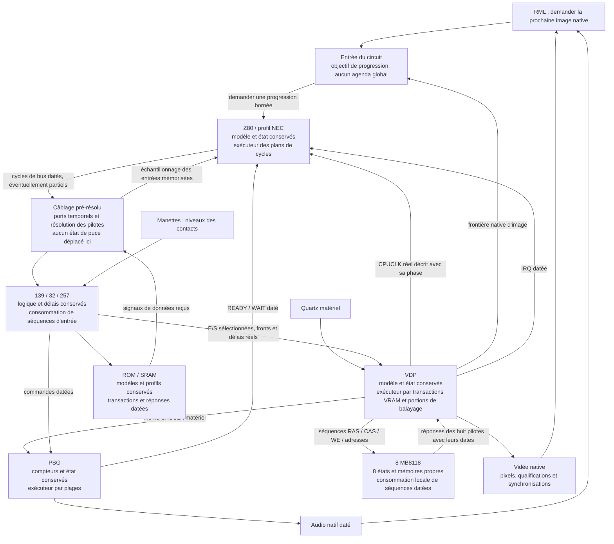

# Architectures d'exécution comparées pour SegaEmu

Recherches du 12 novembre 2026, demandées pour accélérer fortement la SG-1000 et conserver les pistes utiles à la Master System et à la Mega Drive. Acorn reste suspendu. Cette comparaison porte sur les fichiers et chemins cités, pas sur une certification intégrale des autres émulateurs. Aucun de ces programmes n'a été exécuté pour en annoncer une vitesse. Une réputation, un titre « accurate » ou un résultat de jeu ne prouvent pas l'ensemble des signaux et timings d'une puce.

Les sources téléchargées restent sous `artifacts/.tmp-archives/machines/Sega/SG-1000/Comparison/`, hors Git. Les noms des sous-dossiers ci-dessous identifient les copies consultées. `origins.txt` et `sha256.txt` donnent leur provenance et l'identité du contenu ; les branches distantes peuvent évoluer. Cega est archivé au commit `16eabeb6f53760902bd2577d991e88d7ef8aede3`. Aucun code tiers n'est copié dans la production RML et aucune règle de travail provenant de ces dépôts n'est appliquée.

## Comparaison des chemins consultés

| Projet et sources | Organisation observée | Piste réutilisable et limites pour RML |
|---|---|---|
| [Gearsystem](https://github.com/drhelius/Gearsystem/blob/master/src/GearsystemCore.h), `GearsystemCore.cpp`, sous-dossiers Gearsystem/GearHeader | RunCycle reçoit les cycles exécutés du CPU, puis Tick de la vidéo, de l'audio et des entrées ; les options de débogage changent la granularité CPU. | Transmettre une quantité de temps établie, garder des boucles locales aux récepteurs. Ce chemin n'établit pas la conservation des propagations électriques des composants discrets RML ; ne pas le transplanter tel quel. |
| [SMS Plus GX](https://github.com/libretro/smsplus-gx/blob/master/source/system.c), SMSPlusGX | Boucle par ligne : rendu, interruptions, exécution du budget Z80, audio. Reste du budget CPU conservé. | Comptabilité des fractions et excédents, travail groupé. Le rendu d'une ligne avant les instructions ne remplace pas notre chronologie intra-ligne. |
| [Genesis Plus GX](https://github.com/ekeeke/Genesis-Plus-GX/blob/master/core/system.c), GenesisPlusGX | system_frame_sms avance le Z80 vers des dates de ligne ou d'interruption ; phases distinctes de blanking, rendu et IRQ. | Avances bornées par les prochaines interactions, à conserver aussi pour MD. Les budgets et exceptions propres à ces moteurs ne sont pas une preuve de nos timings ou du montage SG. |
| [MEKA](https://github.com/ocornut/meka/blob/master/meka/srcs/sg1ksc3k.cpp), MEKA | Loop_SG1000_SC3000 avance la ligne, les collisions, puis déclenche le rendu et VBlank à la ligne192. | Réduire les reprises de pilotage ; ce rendu à la frontière d'image ne couvre pas seul les écritures vidéo intermédiaires de notre périmètre. |
| [Mednafen](https://github.com/libretro-mirrors/mednafen-git/blob/master/src/sms/vdp.cpp), Mednafen/MednafenVDP | system_frame délègue à SMS_VDPRunFrame ; VRAM adressée en octets dans le VDP, CPU exécuté par opcodes. | Synchronisation locale avant une interaction ; ne pas assimiler le stockage fonctionnel VRAM au modèle des huit DRAM physiques. La [documentation officielle](https://mednafen.github.io/documentation/sms.html) identifie la filiation SMS Plus. |
| [BizHawk SMS](https://github.com/TASEmulators/BizHawk/blob/master/src/BizHawk.Emulation.Cores/Consoles/Sega/SMS/SMS.IEmulator.cs), BizHawk | Boucle par ligne, rendu/IRQ puis ExecuteOne CPU et PSG ; sortie audio par différences de niveau. | Audio notifié sur les changements et niveaux conservés. Le rendu par ligne n'est pas directement notre résolveur de bus vidéo. |
| [Mesen2](https://github.com/SourMesen/Mesen2/blob/master/Core/SMS/SmsMemoryManager.h), Mesen2Clock/Mesen2CPU/Mesen2VDP | Exec(clocks) ajoute le temps puis appelle VDP.Run jusqu'à cette borne ; mappings mémoire par pages. | Gérer la progression dans le composant, garder des entrées spécialisées sans reconstruire la description périodique à chaque petit fragment. Les tableaux de mapping n'établissent pas nos délais de sélection/OE. |
| [jgenesis](https://github.com/jsgroth/jgenesis/blob/master/backend/smsgg-core/src/api.rs), jgenesis/jgenesisVDP | Exécution d'une instruction Z80 puis rattrapage PSG/VDP. process_events précise que des événements sont avancés pour compenser l'entrelacement par instruction. | Compteurs et échéances locaux intéressants ; décalages compensatoires explicitement écartés pour RML. Ne pas changer les dates matérielles pour compenser le pilote logiciel. |
| [ares](https://github.com/ares-emulator/ares/blob/master/ares/ms/cpu/cpu.cpp), aresCPU/aresVDP | CPU instruction/step ; VDP avec comptes H/V, synchronisation coopérative et portions de traitement. | Découpage en domaines et bornes ; l'infrastructure Thread/synchronize de ce projet n'est pas à ajouter à RML. Les mêmes études serviront à SMS/MD. |
| [higan SG](https://github.com/higan-emu/higan/blob/master/higan/sg/cpu/cpu.cpp), higanSG/higanVDP | Instruction CPU, step local et synchronisation coopérative ; stockage VRAM fonctionnel dans le VDP. | Ancêtre architectural à comparer avec ares, pas un second algorithme à copier. Conserver les circuits séparés et leur source réelle chez RML. |
| [BlastEm](https://github.com/libretro/blastem/blob/libretro/sms.c), BlastEm | Cibles CPU/IRQ et rattrapage VDP/PSG ; synchronisation du VDP avant les accès de ports. | Piste importante : domaines indépendants jusqu'à une interaction datée, événements qui raccourcissent la cible. Le miroir libretro consulté est identifié, pas présenté comme une mesure matérielle. Réutilisable à l'étude de MD. |
| [Cega](https://gitlab.com/jgemu/cega/-/blob/16eabeb6f53760902bd2577d991e88d7ef8aede3/src/cega_sg.c), Cega | CPU/PSG chaque troisième cycle maître, VDP chaque deuxième ; slots d'accès dans tms9918.c, données en tableau VRAM. | Comparaison fine des séquences et rapports de clocks, pas une solution de débit par elle-même. Son auteur indique que la vitesse n'était pas prioritaire. Conserver nos accès et délais des mémoires physiques. |
| [MAME TMS99xx](https://github.com/mamedev/mame/blob/master/src/devices/video/tms9928a.cpp), MAME | Mémoire VRAM du device, événements et traitement de lignes. Le TODO du fichier mentionne vidéo/sync externe, mises à jour intra-ligne, clonage de sprites et permutation4K. | Ces manques sont ceux de leur implémentation, pas un constat sur la nôtre. Piste d'organisation uniquement, aucune déclaration de conformité totale fondée sur MAME. |
| [blueMSX](https://github.com/libretro/blueMSX-libretro/blob/master/Src/VideoChips/VDP.c), blueMSX | vdp_sync et temporisations séparées pour affichage, modes, HINT et VINT. | Représentation différée d'une portion stable et mise à jour avant observation. Les mécanismes de board timers du projet ne deviennent pas un ordonnanceur partagé RML. |
| [openMSX](https://github.com/openMSX/openMSX/blob/master/src/video/VDP.cc), openMSX | Points de synchronisation distincts, accès CPU à dates explicites, tables de créneaux et états différés. Le fichier sépare mesures et estimations. | Étude utile du même groupe de puces, même si ce n'est pas une SG. Ne pas reporter des timings V9938/V9958 au TMS9918 : le source lui-même signale des hypothèses pour TMS non mesurés. |
| [MiSTer SMS](https://github.com/MiSTer-devel/SMS_MiSTer/blob/master/rtl/vdp.vhd), MiSTerVDP | Enables CPU/VDP/pixels séparés, interfaces de bus, mémoire à ports FPGA ; options d'augmentation de sprites et turbo dans le projet. | Intéressant pour identifier capture, résolution et domaines. La RAM FPGA n'est pas une preuve des délais MB8118 ; les extensions turbo/sprites ne sont pas le matériel normal à reproduire. |
| [openFPGA SMS](https://github.com/drizzt/openfpga-SMS), openFPGA | Port du cœur MiSTer, source upstream embarquée et adaptation des clocks/ports Pocket. | Filiation conservée pour ne pas compter deux preuves indépendantes ; aucune conclusion supplémentaire sur le silicium SG. |
| [Cogwheel](https://github.com/benryves/Cogwheel/blob/master/Sega/Emulator.cs), CogwheelCore/CogwheelMemory | C# ; RunScanline/RunFrame demandent un budget CPU puis avancent la vidéo. Slots de cartouche/carte/extension/BIOS/RAM séparés. | Comparaison intéressante en C# pour les responsabilités et les mappings ; budgets par ligne et accès fonctionnels ne remplacent pas notre chronologie de broches. |
| [JavaGear](https://github.com/fedex81/javagear-mirror/blob/master/src/common/Engine.java), JavaGear/JavaGearVDP | Ancienne source0.97 via miroir identifié : budget par ligne, séparation finale de8cycles en mode précis, dessin/interruptions par ligne, caches de tiles/sprites. | Conserver les calculs immuables et invalider leurs caches aux vraies écritures ; ne pas adopter une frontière de précision arbitraire de8cycles. |
| [Osmose](https://github.com/lutris/osmose/blob/master/emulator/OsmoseCore.cpp), Osmose | run_frame par ligne ; cpu.run avec excédent conservé, PSG et mise à jour VDP. | Comptabilité locale et regroupement, sans qualification de notre bus physique ; moteur SMS/GG comparé pour idées, pas déclaré SG complet. |
| [Snepulator](https://github.com/JoppyFurr/Snepulator/blob/main/source/sg-1000.c), Snepulator | z80_run_cycles par portions de228cycles, avance vidéo/audio et mappings ROM/RAM par fonctions. | Portions temporelles et responsabilité des périphériques. Les options d'overclock du code ne doivent pas devenir un gain de performance de RML. |
| [ZEsarUX SG](https://github.com/chernandezba/zesarux/blob/main/src/cores/core_sg1000.c), ZEsarUX | Compte des tstates, fins de ligne et d'image, sorties vidéo/audio et régulation de vitesse hôte séparée. | Séparer vitesse maximale d'émulation et limitation de présentation ; ne pas utiliser l'horloge hôte comme cadence de puce. |
| [sega-emulator Rust](https://github.com/leonardo201800478/sega-emulator/blob/main/native/sms_core/src/temporal_machine.rs), RustNative | Runtime réexportant un cœur avec timeline et scheduler central pour CPU/mémoire/PSG/VDP. | Parcours inspecté, mais son architecture centrale ne respecte pas la contrainte RML d'absence d'ordonnanceur commun. Aucun statut de conformité repris de son README. |
| [PicoDrive SMS](https://github.com/notaz/picodrive/blob/master/pico/sms.c), PicoDriveSMS | Budgets Z80, synchronisation d'accès et conversions de compteurs ; options et réserves locales explicites. | Conserver comptes et fractions par domaine ; ne pas adopter les approximations de conversion ou correctifs de compatibilité sans les qualifier sur notre matériel. |
| [PicoDrive MD](https://github.com/notaz/picodrive/blob/master/pico/pico_cmn.c), PicoDriveMD | Cibles68K, compte de cycles Z80/bus et progression du cadre ; phases de rendu/IRQ. | Pistes gardées pour la future MD : interrompre une portion sur un véritable effet du bus, préserver arbitrage et attentes ; pas d'implémentation MD démarrée. |
| [Gens/GS](https://github.com/lutris/gens/blob/master/src/gens/emulator/g_md.cpp), Gens | Ancien moteur MD : budgets68K/Z80 par ligne, paliers avant IRQ/blanking, VDP_Render_Line et comptes DMA. | Conserver les bornes et excédents locaux, sans reprendre les paliers/compensations comme vérité matérielle. Le rendu par ligne ne remplace pas les accès intra-ligne. |
| [Exodus](https://github.com/RogerSanders/Exodus/blob/master/Devices/315-5313/S315-5313_Ports.cpp), ExodusTiming/ExodusExecution/ExodusVDPPorts | Tables H/V détaillées, accès datés, prédiction des lignes et rollback en cas d'accès antérieur ; thread de rendu séparé. | Dates de capture/réponse et bornes d'interaction utiles à l'étude MD ; ne pas introduire le thread ni le rollback spéculatif de cette plateforme dans notre câblage. |

## Projets identifiés dont la comparaison n'est pas encore complète

- Gens/Gens-GS et Exodus sont maintenant comparés sur les chemins cités dans le tableau. Le mauvais ancien chemin gerbilsoft/gens-gs avait renvoyé404 ; ce n'était pas une preuve d'absence de sources. L'approfondissement des particularités MD reste distinct de cette comparaison architecturale.
- DGen : chemin SourceForge identifié mais inaccessible par le lecteur Web utilisé ; pas de conclusion sur son exécution interne sans code consulté.
- [MasterGear](https://fms.komkon.org/MG/) : l'auteur précise que le source n'est pas public. [Emulicious](https://emulicious.net/) et [Kega Fusion](https://www.carpeludum.com/kega-fusion/) : pages officielles consultées, code interne non acquis. Leur fonctionnement interne ne peut pas être qualifié à partir des seuls binaires/pages.
- Les distributions Nostyra/OpenEmu et autres interfaces retrouvées ne sont pas comptées comme des preuves d'un nouveau moteur indépendant lorsqu'elles annoncent un cœur tiers. Aucune exhaustivité de tous les dépôts Internet n'est prétendue ; les projets trouvés restent identifiés avec la limite de l'examen effectué.

## Application au câblage SG-1000

La piste commune applicable est de confier la progression locale à chaque composant, depuis la source périodique réellement raccordée, et de borner ses portions avant toute interaction. Les interruptions et réponses de bus doivent raccourcir cette borne aux dates exactes. Cela correspond déjà aux lignes des directives concernant source périodique établie, transmission de phase, séquence canonique, périodes indépendantes et mise à jour avant observation. Ni tableau VRAM substitué aux DRAM, ni IRQ déplacée, ni fréquence modifiée, ni ordonnanceur partagé.

Première réalisation essayée : train VDP interruptible, cache du minimum des échéances de carte et source quartz rationnelle.46contrôles VDP Debug/Release et13contrôles machine passent. Même état final/pixels/audio sur ChampionTennis, Girl'sGarden etCastle, mais première comparaison isolée défavorable :486,634→564,780ms,487,317→554,887ms et505,161→604,800ms parimage. Régression16,06/13,87/19,72%. Capture `Profiles/TestRun-2fa1ded1e67946faa4c095237531cbb7/profile.trx`. Le bloc n'est pas retenu comme optimisation dans cet état.

Profil de ce premier candidat, ChampionTennis : ReceiveClockTrain5,74% propre, TrainDate2,08%, RecomputeOutsideDeadline4,37%, SetDeadline1,90%, Advance de carte3,60%. Ces coûts propres identifient du travail ajouté par le transport ; leurs inclusifs ne s'additionnent pas. Étape suivante du même bloc : conserver la description périodique entre les petites portions et invalider le minimum aux notifications sans le recalculer plusieurs fois pendant la même propagation. Réutiliser le même résolveur et les mêmes comparaisons, puis ne conserver que le résultat équivalent et réellement plus rapide. Les voies de regroupement des transactions mémoire et de zones vidéo stables restent à qualifier avant réalisation ; aucun gain important futur n'est présenté comme acquis.

Cette seconde réalisation a été essayée :47contrôles VDP Debug/Release passent, ainsi que13contrôles machine. Trois mesures sans trace puis trois profils complets correspondants de12images parROM, même échauffement et commandes, donnent519,484/570,976/532,431ms parimage. Comparaison directe avec les références initiales, pas avec le premier candidat déjà plus lent : +6,75/+17,17/+5,40%. État final complet et toutes les36images/blocsPCM/compteurs matériels identiques (`clock-source-candidates-review.json`). Le gain apparent de8,02%/11,97% contre le premier candidat sur deux jeux ne constitue donc pas une amélioration du code initial ; aucune annonce de gain fondée sur cette comparaison intermédiaire.

Les deux candidats ont été retirés. Sources existantes rétablies depuis5c0e48aa7, contrat et tests exclusivement ajoutés pour le trajet rejeté supprimés. Archive des fichiers candidats : `artifacts/TestsMachines/Sega/SG1000/clock-source-rejected-candidate.zip`. Captures : `20261112-periodic-source-{debug,release}.trx` sousTestsChips, `20261112-periodic-source-machine-debug.trx`, `Profiles/TestRun-95b746e4f5454d329336fc5ad1c12229/profile.trx` sousTestsMachines. Après restitution, mesure des troisjeux :490,145/474,807/500,478ms parimage, touslesétats/images/audio identiques ; `Profiles/TestRun-cdb67e1c4e7d46f28b93e5df538b1997/profile.trx`,1succès,23,504s. Ces valeurs confirment le retour à la référence, pas un nouveau gain. Un premier lancement de restitution avait échoué à compiler car l'accèsGit avait refusé le rétablissement des fichiers existants avant retrait du contrat : accès corrigé, restauration effectuée, compilation et passage final réussis ; ce lancement ne prouve rien sur l'émulation.

Conclusion de l'essai : le pilotage du quartz seul représentait environ8% propre dans la référence et ne pouvait pas produire le facteur attendu. Le prochain lot doit représenter les clocks périodiques entre domaines et borner leurs avances aux interactions CPU/vidéo/mémoires/READY/IRQ réelles, plutôt que conserver tous les récepteurs dans une coordination par demi-front. Les fonctions et dates matérielles restent intégrales ; les prochaines adaptations sont décrites avant modification dans les suivis de composants et de machine. La comparaison d'émulateurs est un ensemble de pistes d'exécution, pas une autorisation de reprendre leurs simplifications.

## Domaine CPU–VDP–PSG raccordé et représentation locale — 12 novembre 2026

Le lot réalise la réception de formes périodiques rationnelles dans les trois composants, la description de CPUCLK depuis le diviseur physique du VDP et les avances locales bornées aux interactions. La carte synchronise le VDP et ses huit DRAM avant un strobe CPU actif ; les seuls niveaux CPU inactifs peuvent être transportés sans avancer immédiatement la vidéo. READY et IRQ bornent le CPU, les réponses DRAM bornent le VDP. Les phases, transactions, captures, priorités et restaurations restent comparées au câblage explicite conservé pour les contrôles autonomes. Aucun moteur partagé entre composants ni nouveau quartz CPU.

Le premier raccordement seul ne gagnait rien : 505,123 / 495,604 / 519,705 ms par image, soit encore 3 à 4 % de régression contre la référence restaurée. Le profil a conduit à traiter ensemble les coûts ajoutés : calculs rationnels ordinaires en 64 bits bornés avec repli Int128 ; prédictions de frontières stables conservées jusqu'à leur invalidation ; champs internes directs pour les registres clock/raster et le bus VRAM ; échéances DRAM scalaires et représentation locale de ses broches/délais ; livraison des huit entrées sans reconstruire les contrats de snapshots. Aucun drapeau Debug/JIT modifié. Les contrats publics et formats d'état restent identiques.

Mesures finales Debug sans trace, 12 images après deux d'échauffement ; comparaison directe avec le code initial, pas avec un candidat déjà régressé :

| Jeu | Référence ms/image | Lot ms/image | Temps réduit |
| --- | ---: | ---: | ---: |
| Champion Tennis, 8 Kio | 486,634 | 366,688 | 24,65 % |
| Girl's Garden, 32 Kio | 487,317 | 356,093 | 26,93 % |
| The Castle, 32 Kio + RAM | 505,161 | 377,395 | 25,29 % |

Les trois états finaux complets sont identiques à la référence initiale. Chacune des 36 images, sorties PCM et lignes de compteurs matériels comparées est identique. Preuve : `artifacts/TestsMachines/Sega/SG1000/20261112-domains-review.json`. Les profils complets séparés produisent également les mêmes états/images/audio que les mesures sans trace ; TRX `Profiles/TestRun-a9a7c777e09843d5b3d77fa72313fdb9/profile.trx`, un succès, 35,060 s. Les groupes de composants totalisent 238 succès Debug et 238 Release, zéro échec/ignoré ; les 14 contrôles machine Debug et Release passent. Captures `20261112-domains-final-{debug,release}.trx` sous TestsChips/Sega/SG-1000 et `20261112-local-registers-machine-{debug,release}.trx` sous TestsMachines/Sega/SG1000. Aucun test lié aux fichiers utilisateur n'est ajouté aux tests autonomes ; le lanceur du profilage supprime son entrée générée et sa requête dans finally.

Ce résultat reste seulement à environ 4,4–4,6 % de la vitesse nominale en Debug, très loin de l'objectif. L'optimisation globale demeure ouverte. Champion Tennis, profil du lot : mémoire 23,70 %, VDP 29,10 %, câblage 15,85 %, CPU 15,09 %, logique 13,30 % du temps propre échantillonné. Les principaux postes propres sont ReceiveLevels DRAM 6,46 %, calcul de l'échéance VDP 5,34 %, ReceivePins ROM 5,04 %, AdvanceTo du bus Z80 3,95 %, résolution des événements VDP 3,95 % et transport VRAM 3,22 %. Les inclusifs ne s'additionnent pas ; ces chiffres sont des échantillons sur la fenêtre mesurée, pas des compteurs d'appels. La GC ne constitue pas l'explication dominante.

Mesure Release séparée du même lot, même fenêtre courte : médianes 42,894 / 45,839 / 54,210 ms par image. La moyenne inclut des valeurs plus hautes ; la cause de cette dispersion reste non qualifiée par cette mesure sans trace. Aucune conclusion de temps réel n'est tirée de ces douze images. Capture `Profiles/TestRun-708e80d28307415f93c6f806b3dbce8a/profile.trx`, un succès, 5,317 s. Il n'existe pas ici de référence Release appariée permettant d'annoncer le pourcentage de gain de ce lot en Release. L'interface RML, le GPU et le périphérique audio restent hors de ces mesures du cœur.

## Refonte du parcours des frontières vidéo et du moteur ROM — 12 novembre 2026

Les pistes de transport groupé, plages temporelles, entrées VRAM communes, minima conservés et séquences vidéo ont été confrontées au code local. Dans le montage natif, CPUCLK est déjà décrit depuis le VDP : il ne force plus un retour à la carte à chaque front ; ce retour reste nécessaire seulement avec un observateur de clock explicite. Les points pixels, VRAM et propagations sont encore très fréquents.

Le lot conservé maintient désormais l'échéance VDP depuis ses mutations et garde la progression dans son moteur pendant les frontières d'entrée DRAM. La carte reçoit ces échéances, livre les huit réponses datées dans leur ordre, y compris les retours imbriqués à la même date, et met à jour les minima CPU/VRAM seulement depuis leurs causes de changement. Le VDP reprend ensuite sa plage sans revenir au pilote après chaque réponse. Chaque composant conserve ses états et ses délais ; aucune activité matérielle ni séquence mémoire n'est supprimée, aucun agenda commun n'est ajouté. La restauration existante de Sg1000Board.State.cs est réutilisée sans modification : RefreshDeadlines invalide les minima, puis ConnectClockDomains rétablit la prédiction des entrées.

Le moteur ROM partagé conserve entrées, sortie/cible et dates dans une représentation directe ; les paramètres du profil sont projetés une fois. Les transports par contrat et par niveaux primitifs réutilisent le même résolveur, avec toutes les captures et délais, dont les propagations nulles et le feedback. Les profils fabricant, les ROM internes optionnelles et les miroirs restent identiques. Ces techniques réutilisent les lignes existantes du tableau des directives concernant les lectures dérivées, la boucle du séquenceur et les transactions canoniques ; elles ne modifient pas le matériel.

Première mesure du lot, hors trace : 316,952 / 315,219 / 332,115 ms par image. Trois profils complets correspondants, tous identiques aux mesures pour l'état final, les images et le PCM ; `Profiles/TestRun-8733af2b451547e5b94b35aaf443b335/profile.trx`, un succès, 33,699 s.

Un second essai associait une livraison commune des contrôles DRAM au même résolveur de chaque instance et un récepteur vidéo passif par lots de 64 signaux datés. 72 contrôles composants Debug/Release et 14 contrôles machine Debug passaient ; chaque échantillon et l'état complet restaient identiques. Pourtant les durées étaient 313,203 / 314,050 / 344,495 ms par image : seulement 1,18 % et 0,37 % de moins sur deux jeux, mais 3,73 % de régression sur Castle. Ce regroupement superficiel ne traite donc pas suffisamment le coût du parcours interne. Il est retiré, avec ses contrats et tests exclusifs ; aucune sortie vidéo par séquences ni API ReceiveSharedPins n'est livrée dans le bloc conservé. Archive `20261112-shared-video-transport-rejected.zip`, preuve `Profiles/TestRun-5dbef5f2582a4c8ead4cb5e775a44887/profile.trx`, un succès, 32,038 s. Les propositions de transport complet par transactions et de production vidéo par séquences restent à traiter ; le rejet de cet essai ne démontre pas leur impossibilité.

Après retrait, mesure isolée finale du bloc conservé, même fenêtre de 12 images et deux d'échauffement. Comparaison directe à c1b074fb6, pas au candidat retiré choisi automatiquement par le banc :

| Jeu | c1b074fb6, ms/image | Lot conservé, ms/image | Réduction du temps |
| --- | ---: | ---: | ---: |
| Champion Tennis | 366,688 | 315,693 | 13,91 % |
| Girl's Garden | 356,093 | 312,919 | 12,12 % |
| The Castle | 377,395 | 335,110 | 11,20 % |

Chaque état final complet et chacune des 36 lignes d'images/PCM/compteurs matériels comparées sont identiques à c1b074fb6 : `artifacts/TestsMachines/Sega/SG1000/20261112-retained-propagation-review.json`. Les profils séparés sont aussi identiques à leurs mesures sans trace. TRX final `Profiles/TestRun-e0e9eeb09ceb4413b9f0c5d67b9f5c5a/profile.trx`, un succès, 31,586 s. Les fluctuations inférieures à quelques pour cent entre les deux mesures du même code sont conservées et ne sont pas annoncées comme un gain supplémentaire.

Vérification finale du code conservé : **70 contrôles composants Debug (3 s) et Release (2 s), 14 contrôles machine Debug (8 s) et Release (4 s), zéro échec/ignoré**. Captures `20261112-retained-ranges-{debug,release}.trx` sous TestsChips/Sega/SG-1000 et `20261112-retained-ranges-machine-{debug,release}.trx` sous TestsMachines/Sega/SG1000. Les tests ajoutés restent autonomes, les ROM locales ne sont lues que par le lanceur de LocalEmulationTests, aucune image utilisateur n'est modifiée, aucun périphérique commandé et aucune fenêtre RML ouverte.

Le résultat reste à **4,91–5,27 % du nominal Debug** ; la machine et son optimisation ne sont pas déclarées terminées. Champion Tennis, profil final : VDP 26,09 %, mémoires 24,54 %, logique 18,72 %, CPU 14,62 %, câblage 13,64 % du temps propre. Principaux postes propres : ReceiveLevels DRAM 8,14 %, OnVramPins 5,25 %, avance de plage VDP 4,06 %, OnCpuPins 2,84 %, avance logique 2,84 %. Ces groupes incluent aussi les mécanismes de propagation internes à chaque composant ; les seuls appels de carte n'expliquent pas tous les coûts. Les inclusifs ne s'additionnent pas. Il faut maintenant réduire le coût des transactions complètes et de leur représentation, tout en conservant les mêmes effets et dates, plutôt que déplacer simplement la boucle des huit destinataires.

## Proposition de remplacement global de l'exécution — 12 novembre 2026

Statut : conception proposée après l'arrêt explicite de l'approche incrémentale. Les contrats et noyaux sont écrits ; un premier raccordement CPU–bus expérimental a été comparé puis profilé. Il est régressif et reste désactivé par défaut. La refonte globale n'est pas achevée et aucun gain n'est attribué à ce candidat ; résultats ci-dessous. Elle remplace la poursuite des petites optimisations de l'architecture a15240c11 ; elle ne consiste pas à renommer AdvanceDomains ni à envelopper ses boucles dans une autre méthode.

### Diagnostic architectural et périmètre

Le profil complet de la version conservée attribue, pour Champion Tennis, 26,09 % du temps propre au VDP, 24,54 % aux mémoires, 18,72 % à la logique, 14,62 % au CPU et 13,64 % au câblage. Les coûts de transport et de progression sont présents dans ces différents groupes ; le seul groupe câblage ne mesure donc pas toute l'orchestration. Ces chiffres ne prouvent pas à eux seuls la fraction qui pourra être éliminée.

Le choix remis en cause est la représentation d'une interaction matérielle par une succession d'appels publics unitaires, avec avancement temporel, décodage, propagation et notification répétés à chaque frontière. Le CPU dispose de plans de cycles Z80BusStep, mais son trajet normal avance encore majoritairement par demi-front. Le VDP conserve des passages par pixel et par phase VRAM. La carte participe encore à de nombreuses propagations locales au travers de ses échéances et callbacks. Mettre ces appels en cache ou déplacer une boucle ne change pas cette unité de travail.

L'unité nouvelle est une transaction électrique datée, ou une plage de signal dont tous les effets sont établis. Elle décrit les broches, pilotes, valeurs/masques connus, fronts, instants d'échantillonnage et validité temporelle. Les valeurs électriquement inconnues restent représentées par leurs masques ; elles ne forcent pas un arrêt lorsque leur propagation est définie par le modèle. Une description peut être partielle : WAIT, une lecture non résolue, un changement asynchrone ou une dépendance temporelle non résolue arrêtent l'exécution au point nécessaire. Aucun résultat futur n'est deviné.

### Schéma cible — montage NTSC actuellement réalisé

Les flèches représentent les liaisons et échanges temporels, pas une nouvelle horloge par domaine. Le VDP conserve ses diviseurs et fournit réellement CPUCLK dans ce montage. La demande d'image ne fixe pas la cadence du CPU. Le câblage résout les fils, leurs pilotes et leurs connexions ; il n'exécute pas les fonctions internes des puces et ne possède pas de file globale d'événements.

### Ce qui est supprimé, remplacé ou conservé

| Mécanisme actuel | Architecture proposée | Effet recherché |
| --- | --- | --- |
| Boucle normale AdvanceDomains, tableau global de 19 échéances et réveils de la carte pour les propagations locales | Progression causale entre ports ; chaque puce exécute localement jusqu'à une entrée/observation requise, avec une garantie explicite de validité des signaux reçus | Retirer le passage de toutes ces phases dans un pilote commun ; ne pas recréer ce même agenda ailleurs |
| Avance normale du CPU demi-front par demi-front, publication des changements de broches phase par phase | Exécuteur des plans canoniques de cycles, production de séquences de bus jusqu'au prochain échantillonnage ou arrêt matériel | Amortir les couches d'appel sur un cycle/prefixe exact, pas sur chaque demi-front ; pas de second décodeur ni de CPU spécialisé SG-1000 |
| Cascade PinsChanged / AdvanceTo / NextEventChanged sur les chemins rapides | Ports recevant des séquences de niveaux/pilotes et leurs dates ; les sorties sont reçues et mémorisées avant l'échantillonnage | Retirer les aller-retours et recalculs génériques pour une forme déjà décrite ; garder un parcours explicite pour les interactions non regroupables |
| Livraison de chaque phase VRAM séparément à chacune des huit DRAM | Description de la séquence électrique ; chaque DRAM consomme son préfixe et produit ses réponses depuis son état propre | Amortir le transport d'un cycle complet ; ne pas simplement déplacer la boucle de huit appels. Préserver RAS/CAS/WE, rétention, refresh, DIN et toutes les latences individuelles |
| Produit un pixel puis retraverse les couches d'exécution, sprites, mémoire et notifications | Exécuteur de portions de balayage, avec les opérations canoniques de fetch, latch et sérialisation, et une représentation native des plages constantes et des pixels variables | Éviter le coût de tout le chemin de coordination pour chacun des 89 604 points d'une image native ; conserver chaque valeur et sa date, y compris hors zone visible |
| Domaines indépendants appelés pour retrouver une réponse ou une frontière déjà connue | Contrats temporels envoyés par les sources et arrêt avant leur fin de validité | Avancer CPU, vidéo et son indépendamment tant qu'aucune interaction physique ne l'interdit ; aucun accès direct du CPU à un tableau de mémoire |
| Registres, ALU, décodeurs d'instructions, profils matériels, cellules mémoires, contraintes électriques et règles d'IRQ/reset | Conservés, avec un seul état canonique propriétaire dans chaque puce | Changer l'exécution et le transport, pas les modèles physiques, les fonctionnalités ou les variantes |
| Trajet par fronts explicites et banc de comparaison | Conservés comme référence de vérification et repli exact lorsque nécessaire | Comparer aux mêmes opérations matérielles sans doubler les modèles ni garder ce trajet comme coût systématique du mode normal |

### Règles d'exécution causale

1. Une sortie décrit ce qu'elle garantit jusqu'à une date, avec ses transitions exactes et ses pilotes/masques connus. Cette validité est déterminée par le composant producteur et ses entrées, jamais par une prédiction de logiciel invité.
2. Le destinataire consomme cette description dans son exécuteur local et échantillonne ses entrées mémorisées aux phases de son propre modèle. Il ne rappelle pas un fournisseur pour obtenir directement un octet de mémoire.
3. Une lecture mémoire traverse toujours le décodage, les délais des circuits, la sélection de la ROM/SRAM et la résolution du bus. Une lecture VRAM traverse toujours les huit DRAM et leurs fonctions. Une transaction structurée ne contourne pas ces composants.
4. Une dépendance non résolue, WAIT, une nouvelle commande, une entrée asynchrone ou une observation nécessaire termine le préfixe au premier instant concerné. Avant d'appliquer une nouvelle cause, les effets antérieurs sont matérialisés puis la partie future devenue invalide est abandonnée. Aucune avance au-delà d'une garantie reçue, aucune correction rétroactive ni rollback spéculatif.
5. Les échéances internes restent dans les composants. La carte ne réunit plus leurs événements dans une boucle globale ; les sources fournissent les informations de validité aux destinataires raccordés. Une dépendance non résolue conduit à une livraison exacte, pas à une recherche répétée des sorties.
6. Les événements à la même date conservent leurs captures, priorités et ordre causal. Plusieurs fils ne sont regroupés en une résolution commune que si aucun échantillonnage ni retour de câblage ne peut distinguer les étapes ; sinon la séquence les représente explicitement.
7. Une observation de broche, de registre ou d'état à une date intermédiaire matérialise le préfixe nécessaire. Les frontières d'interruption, collisions/débordements, RAMLOAD, refresh, contentions et phases de bus ne sont pas déplacées aux fins de ligne ou d'instruction.

### Exemple d'une lecture CPU et d'une portion vidéo

Pour une lecture CPU, le plan de cycle fournit les sorties d'adresse/contrôle et les phases d'échantillonnage depuis CPUCLK. Les composants de logique consomment cette séquence selon leurs délais et transmettent leurs sélections. La mémoire consomme ses vrais niveaux CE/OE, capture ou suit l'adresse selon son profil, puis fournit la forme de sa sortie. Le port de données du CPU échantillonne le bus résolu. Si WAIT impose un arrêt, seul le préfixe réellement déterminé est exécuté et la reprise conserve la phase restante.

Pour la vidéo, le VDP conserve son calendrier de fetch et ses registres. Son exécuteur traite des portions déterminées du balayage ; les cycles VRAM sont transportés comme séquences vers les huit mémoires. Les réponses alimentent les mêmes latches et pipelines. Les pixels constants peuvent être représentés par une plage datée, les pixels variables par leurs valeurs natives ; un adaptateur de vérification peut reconstruire chaque échantillon. Les collisions et autres effets internes sont appliqués à leur position/date exacte. Une écriture CPU ou une entrée de contrôle arrête la portion avant son effet ; un bloc n'est jamais une ligne indivisible qui retarderait une écriture ou une interruption.

### Lots cohérents et critère de réussite

Le premier lot porte sur le contrat de signaux/transactions, les ports et l'exécution CPU–bus–logique–mémoire complète. Le second porte sur VDP–VRAM–balayage, avec l'entrée/sortie des mêmes ports et les boucles de retour. Le raccordement final intègre PSG/READY, entrées et frontière native d'image. Il s'agit de remplacer les chemins d'exécution de bout en bout, pas d'ajouter un orchestrateur autour des boucles existantes.

La version a15240c11 reste la référence figée. Avant toute adoption, comparaison rigoureuse des états complets, phases, accès/échantillonnages, signaux et chronologies, IRQ/NMI/WAIT/reset, chaque pixel et le PCM, avec reprises en milieu de transaction et plusieurs ROM/configurations. Les observations explicites doivent retrouver le même état aux frontières intermédiaires, pas seulement le même hash de fin d'image. Les limites matérielles déjà acceptées restent identifiées ; une équivalence entre exécuteurs n'est pas une nouvelle preuve physique.

Après chaque grosse refonte retenue : mesure sans instrumentation concurrente puis profil complet séparé sur la même version, attribution propre/inclusive et comparaison des sorties. Ajouter les volumes de transactions et de livraisons pertinents pour vérifier que le nombre de communications dépend bien des interactions matérielles structurées, plutôt que du produit des fronts par le nombre de destinataires. Aucun débit cible n'est obtenu en modifiant les options Debug, fréquences, timings ou précision.

Le gain massif est une hypothèse à vérifier : l'objectif est de supprimer des catégories d'overhead répétées sur les principaux domaines, pas de gagner sur une méthode isolée. Les profils actuels établissent la dispersion des coûts, pas un facteur d'accélération garanti. Si le nouveau chemin conserve pratiquement la même granularité d'appels et les mêmes coûts, sa rupture architecturale ne sera pas considérée comme réalisée, même si quelques pour cent sont gagnés. La cible machine reste le temps réel en Debug, avec sa marge de calcul à mesurer.

### État réel des fondations du premier lot

Les contrats LogicInputRange/LogicOutputRange, le noyau local CombinationalOutputs et les entrées par séquences des SN74LS139/32/257 sont écrits, avec préparation et résolution partagées avec leur trajet explicite. Le CPU possède son transport Z80BusRange et livre ses sorties aux points canoniques de consommation des entrées. Les variantes utilisent le même moteur. Les 26 contrôles ciblés CPU/plages/logique passent en Release ; le groupe large de 146 contrôles CPU/logique Debug puis les huit contrôles ciblés après ajout du contrôle de refus/nettoyage passent. Preuves et limites dans les fiches des composants.

Le trajet CPU–bus–mémoire expérimental est désormais raccordé par des séquences et une fusion des sources propres à chaque destinataire, sans rejouer OnCpuPins pour chaque élément. Son pilote n'utilise pas l'agenda global des19 échéances. Ce raccordement est vérifié fonctionnellement mais son coût de distribution est régressif ; il doit être remplacé avant adoption. Le CPU conserve encore sa boucle locale de fronts ; la suppression des traversées externes est préparée, pas encore mesurée sur la machine. Le VDP–VRAM–balayage et le raccordement final son/entrées restent ouverts. Aucun nouveau FPS n'est annoncé et aucun profil de machine n'est lancé sur ces fondations non raccordées.

Les moteurs ROM partagé, SRAM TMM2009 et SRAM TMM2016/NEC/Fujitsu possèdent maintenant ExecuteInputRange. Ils fusionnent localement les entrées et propagations et réutilisent les mutations canoniques du trajet explicite, sans boucle sur les méthodes publiques unitaires. Le groupe mémoire statique complet passe :55 contrôles Debug et55 Release, zéro échec/ignoré. Après factorisation, les14 contrôles du trajet machine existant passent aussi en Debug. Références de rapports et invariants dans les fiches Tmm23256/Tmm2009/Tmm2016. Ces vérifications isolées précèdent le raccordement expérimental décrit ci-dessous ; elles ne suffisent pas à adopter la refonte globale.

### Premier raccordement CPU–bus : équivalent, mais régressif et non adopté

`Sg1000CpuBus.cs` réalise un trajet expérimental sélectionné uniquement par le banc (`Profile-Sg1000.ps1 -BusRanges`), désactivé par défaut dans la machine et le cœur applicatif. Les sources de signaux sont fusionnées pour leurs seuls destinataires physiques ; les circuits logiques et mémoires exécutent leurs propres séquences, puis le bus CPU est résolu depuis les niveaux reçus. Le pilote par plages n'utilise plus AdvanceDomains/NextCpuWireDeadline ni le minimum global des19slots. Le VDP–VRAM conserve encore son trajet précédent et le CPU sa progression locale par fronts : la refonte globale reste inachevée.

Comparaison Debug : **22 contrôles machine réussis, zéro échec/ignoré**,25s, `20261112-native-bus-all-machine-debug.trx`. Les tests ROM et cartouches SRAM sont exécutés avec chaque transport : géométries8/16/32/48KiB, deuxROM8KiB/mirroirs explicitement sélectionnés, profils constructeur, ROM interne facultative et inhibition, insertion/retrait/origine de temps, deux SRAM de cartouche, restauration et refus atomiques. Une comparaison directe des états complets couvre sept dates arbitraires et rasters, manettes, restauration et NMI Pause, puis PCM. Les premiers écarts concernaient deux avances sans cause introduites par ce raccordement : date d'interfaceCPU du VDP avancée à chaque barrière et date de la TMM2009 avancée sans livraison. Elles ont été retirées ; aucune tolérance de comparaison ajoutée.

Mesure sans trace puis profil complet séparé, même scénario de12images et2échauffements, aucune compilation/test concurrent :

| ROM | Référence a15240c11 ms/image | Candidat ms/image | Résultat |
| --- | ---: | ---: | --- |
| Champion Tennis8KiB |315,6934|714,75935|Non adopté|
| Girl’s Garden32KiB |312,91855|713,5109|Non adopté|
| The Castle32KiB+SRAM8KiB |335,1103|819,2795|Non adopté|

Rapports : Champion `20261112T182524714Z-da8748`, Girl `20261112T182546551Z-8e8856`, Castle `20261112T182608195Z-0757fe` sous leurs dossiers Profiles. Test de profil demandé réussi en1min7s, `Profiles/TestRun-1ff08243adc8464ea6d62a80986565c2/profile.trx`. Les états finaux, vidéo et PCM sont identiques aux références conservées. La comparaison directe retrouve aussi tous les compteurs matériels, qualifications, empreintes vidéo et PCM de chacune des12images mesurées, pour les trois jeux. Synthèse `artifacts/TestsMachines/Sega/SG1000/20261112-native-bus-candidate-review.json`.

Le coût ajouté est établi : BuildBusInputs reparcourt le même préfixe pour presque tous les destinataires et ProjectBusInputs reconstruit leurs mots, y compris lorsqu'aucune entrée raccordée n'a changé. Sur Champion, BuildBusInputs représente11,87% propres et33,54% inclusifs ; ProjectBusInputs5,27% propres, inclus dans le précédent (ne pas additionner ces temps inclusifs). Les compteurs cumulés des14images totalisent546555 livraisons,1539089 mots CPU,10078537 mots d'entrée logique et4203400 mots mémoire. Le regroupement a donc ajouté une distribution et des validations trop nombreuses ; la suppression de l'agenda central n'apporte pas à elle seule un gain.

Correction d'attribution : les premiers regroupements cherchaient Chips.CPU dans toute la signature ; le paramètre Z80BusRange faisait attribuer des méthodes de câblage au CPU. Group analyse désormais uniquement le propriétaire avant les paramètres ; trois contrôles d'analyse réussissent (`20261112-profile-signature-ownership-debug.trx`). La synthèse conservée reclasse les coûts propres des mêmes traces sans changer les mesures : Champion câblage33,81%, CPU17,73%, logique15,63%, mémoire16,13%, VDP12,69%, PSG2,99%. Pour Girl : câblage31,45%, logique19,94%, CPU16,54%, mémoire15,37%, VDP12,79% ; Castle : câblage32,57%, mémoire21,15%, CPU15,78%, logique15,50%, VDP12,21%. Les rapports bruts d'origine restent conservés ; leurs anciens totaux par groupe ne doivent pas être réutilisés sans cette correction.

La prochaine action porte sur le remplacement de cette distribution répétitive : décoder les mots de fils une fois, livrer les seuls changements raccordés, conserver les réponses pendantes localement et réunir les barrières au même instant sans cause nouvelle. Le candidat reste isolé ; le résultat doit être comparé à a15240c11, et non seulement à ce candidat ralenti. Aucun changement de fréquence, précision, options Debug ou fonction de puce n'est permis pour améliorer les chiffres.

### Distribution commune et filtrée — résultat toujours non adopté

Le lot de distribution est remplacé : les fils CPU sont décodés une seule fois dans CpuBusWires ; une fusion prépare les entrées des portes, une seconde distribue les causes aux seuls destinataires raccordés. BuildBusInputs et ses parcours par destinataire sont supprimés. Les mots identiques ne sont plus réinjectés à chaque barrière. Les sorties de séquences publient leur prochaine réponse locale ; une entrée inchangée sans réponse due ne réveille pas le composant. Les échéances restent dans leurs propriétaires ; le raccordement conserve les informations reçues sans les interroger ni créer de minimum global. Les observations finales matérialisent les états différés. Les échanges CPU sans cause nouvelle au même instant sont réunis ; RESET/NMI/BUSRQ restent appliqués aux frontières qualifiées.

Vérifications Debug : **71 contrôles composants** réussis (`20261112-sparse-routing-components-debug.trx`), puis **25 contrôles machine/analyse** réussis (`20261112-sparse-routing-machine-debug.trx`), zéro échec/ignoré. Les conditions d'exécution précédentes sont conservées : source réelle, tous les modèles/profils, exactitude des états, délais, snapshots et inconnus acceptés. Aucun mode de précision réduit ni option Debug modifiée.

Mesure complète sans instrumentation puis profil complet séparé, trois ROM,12images et2échauffements, aucune compilation ni test concurrent :

| ROM | Référence conservée ms/image | Distribution corrigée ms/image | Décision |
| --- | ---: | ---: | --- |
| Champion Tennis |315,6934|415,4509|Non adopté|
| Girl’s Garden |312,91855|416,2747|Non adopté|
| The Castle |335,1103|437,2870|Non adopté|

Rapports sous Profiles : Champion `20261112T184158837Z-379ae7`, Girl `20261112T184211910Z-e95efc`, Castle `20261112T184224490Z-f7298e`. Passage demandé réussi en40s, `Profiles/TestRun-f0939614b7a74e9bab7c13f73127e598/profile.trx`. Les états finaux, vidéo et PCM concordent aux références a15240c11 ; la comparaison directe retrouve aussi chaque ligne de compteurs/qualifications/hashes natifs des12images. Les champs hôtes de durée et nouveaux compteurs de transport ne sont pas des états matériels.

Les volumes cumulés sur14images baissent : Champion entrées logiques10078537→1703951, entrées mémoire4203400→2049464 ; Girl10077781→1703867 et4203015→2049292 ; Castle10163675→1869636 et6938616→2147070. Les livraisons CPU restent546555/546650/550359 : le nombre de barrières aux entrées n'a pas encore diminué dans ce scénario. Cela établit la suppression d'une grande partie du transport inutile, mais **aucun gain sur la référence conservée**. Ne pas annoncer le gain contre le candidat raté comme un résultat satisfaisant.

Nouveaux coûts propres Champion : VDP22,80%, câblage23,92%, mémoire21,22%, logique16,12%, CPU11,24%, PSG1,60% (arrondis). Méthodes principales : AdvanceMasterClockSourceUntil5,04% propres/41,64% inclusifs, ProjectBusInputs4,93% propres, MB8118.ReceiveLevels4,32% propres, MB8118.AdvanceTo3,38% propres. Ces profils portent sur la machine entière. La granularité des barrières CPU et les trajets VDP–VRAM–balayage restent à remplacer conformément au schéma global ; ne pas considérer la refonte terminée parce que les nouvelles structures existent.

Le lanceur PowerShell fournit CompareTo vide sous forme de chaîne vide, non null : le premier filtre d'exclusion des candidats ne l'avait pas pris en compte. La condition utilise maintenant IsNullOrEmpty. Les trois comparaisons de cette capture ont été corrigées directement vers leurs références a15240c11 conservées, sans changer aucune mesure ni état. Les rapports json/md et latest-results portent ces références corrigées. Ce recalcul de comparaison n'est pas une nouvelle mesure ; ne pas réutiliser les pourcentages initialement calculés contre le candidat régressif. La version applicative reste sur le trajet antérieur ; aucun gain nouveau n'est adopté.

### Bilan d'opérations du chemin complet avant modification supplémentaire

Examen du trajet actuellement raccordé : CPU (plans canoniques, DATA/WAIT/INT) → mots de fils communs → décodeur → portes → ROM/SRAM/manettes → résolution des pilotes → CPU ; quartz → diviseur VDP → balayage/fetch/sprites → séquence VRAM → huit DRAM → données VRAM/captureCAS/RAMLOAD ; PSG → intégration PCM ; indices vidéo → présentation native XRGB. Le mode expérimental reste désactivé par défaut. Les chiffres disponibles ci-dessous proviennent de la capture415–437ms et ne constituent pas une mesure du nouveau lot VDP.

| Travail | Fréquence établie dans la capture Champion (14images, échauffement compris) | Traitement du lot |
| --- | --- | --- |
| Horloges matérielles |837020 clocks CPU et5022118 demi-fronts maître | Conservées avec mêmes phases/fréquences ; aucune réduction physique |
| Échantillonnages et livraisons CPU |546555 barrières,1539089 mots de sortie | Conservés lorsque nécessaires ; le CPU n'est pas autorisé à ignorer une dépendance |
| Décodage commun des fils CPU |Une préparation par mot CPU reçu, non une par destinataire | Conservé ; les deux fusions par étages n'effectuent plus de recherche globale des destinataires |
| Entrées effectives logique/mémoire |1703951 /2049464 mots, après suppression des mots identiques | Conservées lorsqu'une cause raccordée change ; ne pas réintroduire les mots initiaux à chaque barrière |
| Avance du balayage depuis le CPU |Le candidat précédent appelait SynchronizeVideoDomain à chacune des546555 barrières, plus les accès actifs et observations | Supprimer l'appel systématique ; synchroniser avant une entrée active, une réponse/IRQ annoncée et toute observation. Mesurer les appels restants et la taille des plages réelles |
| Transport de chaque lecture VRAM déterminée |4fronts RAS/CAS ×8 =32 livraisons de broches minimum, plus la ligne d'adresse initiale selon ses changements | Remplacer par8 réceptions d'une même forme commune préparée une fois. Au moins24 appels publics de livraison de phases supprimés par cycle représenté ; pas de suppression des mutations dans les huit états |
| Traitement local DRAM |Capture row/column, refresh/rétention, startup, qualification, données et délais | Conservé intégralement ; fusion des entrées reçues et réponses dans le moteur de chaque instance, sans retour par la carte pour chaque phase |
| Écritures VRAM et cycles non déterminés |Données du registre CPU prises à leur vraie phase189ns, fronts WE et relâchements | Conservés sur le transport explicite ; aucun octet futur capturé prématurément |
| Pixels et sorties natives |89604 points par raster complet ;49152 pixels actifs présentés en XRGB | Conservés, avec mêmes dates/couleurs/known, sprites, collisions, sync et frontière native |
| Son |Diviseurs, commandes, READY et PCM natif | Conservés ; ce trajet n'est pas remplacé par une écoute ou un périphérique hôte |

Le prochain changement supplémentaire ne crée pas d'exécuteur : préparer la forme DRAM commune une fois à la réception VDP et ne varier que les deux DIN par destinataire. Les nouveaux compteurs devront donner le nombre réel de cycles représentés, livraisons explicites par bit restantes, appels de synchronisation vidéo et points produits. Le minimum24×R d'appels de réception de phases retirés sera présenté comme une borne structurelle pour R lectures représentées, jamais comme le nombre de toutes les opérations C# économisées. Les huit appels aux propriétaires et leurs opérations internes restent comptés. Le gain reste à prouver sur les313–335ms, pas sur les candidats ralentis.

### Mesure du transport des lectures complètes — lot non adopté, 12 novembre 2026

Le lot est implémenté : une forme commune préparée une fois, huit réceptions avec DIN séparés, résolution locale des phases et des réponses, annulation du futur à RESET/synchronisation externe, reprise explicite après restauration. Le CPU ne synchronise plus systématiquement le balayage à chaque barrière DATA/WAIT/INT ; les accès actifs, réponses vidéo dues et observations conservent leur synchronisation. Le trajet applicatif par défaut n'est pas changé.

Les trois exécutions sont séquentielles, Debug sans optimisations JIT, même cœur SHA256 `cd200fc9dfb313185b720110449bf3933a57bc62ed6455d722ebba7fb6ee328f`, deux images d'échauffement puis douze mesurées. La mesure sans trace précède le profil EventPipe dans chaque exécution. Aucun build ou test concurrent lancé par cet agent pendant ces passes.

| ROM | Référence a15240c11 ms/image | Nouveau lot ms/image | Surcroît de durée | Synchronisations vidéo sur 14 images |
| --- | ---: | ---: | ---: | ---: |
| Champion Tennis, 8 Kio |315,6934|431,1915|36,59 %|31|
| Girl's Garden, 32 Kio |312,91855|473,07575|51,18 %|37|
| The Castle, 32 Kio + SRAM |335,1103|530,79285|58,39 %|31|

Rapports complets sous `artifacts/TestsMachines/Sega/SG1000/Profiles/` : Champion `Champion Tennis (Japan)/20261112T192639504Z-0ea693`, Girl `Girl's Garden (Japan)/20261112T193026718Z-cfc5ab`, Castle `Castle, The (Japan)/20261112T193112356Z-53f915`. Chaque dossier conserve report.json/md, Measure et Profile, les lignes par image, état final, XRGB, WAV, nettrace, speedscope et coûts propres/inclusifs. Les deux derniers TRX sont `TestRun-b341879b3fb947fb9178655e30897e4b/profile.trx` et `TestRun-c5a138c28867491ca7514c65d585aca8/profile.trx`. La première exécution est terminée, son rapport est Completed et son fichier de test généré a été nettoyé ; son identifiant de session terminal n'a pas été récupéré après troncature de la sortie, ne pas inventer cet identifiant.

**Volumes réellement mesurés, cumulés avec l'échauffement :** chacun des trois jeux reçoit 234621 formes de lecture VRAM et 5224 livraisons de broches DRAM explicites. Cela donne 1876968 réceptions de formes dans les huit propriétaires. Le minimum structurel de livraisons de phases supprimées est 24 × 234621 = **5630904**, hors éventuelles livraisons supplémentaires de l'adresse initiale. Il ne s'agit ni du nombre de toutes les opérations supprimées ni d'une baisse de durée. Les 1254456 échantillons vidéo natifs, soit 14 × 89604, restent produits. Les barrières CPU demeurent respectivement 546555, 546650 et 550359 ; les entrées logiques/mémoire ne baissent pas davantage que dans le lot précédent. Le nouvel appel conditionnel réduit les synchronisations du balayage de plus de 546000 à 31–37 ; il ne supprime aucune clock CPU ou vidéo. Cette comparaison des synchronisations utilise la borne établie du précédent appel inconditionnel, pas un ancien compteur qui n'existait pas.

**Fidélité sur les scénarios mesurés :** les états finaux complets, vidéo et audio concordent aux trois références a15240c11. La comparaison directe des champs matériels de chacune des 36 images retrouve dates, compteurs CPU/quartz, PC, instructions, qualifications, interruption, quantités PCM et hashes vidéo/PCM identiques ; seuls les temps hôtes et compteurs diagnostiques sont exclus. Les deux passes de chaque jeu concordent également. Les 57 contrôles composants Debug et 25 contrôles machine/profilage Debug passent (`20261112-vram-shared-wave-components-debug.trx` et `20261112-vram-shared-wave-machine-debug.trx`). Ces comparaisons ne sont pas une preuve exhaustive de tous les comportements physiques.

| Coût observé | Champion propre / inclusif | Girl propre / inclusif | Castle propre / inclusif |
| --- | ---: | ---: | ---: |
| MB8118.AdvanceCore |7,18 /29,38 %|5,90 /27,69 %|4,31 /26,65 %|
| Distribution des sources du bus |5,37 /10,83 %|6,08 /9,97 %|5,06 /10,59 %|
| MB8118.ApplyLevels |4,01 /9,20 %|4,62 /9,36 %|4,60 /10,05 %|
| MB8118.PublishDeadline |3,87 /6,94 %|3,22 /7,04 %|3,48 /8,78 %|
| Réception des plages CPU |3,99 /45,97 %|4,15 /44,99 %|3,22 /47,42 %|

Les coûts inclusifs se recouvrent : ne pas les additionner. Sur Champion, la construction locale `ReadInputLevels` coûte encore 4,88 % propres ; le moteur réinterprète les cinq phases dans chaque DRAM, avec des recherches de prochaine phase/réponse et des publications répétées. **La disparition des appels de transport n'a pas supprimé assez de travail total.** Ce sont des surcoûts de la représentation logicielle, distincts des captures row/column, refresh/rétention, qualifications, délais et sorties indispensables. Le bilan invalide ce lot comme optimisation globale : il reste expérimental et désactivé, aucune accélération ni clôture n'est revendiquée. Avant un nouveau lot, son plan doit supprimer cette réinterprétation et la propagation répétée des échéances, ainsi que le travail de distribution CPU encore important ; déplacer ces mêmes boucles ou ajouter une couche de séquences supplémentaire reproduirait l'échec constaté.

## Moteur unique, validation globale du 12 novembre 2026

Cette section remplace les statuts courants « candidat désactivé » des étapes historiques ci-dessus. Le chemin SG-1000 antérieur, son agenda de dix-neuf slots et ses cascades de callbacks ont été retirés. Il n'existe plus de sélecteur d'exécution dans le module ni dans le lanceur de profilage. Les API scalaires génériques des puces restent disponibles aux autres montages ; ce ne sont pas des moteurs SG-1000 alternatifs.

Le même trajet traite alimentation/démarrage, CPU, décodeur, portes, ROM/SRAM, commandes VDP/PSG, manettes, changement de cartouche et restauration. Les mots CPU et leur contribution commune sont préparés une fois ; le premier parcours CPU/décodeur livre les portes et les destinataires indépendants des portes. Le second traite les causes des sorties de portes sans rejouer le décodeur ni redistribuer les destinataires déjà servis. Le filtre de ce second parcours inspecte encore les mots CPU non concernés : ce coût est compté séparément, pas présenté comme supprimé.

Chaque puce conserve ses états et ses réponses temporelles. Le CPU reçoit des fenêtres WAIT/contrôle bornées par les échéances et connexions réelles ; les cycles I/O et d'acquittement invalident ces fenêtres jusqu'aux dernières propagations. Les échantillonnages restent exécutés, depuis les niveaux reçus. Les dépendances DATA imposent toujours une livraison avant consommation. Les portions internes déjà qualifiées utilisent le helper commun, sans second décodeur. Les quatre boîtiers logiques résolvent les pins pendantes et leur prochain minimum dans le même parcours ; les réponses simultanées sont toutes résolues avant leur publication ordonnée. Le masque de présence distingue une absence d'une vraie date long.MaxValue.

Les huit DRAM restent huit propriétaires. Une forme commune de lecture est reçue une fois par propriétaire ; le préfixe déterminé applique directement les opérations physiques partagées avec le trajet scalaire, sans reconstruire cinq mots ni réinterpréter leurs changements. Les entrées explicites et annulations gardent leur ordre. Le VDP conserve chaque mutation et capture CAS/RAMLOAD, mais ne rappelle plus le transport des broches représentées sans destinataire ; l'observation explicite redevient active aux changements d'abonnement et pour le repli. Les mémoires statiques exécutent toutes leurs propagations, mais ne construisent aucun historique de sorties lorsque seul le niveau à la prochaine frontière CPU est consommé : FinalOutput et HasCompleteHistory rendent cette observation explicite. Ce n'est ni une stabilité fictive du signal ni une suppression d'activité mémoire. Les contacts des deux multiplexeurs sont préparés aux changements de manette, et le bus CPU n'est résolu de nouveau qu'à changement de pilote.

### Défaut détecté et correction

Le premier passage global a retrouvé chaque image et PCM, mais refusé l'état final : Vdp.CpuWriteBus.WriteMode différait. Capture conservée : `Profiles/Champion Tennis (Japan)/20261112T204501190Z-a13146`, TRX `Profiles/TestRun-58ab3fde56444540b5fc68af03af030a/profile.trx`. Le cache de liaison VDP/PSG était amorcé depuis des niveaux calculés du CPU, considérés à tort comme déjà reçus. Il est maintenant amorcé depuis les entrées canoniques réellement reçues par ces deux puces. La référence et ses champs n'ont pas été modifiés ou normalisés. Après correction, la comparaison complète passe.

### Résultats finaux Debug

Deux images d'échauffement puis douze mesurées, trois jeux, mesure sans trace puis profil EventPipe séparé, pas d'autre compilation/test lancé par l'agent pendant chaque mesure. Même module SHA256 `708478fc4016d7351294ec32e268404d142155e202238ae65206f54a71a2faec`, .NET 10.0.15, optimisations JIT désactivées. Références explicites a15240c11 conservées : 315,6934 / 312,91855 / 335,1103 ms, jamais les candidats ralentis.

| Jeu | Référence ms/image | Moteur unique ms/image | Réduction de durée |
| --- | ---: | ---: | ---: |
| Champion Tennis, 8 Kio |315,6934|310,3631|+1,6884 %|
| Girl's Garden, 32 Kio |312,91855|318,57305|-1,8070 %|
| The Castle, 32 Kio avec SRAM |335,1103|341,53755|-1,9180 %|

**Aucun gain massif ni gain global établi : la cible de dépassement large du temps réel Debug reste non atteinte.** L'ancien chemin n'a pas été réintroduit. Ces passages ne démontrent pas que le moteur soit suffisamment optimisé, ni que tous les jeux/périphériques ou comportements physiques soient vérifiés.

Rapports finaux sous `artifacts/TestsMachines/Sega/SG1000/Profiles/` :

- Champion : `Champion Tennis (Japan)/20261112T204929832Z-7c0879`, TRX `TestRun-f63c4a78a7c84e73ab4137beedd77ccf/profile.trx`.
- Girl : `Girl's Garden (Japan)/20261112T205037816Z-ae52e1`, TRX `TestRun-b4633ebd4de5422787d6b332c3f92ddf/profile.trx`.
- Castle : `Castle, The (Japan)/20261112T205157565Z-3f213d`, TRX `TestRun-cddd7111207243478c7fbbce142632c2/profile.trx`.

Chaque dossier contient report.json/md, les lignes par image, état complet final, pixels XRGB, WAV natif, nettrace, speedscope et tous les coûts propres/inclusifs. Les trois états finaux complets et chacune des 36 observations natives par image (dates, compteurs, PC, instructions, qualifications, IRQ/NMI, quantités audio et hashes vidéo/PCM) concordent aux références. Mesure et profil concordent également sur leurs états/images/PCM. Le banc refuse un résultat dont ces comparaisons échouent ; il attribue les coûts au propriétaire de la méthode avant sa signature.

Le passage autonome complémentaire `20261112-single-path-execution-debug.trx`, sous `artifacts/TestsMachines/Sega/SG1000/`, réussit ses trois scénarios en 2 s, zéro échec/ignoré. Le programme synthétique vérifie RAM et miroir, quatre zones VRAM connues, pixels attendus, commandes PSG et PCM bipolaire, les deux manettes et NMI. La reprise compare l'état complet après sauvegarde JSON à 391237 ns puis 501901, 1000071, 4000003 et 5000007 ns avec changements d'entrée ; le refus d'états mal formés reste atomique. C'est une vérification du montage et de ces parcours, pas une caractérisation indépendante exhaustive de chaque silicium. Les anciens tests de puces/machine supprimés à la demande de l'utilisateur ne sont pas présentés comme rejoués sur cette révision. Aucun passage Release ni essai d'interface RML n'est annoncé pour ce lot.

### Volumes réels du nouveau trajet

Cumuls comprenant le démarrage et les deux échauffements. Le comptage démarre désormais à la construction du moteur unique ; les anciens compteurs du candidat commençaient après l'alimentation initiale. Les différences d'initialisation ne doivent pas être présentées comme des cycles matériels ajoutés.

| Volume | Champion | Girl | Castle |
| --- | ---: | ---: | ---: |
| Livraisons de préfixes CPU |160792|160912|155773|
| Mots CPU |1539089|1538889|1564518|
| Mots d'entrée logique |1703958|1703874|1869643|
| Mots d'entrée mémoire |2049465|2049293|2147072|
| Échantillonnages WAIT sans redistribution |160741|160744|164809|
| Échantillonnages de contrôle sans redistribution |225031|225003|229786|
| Résolutions du bus CPU |160753|160746|155608|
| Visites des causes directes |1603411|1603311|1643424|
| Visites des causes de portes |1442639|1442437|1450899|
| Mots CPU inspectés puis écartés du second parcours |160752|160794|174055|
| Enregistrements de sorties mémoire non construits |578657|578539|687276|
| Formes de lecture VRAM reçues |234752|234752|234752|
| Livraisons explicites de broches DRAM |0|0|0|
| Synchronisations vidéo |31|37|31|
| Échantillons vidéo natifs |1254456|1254456|1254456|

Les fenêtres exécutent encore les échantillonnages ; leurs compteurs ne sont pas une soustraction exacte des callbacks anciens, qui pouvaient déjà fusionner deux demandes au même instant. À titre de contexte, le précédent candidat livrait 546555 / 546650 / 550359 préfixes. Les formes VRAM impliquent chacune huit réceptions séparées : 1878016 réceptions par scénario. Par rapport à une livraison minimale de quatre fronts à chacune des huit puces, la borne structurelle est de 24 × 234752 = 5634048 réceptions de phases évitées. Ce calcul ne compte pas toutes les opérations internes et ne constitue pas un pourcentage de temps gagné. Les scénarios ROM courts n'exercent pas les livraisons VRAM explicites ; le programme synthétique complémentaire vérifie les écritures.

### Nouveau profil complet

| Méthode | Champion propre/inclusif % | Girl propre/inclusif % | Castle propre/inclusif % |
| --- | ---: | ---: | ---: |
| MB8118.AdvanceCore |4,82 /23,41|5,37 /22,99|4,44 /20,53|
| MB8118.PublishDeadline |3,78 /6,45|4,05 /6,78|3,56 /6,18|
| VDP.AdvanceMasterClockSourceUntil |3,32 /48,58|3,48 /48,19|2,67 /45,27|
| CombinationalOutputs.ExecuteInputRange |2,72 /10,97|2,50 /10,80|2,61 /10,04|
| Sg1000Board.ChangedRecipients |2,51 /2,59|3,00 /3,07|2,51 /2,51|

Ces coûts inclusifs se recouvrent et ne s'additionnent pas. Les coûts propres par groupes, les valeurs absolues en millisecondes et toutes les méthodes sont dans chaque cpu-costs.json ; les traces complètes sont conservées. La réception des préfixes représente encore 43,83 % inclusifs sur Champion ; le domaine vidéo comprend ses réponses DRAM. Les contrôles d'échéance DRAM et la préparation/distribution des causes restent des coûts importants. La réduction des livraisons seule n'a toujours pas établi l'accélération globale exigée. Le commit de sauvegarde conserve donc un travail d'optimisation inachevé, pas une machine déclarée terminée.

## Efficacité individuelle des puces — 12 novembre 2026

Banc `tests/RetroMediaLab.Chips.Tests/Performance/Sg1000ChipEfficiency.cs`, lancé avec `pwsh -NoProfile -File tests/RetroMediaLab.Chips.Tests/Profile-Sg1000Chips.ps1`. Aucun code de production modifié. 17 composants/profils, deux parcours chacun : 34 cas par configuration, Debug puis Release séquentiels. Les 34 cas réussissent dans chaque configuration; les 17 paires ont des empreintes identiques des états capturés complets à la fin du scénario. Les volumes de transitions de sortie concordent également. Cela compare les deux parcours, sans constituer une preuve de conformité au silicium.

Huit lots d'échauffement, cinq échantillons de huit lots chacun; médiane du coût par unité. Construction, vérifications et empreintes hors chronométrage; préparation des entrées groupées et réceptions de sorties incluses. .NET 10.0.15, aucun débogueur attaché; compilation JIT par paliers désactivée dans le processus du banc pour éviter les recompilations pendant les mesures courtes. Optimiseur JIT désactivé en Debug et activé en Release. Ce protocole est distinct du comportement JIT par défaut de RML. Tous les lots mesurés rapportent zéro octet alloué sur le thread du banc.

| Composant / profil | Unité (millions/s) | Debug fronts | Debug plages | Release fronts | Release plages |
|---|---|---:|---:|---:|---:|
| CPU Zilog Z80 NMOS | clocks | 2,345 | 1,897 | 14,492 | 14,300 |
| CPU NEC µPD780C-1 | clocks | 2,319 | 2,001 | 15,074 | 13,410 |
| SN74LS139 maximum | mots entrée | 2,017 | 2,361 | 12,698 | 13,542 |
| SN74LS32 maximum | mots entrée | 3,359 | 4,604 | 21,221 | 35,339 |
| SN74LS257 maximum | mots entrée | 3,744 | 4,561 | 25,302 | 29,807 |
| TMM2009 non caractérisée | paires écrire/lire | 1,821 | 1,669 | 11,816 | 9,193 |
| SRAM MB8464-15L | paires écrire/lire | 0,682 | 0,658 | 4,684 | 3,788 |
| SRAM NEC-uPD4016-2 | paires écrire/lire | 0,773 | 0,708 | 4,843 | 4,413 |
| ROM logical-8192-unqualified | lectures | 2,036 | 2,265 | 12,167 | 13,440 |
| ROM logical-16384-unqualified | lectures | 2,119 | 2,180 | 11,582 | 13,511 |
| ROM logical-32768-unqualified | lectures | 2,117 | 2,171 | 11,731 | 13,479 |
| ROM NEC-uPD23256A | lectures | 2,295 | 2,264 | 12,500 | 13,872 |
| ROM MB83256-MPR10152-unqualified-grade | lectures | 1,893 | 2,119 | 11,173 | 12,447 |
| MB8118 Speed12 ×1 | bits lus | 1,762 | 2,464 | 8,194 | 14,095 |
| MB8118 Speed12 ×8 | octets lus | 0,218 | 0,327 | 1,257 | 1,734 |
| TMS9918A NTSC | clocks maître | 2,020 | 2,196 | 13,269 | 16,809 |
| SN76489AN READY150ns | clocks entrée | 10,268 | 102,009 | 44,593 | 503,929 |

CPU : clocks effectives (MHz), boucle de transferts/arithmétique/écritures/sauts et mémoire idéale externe via le bus, WAIT/INT stables. VDP : clocks maître, affichage actif avec donnée VRAM externe constante connue, sans CPU ni DRAM raccordés, chaque signal vidéo observé. PSG : trois tonalités et bruit actifs avec toutes les transitions audio observées. Logique : mots complets variables toutes les µs, délais conservés et sorties comptées. SRAM : paires écriture/relecture (deux accès), phases espacées de 1 µs. ROM : lectures CE/OE complètes, trois phases espacées de 1 µs. DRAM : lectures complètes, RAS+45/CAS+85/RAS haut+270/CAS haut+335 ns, période 1 µs; cellules connues et démarrage préparés hors mesure, huit propriétaires distincts pour le banc octet.

Les profils TMM2009 et ROM logical restent électriquement non caractérisés. Le grade réel de la ROM Castle demeure non qualifié : les valeurs nominales du montage sont utilisées. Speed12 est le profil MB8118 actuellement câblé; ce nom ne prouve pas le grade réel des composants de carte.

Constat : les parcours groupés du CPU et des SRAM ne procurent pas de gain sur ces scénarios. Le banc DRAM de huit propriétaires ne dépasse que 0,33 million d'octets lus/s en Debug. Le VDP isolé atteint environ 2,20 MHz maître en Debug pour 10,738635 MHz requis; le CPU NEC groupé environ 2,00 MHz pour 3,579545 MHz requis. Ces deux composants isolés restent sous leur cadence nominale dans ce protocole Debug. Le PSG bénéficie fortement de l'avance par source. Ce travail mesure les coûts, sans réaliser d'optimisation ni annoncer un gain machine ou une clôture matérielle.

Rapports détaillés, chaque échantillon (temps, unités, nanosecondes émulées, transitions, allocations), empreintes et TRX : `artifacts/TestsChips/Sega/SG-1000/Efficiency/20261112T212037308Z/{Debug,Release}/results.{json,md}`. Le passage court précédent `20261112T211948244Z` est exploratoire et remplacé par ce protocole stabilisé. L'entrée xUnit générée a été supprimée dans finally; le lanceur restaure les variables d'environnement. L'option MSBuild `RmlChipEfficiencyOnly=true` compile uniquement le banc : elle évite une dépendance absente de l'ancien test NEC sans modifier ce test.

## Attribution aux composants pendant les images complètes — 12 novembre 2026

Réanalyse des trois profils complets déjà capturés, sans relancer un benchmark et sans modifier les modèles. Le SHA256 du module Debug présent est identique à celui des passes natives/profilées : `708478fc4016d7351294ec32e268404d142155e202238ae65206f54a71a2faec`. Script reproductible : `tests/RetroMediaLab.LocalEmulationTests/Summarize-Sg1000ComponentCosts.ps1`, paramètres `-Report` (chemins séparés par `|` lors de l'emploi de pwsh -File), `-OutputDirectory`.

Sommes des coûts propres des méthodes de chaque composant : partition des échantillons de RunFrame, sans addition des descendants. Les paramètres des signatures ne sont pas des propriétaires. Les trois partitions sont vérifiées contre le total échantillonné et les éventuels temps bloqués.

| Composant | Champion propre % | Girl propre % | Castle propre % |
|---|---:|---:|---:|
| Câblage | 23,94 | 24,49 | 24,90 |
| DRAM MB8118 | 20,44 | 20,40 | 19,33 |
| VDP | 19,46 | 19,42 | 17,43 |
| Logique | 14,85 | 14,64 | 14,08 |
| CPU | 9,46 | 9,08 | 9,41 |
| Autres mémoires | 8,48 | 8,57 | 11,87 |
| Runtime et autres | 1,73 | 2,08 | 1,90 |
| PSG | 1,16 | 0,85 | 0,71 |
| Backend | 0,49 | 0,47 | 0,36 |

Les coûts propres CPU/VDP/DRAM restent distincts des rappels vers leurs destinataires. Sur Champion, `Mb8118.AdvanceCore` représente 4,82 % propres mais 23,41 % inclusifs; `PublishDeadline` 3,78/6,45 %. Pour le VDP, `AdvanceMasterClockSourceUntil` représente 3,32/48,58 %, `AdvanceMasterHalfEdges` 2,49/17,78 %, et `ProduceRasterPixel` 1,47/14,92 %. Pour le CPU : `Z80BusSequencer.AdvanceTo` 2,13/2,43 % et `ScheduleTargets` 1,08/1,08 %. Pour la logique, `CombinationalOutputs.ExecuteInputRange` 2,72/10,97 %. Ces coûts inclusifs se recouvrent et ne s'additionnent pas. Ils ne sont pas des comptes d'appels.

Volume moyen sur Champion : 16768 formes de lecture VRAM/image, soit 134144 réceptions par les huit DRAM; 89604 signaux vidéo natifs/image; environ 11491 livraisons CPU/image contenant 109997 mots; 121778 mots d'entrée logique; 146472 mots d'entrée mémoire. Ces moyennes sont calculées par différence des lignes cumulées des images complètes, en excluant la première pour éviter d'inclure le démarrage et l'échauffement. Les deux synchronisations vidéo/image ne prouvent pas que le VDP ne traite que deux événements : le travail interne reste dans la puce.

Projection indicative sur le temps mural natif moyen : DRAM environ 64,6–67,3 ms/image, VDP 60,4–64,0, CPU 29,9–32,6, câblage 75,6–86,2, logique 46,9–48,8. Ce sont des estimations issues des parts échantillonnées de la passe profilée; aucun chronométrage direct n'a été ajouté dans les puces. Les millisecondes échantillonnées par image profilée sont aussi conservées séparément. Ne pas présenter ces projections comme une décomposition exacte des médianes natives de 310–342 ms/image.

Priorités établies : DRAM (avances/résolution/délais), VDP (avances temporelles/raster), et transport/logique forment le gros du coût; le CPU reste lent isolément mais représente seulement environ 9 % propres du scénario machine. Le PSG reste secondaire. Les profils couvrent douze images et deux images d'échauffement sur trois jeux : ils ne couvrent pas toutes les phases de jeu. Aucune nouvelle optimisation ni gain machine annoncé. Rapports complets par composant, méthodes propres/inclusives et volumes : `artifacts/TestsMachines/Sega/SG1000/ComponentCosts/20261112/component-costs.{json,md}`.

## Lot ciblé transport / logique / DRAM — 12 novembre 2026

Lot guidé par les coûts mesurés, sans nouvelle architecture ni modification des fonctions physiques. Le contrat Z80 expose les niveaux et pilotages primitifs de son mot existant (propriétés exclues de la sérialisation); CpuBusWires prépare la projection des fils sans six reconstructions Nullable par mot, puis compare les masques primitifs. Le séquenceur CPU reste inchangé. LS139 résout ses deux décodeurs indépendants par une table complète de 64 mots niveaux/pilotages; LS32 calcule les quatre résultats ternaires en parallèle. Les délais ne sont calculés que pour les cibles effectivement changées, en conservant leur prévalidation, les annulations et les propagations. Les DRAM ne traversent plus ResolveReadOutputTo lorsqu'aucune sortie n'est échue; les publications d'échéance évitent les passages sans changement et sans destinataire. Huit propriétaires DRAM restent distincts.

Essai rejeté : éviter les livraisons d'entrée VRAM inchangées conservait images, PCM et observations natives mais décalait la date capturée VramBus.TimeNanoseconds de 80 ns sur Champion. Cette partie a été retirée; le rapport rejeté 20261112T220040953Z-facf94 reste une preuve négative, pas une validation. Les résultats ci-dessous portent sur le lot corrigé et des états finaux strictement identiques.

| ROM | Référence Debug ms/image | Après ms/image | Temps réduit |
|---|---:|---:|---:|
| Champion Tennis (Japan) | 310,363 | 289,966 | 6,57 % |
| Girl's Garden (Japan) | 318,573 | 296,191 | 7,03 % |
| Castle, The (Japan) | 341,538 | 308,648 | 9,63 % |

Médianes des passes natives sans profileur, 12 images après 2 images d'échauffement; mêmes ROM et scénario que les références 310,363/318,573/341,538. Aucun gain attribué à une seule modification du lot. Le gain de 6,6 à 9,6 % est réel sur ces passages mais reste limité; la cible de temps réel Debug reste largement non atteinte.

Validation regroupée : 34 cas du banc d'efficacité par configuration Debug/Release, plus trois contrôles autonomes (729 entrées ternaires du LS139, 6561 entrées ternaires du LS32, 81 états de pilotage des quatre commandes CPU). Les 34 empreintes isolées Debug avant/après sont identiques. Sur les trois ROM : états finaux complets identiques aux références; vidéo, PCM et observations de chaque image identiques, soit 36 observations natives. Les volumes CPU/clocks/instructions, mots CPU/logique/mémoire, formes VRAM et livraisons explicites sont inchangés. Aucune transaction matérielle éliminée : réduction des conversions, calculs et sous-appels logiciels. Les appels internes évités ne sont pas instrumentés; ne pas présenter un nombre d'appels déduit comme mesuré.

Les nouveaux profils complets sont capturés séparément après chaque passe native. Répartition des coûts propres :

| Composant | Champion % | Girl % | Castle % |
|---|---:|---:|---:|
| Câblage | 21,12 | 22,51 | 28,37 |
| DRAM MB8118 | 21,09 | 26,03 | 20,01 |
| VDP | 22,76 | 18,35 | 19,96 |
| Logique | 13,50 | 11,91 | 8,58 |
| CPU | 7,86 | 6,81 | 4,50 |
| Autres mémoires | 9,14 | 11,08 | 13,08 |
| PSG | 0,87 | 0,43 | 0,82 |

Les parts échantillonnées présentent plus de dispersion sur ce passage court; ne pas annoncer de gain ou de régression de chaque composant à partir de sa seule variation de pourcentage. Les méthodes propres/inclusives, leurs ms profilées/image et les volumes sont conservés dans `artifacts/TestsMachines/Sega/SG1000/ComponentCosts/20261112-after-transport-logic-dram/component-costs.{json,md}`. Les dominantes restent DRAM, VDP et câblage.

Rapports individuels Debug/Release : `artifacts/TestsChips/Sega/SG-1000/Efficiency/20261112T215908880Z`. Profils machine conservés :
- `F:\GW GUI\artifacts\TestsMachines\Sega\SG1000\Profiles\Champion Tennis (Japan)\20261112T220138661Z-8b9eeb\report.json`
- `F:\GW GUI\artifacts\TestsMachines\Sega\SG1000\Profiles\Girl's Garden (Japan)\20261112T220202168Z-08106e\report.json`
- `F:\GW GUI\artifacts\TestsMachines\Sega\SG1000\Profiles\Castle, The (Japan)\20261112T220225291Z-690f93\report.json`
