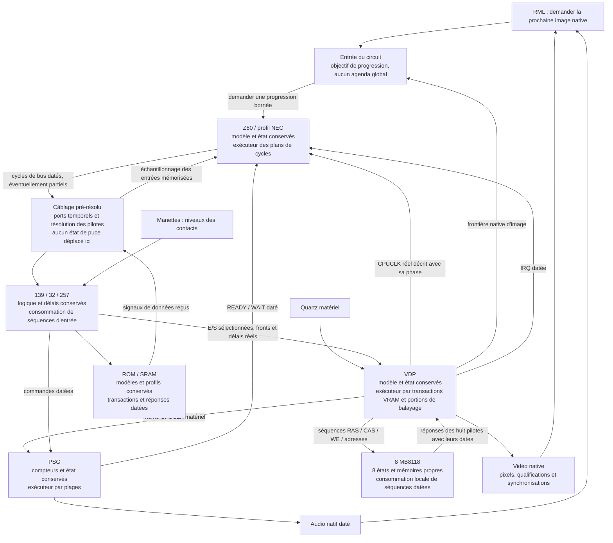
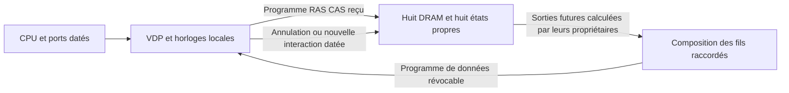
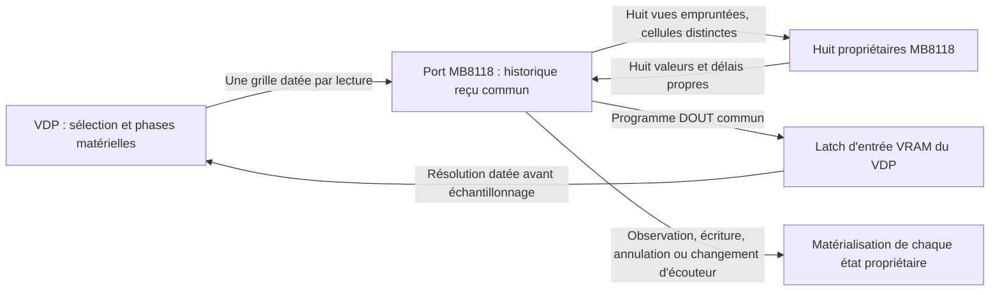

# Architectures d'exécution comparées pour SegaEmu

**Correction du 13 novembre 2026 : les 7,17 ms/image précédemment attribuées à PresentVideo en Release sont une attribution par échantillonnage, pas une durée directement chronométrée. Le chronométrage direct de la référence A mesure 0,089 à 0,137 ms/image dans ces scénarios. Ces deux mesures ne doivent pas être confondues. Voir le lot A/B ci-dessous.**

Recherches du 12 novembre 2026, demandées pour accélérer fortement la SG-1000 et conserver les pistes utiles à la Master System et à la Mega Drive. Acorn reste suspendu. Cette comparaison porte sur les fichiers et chemins cités, pas sur une certification intégrale des autres émulateurs. Aucun de ces programmes n'a été exécuté pour en annoncer une vitesse. Une réputation, un titre « accurate » ou un résultat de jeu ne prouvent pas l'ensemble des signaux et timings d'une puce.

Les sources téléchargées restent sous `artifacts/.tmp-archives/machines/Sega/SG-1000/Comparison/`, hors Git. Les noms des sous-dossiers ci-dessous identifient les copies consultées. `origins.txt` et `sha256.txt` donnent leur provenance et l'identité du contenu ; les branches distantes peuvent évoluer. Cega est archivé au commit `16eabeb6f53760902bd2577d991e88d7ef8aede3`. Aucun code tiers n'est copié dans la production RML et aucune règle de travail provenant de ces dépôts n'est appliquée.

## Comparaison des chemins consultés

| Projet et sources | Organisation observée | Piste réutilisable et limites pour RML |
|---|---|---|
| [Gearsystem](https://github.com/drhelius/Gearsystem/blob/master/src/GearsystemCore.h), `GearsystemCore.cpp`, sous-dossiers Gearsystem/GearHeader | RunCycle reçoit les cycles exécutés du CPU, puis Tick de la vidéo, de l'audio et des entrées ; les options de débogage changent la granularité CPU. | Transmettre une quantité de temps établie, garder des boucles locales aux récepteurs. Ce chemin n'établit pas la conservation des propagations électriques des composants discrets RML ; ne pas le transplanter tel quel. |
| [SMS Plus GX](https://github.com/libretro/smsplus-gx/blob/master/source/system.c), SMSPlusGX | Boucle par ligne : rendu, interruptions, exécution du budget Z80, audio. Reste du budget CPU conservé. | Comptabilité des fractions et excédents, travail groupé. Le rendu d'une ligne avant les instructions ne remplace pas notre chronologie intra-ligne. |
| [Genesis Plus GX](https://github.com/ekeeke/Genesis-Plus-GX/blob/master/core/system.c), GenesisPlusGX | system_frame_sms avance le Z80 vers des dates de ligne ou d'interruption ; phases distinctes de blanking, rendu et IRQ. | Avances bornées par les prochaines interactions, à conserver aussi pour MD. Les budgets et exceptions propres à ces moteurs ne sont pas une preuve de nos timings ou du montage SG. |
| [MEKA](https://github.com/ocornut/meka/blob/master/meka/srcs/sg1ksc3k.cpp), MEKA | Loop_SG1000_SC3000 avance la ligne, les collisions, puis déclenche le rendu et VBlank à la ligne192. | Réduire les reprises de pilotage ; ce rendu à la frontière d'image ne couvre pas seul les écritures vidéo intermédiaires de notre périmètre. |
| [Mednafen](https://github.com/libretro-mirrors/mednafen-git/blob/master/src/sms/vdp.cpp), Mednafen/MednafenVDP | system_frame délègue à SMS_VDPRunFrame ; VRAM adressée en octets dans le VDP, CPU exécuté par opcodes. | Synchronisation locale avant une interaction ; ne pas assimiler le stockage fonctionnel VRAM au modèle des huit DRAM physiques. La [documentation officielle](https://mednafen.github.io/documentation/sms.html) identifie la filiation SMS Plus. |
| [BizHawk SMS](https://github.com/TASEmulators/BizHawk/blob/master/src/BizHawk.Emulation.Cores/Consoles/Sega/SMS/SMS.IEmulator.cs), BizHawk | Boucle par ligne, rendu/IRQ puis ExecuteOne CPU et PSG ; sortie audio par différences de niveau. | Audio notifié sur les changements et niveaux conservés. Le rendu par ligne n'est pas directement notre résolveur de bus vidéo. |
| [Mesen2](https://github.com/SourMesen/Mesen2/blob/master/Core/SMS/SmsMemoryManager.h), Mesen2Clock/Mesen2CPU/Mesen2VDP | Exec(clocks) ajoute le temps puis appelle VDP.Run jusqu'à cette borne ; mappings mémoire par pages. | Gérer la progression dans le composant, garder des entrées spécialisées sans reconstruire la description périodique à chaque petit fragment. Les tableaux de mapping n'établissent pas nos délais de sélection/OE. |
| [jgenesis](https://github.com/jsgroth/jgenesis/blob/master/backend/smsgg-core/src/api.rs), jgenesis/jgenesisVDP | Exécution d'une instruction Z80 puis rattrapage PSG/VDP. process_events précise que des événements sont avancés pour compenser l'entrelacement par instruction. | Compteurs et échéances locaux intéressants ; décalages compensatoires explicitement écartés pour RML. Ne pas changer les dates matérielles pour compenser le pilote logiciel. |
| [ares](https://github.com/ares-emulator/ares/blob/master/ares/ms/cpu/cpu.cpp), aresCPU/aresVDP | CPU instruction/step ; VDP avec comptes H/V, synchronisation coopérative et portions de traitement. | Découpage en domaines et bornes ; l'infrastructure Thread/synchronize de ce projet n'est pas à ajouter à RML. Les mêmes études serviront à SMS/MD. |
| [higan SG](https://github.com/higan-emu/higan/blob/master/higan/sg/cpu/cpu.cpp), higanSG/higanVDP | Instruction CPU, step local et synchronisation coopérative ; stockage VRAM fonctionnel dans le VDP. | Ancêtre architectural à comparer avec ares, pas un second algorithme à copier. Conserver les circuits séparés et leur source réelle chez RML. |
| [BlastEm](https://github.com/libretro/blastem/blob/libretro/sms.c), BlastEm | Cibles CPU/IRQ et rattrapage VDP/PSG ; synchronisation du VDP avant les accès de ports. | Piste importante : domaines indépendants jusqu'à une interaction datée, événements qui raccourcissent la cible. Le miroir libretro consulté est identifié, pas présenté comme une mesure matérielle. Réutilisable à l'étude de MD. |
| [Cega](https://gitlab.com/jgemu/cega/-/blob/16eabeb6f53760902bd2577d991e88d7ef8aede3/src/cega_sg.c), Cega | CPU/PSG chaque troisième cycle maître, VDP chaque deuxième ; slots d'accès dans tms9918.c, données en tableau VRAM. | Comparaison fine des séquences et rapports de clocks, pas une solution de débit par elle-même. Son auteur indique que la vitesse n'était pas prioritaire. Conserver nos accès et délais des mémoires physiques. |
| [MAME TMS99xx](https://github.com/mamedev/mame/blob/master/src/devices/video/tms9928a.cpp), MAME | Mémoire VRAM du device, événements et traitement de lignes. Le TODO du fichier mentionne vidéo/sync externe, mises à jour intra-ligne, clonage de sprites et permutation4K. | Ces manques sont ceux de leur implémentation, pas un constat sur la nôtre. Piste d'organisation uniquement, aucune déclaration de conformité totale fondée sur MAME. |
| [blueMSX](https://github.com/libretro/blueMSX-libretro/blob/master/Src/VideoChips/VDP.c), blueMSX | vdp_sync et temporisations séparées pour affichage, modes, HINT et VINT. | Représentation différée d'une portion stable et mise à jour avant observation. Les mécanismes de board timers du projet ne deviennent pas un ordonnanceur partagé RML. |
| [openMSX](https://github.com/openMSX/openMSX/blob/master/src/video/VDP.cc), openMSX | Points de synchronisation distincts, accès CPU à dates explicites, tables de créneaux et états différés. Le fichier sépare mesures et estimations. | Étude utile du même groupe de puces, même si ce n'est pas une SG. Ne pas reporter des timings V9938/V9958 au TMS9918 : le source lui-même signale des hypothèses pour TMS non mesurés. |
| [MiSTer SMS](https://github.com/MiSTer-devel/SMS_MiSTer/blob/master/rtl/vdp.vhd), MiSTerVDP | Enables CPU/VDP/pixels séparés, interfaces de bus, mémoire à ports FPGA ; options d'augmentation de sprites et turbo dans le projet. | Intéressant pour identifier capture, résolution et domaines. La RAM FPGA n'est pas une preuve des délais MB8118 ; les extensions turbo/sprites ne sont pas le matériel normal à reproduire. |
| [openFPGA SMS](https://github.com/drizzt/openfpga-SMS), openFPGA | Port du cœur MiSTer, source upstream embarquée et adaptation des clocks/ports Pocket. | Filiation conservée pour ne pas compter deux preuves indépendantes ; aucune conclusion supplémentaire sur le silicium SG. |
| [Cogwheel](https://github.com/benryves/Cogwheel/blob/master/Sega/Emulator.cs), CogwheelCore/CogwheelMemory | C# ; RunScanline/RunFrame demandent un budget CPU puis avancent la vidéo. Slots de cartouche/carte/extension/BIOS/RAM séparés. | Comparaison intéressante en C# pour les responsabilités et les mappings ; budgets par ligne et accès fonctionnels ne remplacent pas notre chronologie de broches. |
| [JavaGear](https://github.com/fedex81/javagear-mirror/blob/master/src/common/Engine.java), JavaGear/JavaGearVDP | Ancienne source0.97 via miroir identifié : budget par ligne, séparation finale de8cycles en mode précis, dessin/interruptions par ligne, caches de tiles/sprites. | Conserver les calculs immuables et invalider leurs caches aux vraies écritures ; ne pas adopter une frontière de précision arbitraire de8cycles. |
| [Osmose](https://github.com/lutris/osmose/blob/master/emulator/OsmoseCore.cpp), Osmose | run_frame par ligne ; cpu.run avec excédent conservé, PSG et mise à jour VDP. | Comptabilité locale et regroupement, sans qualification de notre bus physique ; moteur SMS/GG comparé pour idées, pas déclaré SG complet. |
| [Snepulator](https://github.com/JoppyFurr/Snepulator/blob/main/source/sg-1000.c), Snepulator | z80_run_cycles par portions de228cycles, avance vidéo/audio et mappings ROM/RAM par fonctions. | Portions temporelles et responsabilité des périphériques. Les options d'overclock du code ne doivent pas devenir un gain de performance de RML. |
| [ZEsarUX SG](https://github.com/chernandezba/zesarux/blob/main/src/cores/core_sg1000.c), ZEsarUX | Compte des tstates, fins de ligne et d'image, sorties vidéo/audio et régulation de vitesse hôte séparée. | Séparer vitesse maximale d'émulation et limitation de présentation ; ne pas utiliser l'horloge hôte comme cadence de puce. |
| [sega-emulator Rust](https://github.com/leonardo201800478/sega-emulator/blob/main/native/sms_core/src/temporal_machine.rs), RustNative | Runtime réexportant un cœur avec timeline et scheduler central pour CPU/mémoire/PSG/VDP. | Parcours inspecté, mais son architecture centrale ne respecte pas la contrainte RML d'absence d'ordonnanceur commun. Aucun statut de conformité repris de son README. |
| [PicoDrive SMS](https://github.com/notaz/picodrive/blob/master/pico/sms.c), PicoDriveSMS | Budgets Z80, synchronisation d'accès et conversions de compteurs ; options et réserves locales explicites. | Conserver comptes et fractions par domaine ; ne pas adopter les approximations de conversion ou correctifs de compatibilité sans les qualifier sur notre matériel. |
| [PicoDrive MD](https://github.com/notaz/picodrive/blob/master/pico/pico_cmn.c), PicoDriveMD | Cibles68K, compte de cycles Z80/bus et progression du cadre ; phases de rendu/IRQ. | Pistes gardées pour la future MD : interrompre une portion sur un véritable effet du bus, préserver arbitrage et attentes ; pas d'implémentation MD démarrée. |
| [Gens/GS](https://github.com/lutris/gens/blob/master/src/gens/emulator/g_md.cpp), Gens | Ancien moteur MD : budgets68K/Z80 par ligne, paliers avant IRQ/blanking, VDP_Render_Line et comptes DMA. | Conserver les bornes et excédents locaux, sans reprendre les paliers/compensations comme vérité matérielle. Le rendu par ligne ne remplace pas les accès intra-ligne. |
| [Exodus](https://github.com/RogerSanders/Exodus/blob/master/Devices/315-5313/S315-5313_Ports.cpp), ExodusTiming/ExodusExecution/ExodusVDPPorts | Tables H/V détaillées, accès datés, prédiction des lignes et rollback en cas d'accès antérieur ; thread de rendu séparé. | Dates de capture/réponse et bornes d'interaction utiles à l'étude MD ; ne pas introduire le thread ni le rollback spéculatif de cette plateforme dans notre câblage. |

## Projets identifiés dont la comparaison n'est pas encore complète

- Gens/Gens-GS et Exodus sont maintenant comparés sur les chemins cités dans le tableau. Le mauvais ancien chemin gerbilsoft/gens-gs avait renvoyé404 ; ce n'était pas une preuve d'absence de sources. L'approfondissement des particularités MD reste distinct de cette comparaison architecturale.
- DGen : chemin SourceForge identifié mais inaccessible par le lecteur Web utilisé ; pas de conclusion sur son exécution interne sans code consulté.
- [MasterGear](https://fms.komkon.org/MG/) : l'auteur précise que le source n'est pas public. [Emulicious](https://emulicious.net/) et [Kega Fusion](https://www.carpeludum.com/kega-fusion/) : pages officielles consultées, code interne non acquis. Leur fonctionnement interne ne peut pas être qualifié à partir des seuls binaires/pages.
- Les distributions Nostyra/OpenEmu et autres interfaces retrouvées ne sont pas comptées comme des preuves d'un nouveau moteur indépendant lorsqu'elles annoncent un cœur tiers. Aucune exhaustivité de tous les dépôts Internet n'est prétendue ; les projets trouvés restent identifiés avec la limite de l'examen effectué.

## Application au câblage SG-1000

La piste commune applicable est de confier la progression locale à chaque composant, depuis la source périodique réellement raccordée, et de borner ses portions avant toute interaction. Les interruptions et réponses de bus doivent raccourcir cette borne aux dates exactes. Cela correspond déjà aux lignes des directives concernant source périodique établie, transmission de phase, séquence canonique, périodes indépendantes et mise à jour avant observation. Ni tableau VRAM substitué aux DRAM, ni IRQ déplacée, ni fréquence modifiée, ni ordonnanceur partagé.

Première réalisation essayée : train VDP interruptible, cache du minimum des échéances de carte et source quartz rationnelle.46contrôles VDP Debug/Release et13contrôles machine passent. Même état final/pixels/audio sur ChampionTennis, Girl'sGarden etCastle, mais première comparaison isolée défavorable :486,634→564,780ms,487,317→554,887ms et505,161→604,800ms parimage. Régression16,06/13,87/19,72%. Capture `Profiles/TestRun-2fa1ded1e67946faa4c095237531cbb7/profile.trx`. Le bloc n'est pas retenu comme optimisation dans cet état.

Profil de ce premier candidat, ChampionTennis : ReceiveClockTrain5,74% propre, TrainDate2,08%, RecomputeOutsideDeadline4,37%, SetDeadline1,90%, Advance de carte3,60%. Ces coûts propres identifient du travail ajouté par le transport ; leurs inclusifs ne s'additionnent pas. Étape suivante du même bloc : conserver la description périodique entre les petites portions et invalider le minimum aux notifications sans le recalculer plusieurs fois pendant la même propagation. Réutiliser le même résolveur et les mêmes comparaisons, puis ne conserver que le résultat équivalent et réellement plus rapide. Les voies de regroupement des transactions mémoire et de zones vidéo stables restent à qualifier avant réalisation ; aucun gain important futur n'est présenté comme acquis.

Cette seconde réalisation a été essayée :47contrôles VDP Debug/Release passent, ainsi que13contrôles machine. Trois mesures sans trace puis trois profils complets correspondants de12images parROM, même échauffement et commandes, donnent519,484/570,976/532,431ms parimage. Comparaison directe avec les références initiales, pas avec le premier candidat déjà plus lent : +6,75/+17,17/+5,40%. État final complet et toutes les36images/blocsPCM/compteurs matériels identiques (`clock-source-candidates-review.json`). Le gain apparent de8,02%/11,97% contre le premier candidat sur deux jeux ne constitue donc pas une amélioration du code initial ; aucune annonce de gain fondée sur cette comparaison intermédiaire.

Les deux candidats ont été retirés. Sources existantes rétablies depuis5c0e48aa7, contrat et tests exclusivement ajoutés pour le trajet rejeté supprimés. Archive des fichiers candidats : `artifacts/TestsMachines/Sega/SG1000/clock-source-rejected-candidate.zip`. Captures : `20261112-periodic-source-{debug,release}.trx` sousTestsChips, `20261112-periodic-source-machine-debug.trx`, `Profiles/TestRun-95b746e4f5454d329336fc5ad1c12229/profile.trx` sousTestsMachines. Après restitution, mesure des troisjeux :490,145/474,807/500,478ms parimage, touslesétats/images/audio identiques ; `Profiles/TestRun-cdb67e1c4e7d46f28b93e5df538b1997/profile.trx`,1succès,23,504s. Ces valeurs confirment le retour à la référence, pas un nouveau gain. Un premier lancement de restitution avait échoué à compiler car l'accèsGit avait refusé le rétablissement des fichiers existants avant retrait du contrat : accès corrigé, restauration effectuée, compilation et passage final réussis ; ce lancement ne prouve rien sur l'émulation.

Conclusion de l'essai : le pilotage du quartz seul représentait environ8% propre dans la référence et ne pouvait pas produire le facteur attendu. Le prochain lot doit représenter les clocks périodiques entre domaines et borner leurs avances aux interactions CPU/vidéo/mémoires/READY/IRQ réelles, plutôt que conserver tous les récepteurs dans une coordination par demi-front. Les fonctions et dates matérielles restent intégrales ; les prochaines adaptations sont décrites avant modification dans les suivis de composants et de machine. La comparaison d'émulateurs est un ensemble de pistes d'exécution, pas une autorisation de reprendre leurs simplifications.

## Domaine CPU–VDP–PSG raccordé et représentation locale — 12 novembre 2026

Le lot réalise la réception de formes périodiques rationnelles dans les trois composants, la description de CPUCLK depuis le diviseur physique du VDP et les avances locales bornées aux interactions. La carte synchronise le VDP et ses huit DRAM avant un strobe CPU actif ; les seuls niveaux CPU inactifs peuvent être transportés sans avancer immédiatement la vidéo. READY et IRQ bornent le CPU, les réponses DRAM bornent le VDP. Les phases, transactions, captures, priorités et restaurations restent comparées au câblage explicite conservé pour les contrôles autonomes. Aucun moteur partagé entre composants ni nouveau quartz CPU.

Le premier raccordement seul ne gagnait rien : 505,123 / 495,604 / 519,705 ms par image, soit encore 3 à 4 % de régression contre la référence restaurée. Le profil a conduit à traiter ensemble les coûts ajoutés : calculs rationnels ordinaires en 64 bits bornés avec repli Int128 ; prédictions de frontières stables conservées jusqu'à leur invalidation ; champs internes directs pour les registres clock/raster et le bus VRAM ; échéances DRAM scalaires et représentation locale de ses broches/délais ; livraison des huit entrées sans reconstruire les contrats de snapshots. Aucun drapeau Debug/JIT modifié. Les contrats publics et formats d'état restent identiques.

Mesures finales Debug sans trace, 12 images après deux d'échauffement ; comparaison directe avec le code initial, pas avec un candidat déjà régressé :

| Jeu | Référence ms/image | Lot ms/image | Temps réduit |
| --- | ---: | ---: | ---: |
| Champion Tennis, 8 Kio | 486,634 | 366,688 | 24,65 % |
| Girl's Garden, 32 Kio | 487,317 | 356,093 | 26,93 % |
| The Castle, 32 Kio + RAM | 505,161 | 377,395 | 25,29 % |

Les trois états finaux complets sont identiques à la référence initiale. Chacune des 36 images, sorties PCM et lignes de compteurs matériels comparées est identique. Preuve : `artifacts/TestsMachines/Sega/SG1000/20261112-domains-review.json`. Les profils complets séparés produisent également les mêmes états/images/audio que les mesures sans trace ; TRX `Profiles/TestRun-a9a7c777e09843d5b3d77fa72313fdb9/profile.trx`, un succès, 35,060 s. Les groupes de composants totalisent 238 succès Debug et 238 Release, zéro échec/ignoré ; les 14 contrôles machine Debug et Release passent. Captures `20261112-domains-final-{debug,release}.trx` sous TestsChips/Sega/SG-1000 et `20261112-local-registers-machine-{debug,release}.trx` sous TestsMachines/Sega/SG1000. Aucun test lié aux fichiers utilisateur n'est ajouté aux tests autonomes ; le lanceur du profilage supprime son entrée générée et sa requête dans finally.

Ce résultat reste seulement à environ 4,4–4,6 % de la vitesse nominale en Debug, très loin de l'objectif. L'optimisation globale demeure ouverte. Champion Tennis, profil du lot : mémoire 23,70 %, VDP 29,10 %, câblage 15,85 %, CPU 15,09 %, logique 13,30 % du temps propre échantillonné. Les principaux postes propres sont ReceiveLevels DRAM 6,46 %, calcul de l'échéance VDP 5,34 %, ReceivePins ROM 5,04 %, AdvanceTo du bus Z80 3,95 %, résolution des événements VDP 3,95 % et transport VRAM 3,22 %. Les inclusifs ne s'additionnent pas ; ces chiffres sont des échantillons sur la fenêtre mesurée, pas des compteurs d'appels. La GC ne constitue pas l'explication dominante.

Mesure Release séparée du même lot, même fenêtre courte : médianes 42,894 / 45,839 / 54,210 ms par image. La moyenne inclut des valeurs plus hautes ; la cause de cette dispersion reste non qualifiée par cette mesure sans trace. Aucune conclusion de temps réel n'est tirée de ces douze images. Capture `Profiles/TestRun-708e80d28307415f93c6f806b3dbce8a/profile.trx`, un succès, 5,317 s. Il n'existe pas ici de référence Release appariée permettant d'annoncer le pourcentage de gain de ce lot en Release. L'interface RML, le GPU et le périphérique audio restent hors de ces mesures du cœur.

## Refonte du parcours des frontières vidéo et du moteur ROM — 12 novembre 2026

Les pistes de transport groupé, plages temporelles, entrées VRAM communes, minima conservés et séquences vidéo ont été confrontées au code local. Dans le montage natif, CPUCLK est déjà décrit depuis le VDP : il ne force plus un retour à la carte à chaque front ; ce retour reste nécessaire seulement avec un observateur de clock explicite. Les points pixels, VRAM et propagations sont encore très fréquents.

Le lot conservé maintient désormais l'échéance VDP depuis ses mutations et garde la progression dans son moteur pendant les frontières d'entrée DRAM. La carte reçoit ces échéances, livre les huit réponses datées dans leur ordre, y compris les retours imbriqués à la même date, et met à jour les minima CPU/VRAM seulement depuis leurs causes de changement. Le VDP reprend ensuite sa plage sans revenir au pilote après chaque réponse. Chaque composant conserve ses états et ses délais ; aucune activité matérielle ni séquence mémoire n'est supprimée, aucun agenda commun n'est ajouté. La restauration existante de Sg1000Board.State.cs est réutilisée sans modification : RefreshDeadlines invalide les minima, puis ConnectClockDomains rétablit la prédiction des entrées.

Le moteur ROM partagé conserve entrées, sortie/cible et dates dans une représentation directe ; les paramètres du profil sont projetés une fois. Les transports par contrat et par niveaux primitifs réutilisent le même résolveur, avec toutes les captures et délais, dont les propagations nulles et le feedback. Les profils fabricant, les ROM internes optionnelles et les miroirs restent identiques. Ces techniques réutilisent les lignes existantes du tableau des directives concernant les lectures dérivées, la boucle du séquenceur et les transactions canoniques ; elles ne modifient pas le matériel.

Première mesure du lot, hors trace : 316,952 / 315,219 / 332,115 ms par image. Trois profils complets correspondants, tous identiques aux mesures pour l'état final, les images et le PCM ; `Profiles/TestRun-8733af2b451547e5b94b35aaf443b335/profile.trx`, un succès, 33,699 s.

Un second essai associait une livraison commune des contrôles DRAM au même résolveur de chaque instance et un récepteur vidéo passif par lots de 64 signaux datés. 72 contrôles composants Debug/Release et 14 contrôles machine Debug passaient ; chaque échantillon et l'état complet restaient identiques. Pourtant les durées étaient 313,203 / 314,050 / 344,495 ms par image : seulement 1,18 % et 0,37 % de moins sur deux jeux, mais 3,73 % de régression sur Castle. Ce regroupement superficiel ne traite donc pas suffisamment le coût du parcours interne. Il est retiré, avec ses contrats et tests exclusifs ; aucune sortie vidéo par séquences ni API ReceiveSharedPins n'est livrée dans le bloc conservé. Archive `20261112-shared-video-transport-rejected.zip`, preuve `Profiles/TestRun-5dbef5f2582a4c8ead4cb5e775a44887/profile.trx`, un succès, 32,038 s. Les propositions de transport complet par transactions et de production vidéo par séquences restent à traiter ; le rejet de cet essai ne démontre pas leur impossibilité.

Après retrait, mesure isolée finale du bloc conservé, même fenêtre de 12 images et deux d'échauffement. Comparaison directe à c1b074fb6, pas au candidat retiré choisi automatiquement par le banc :

| Jeu | c1b074fb6, ms/image | Lot conservé, ms/image | Réduction du temps |
| --- | ---: | ---: | ---: |
| Champion Tennis | 366,688 | 315,693 | 13,91 % |
| Girl's Garden | 356,093 | 312,919 | 12,12 % |
| The Castle | 377,395 | 335,110 | 11,20 % |

Chaque état final complet et chacune des 36 lignes d'images/PCM/compteurs matériels comparées sont identiques à c1b074fb6 : `artifacts/TestsMachines/Sega/SG1000/20261112-retained-propagation-review.json`. Les profils séparés sont aussi identiques à leurs mesures sans trace. TRX final `Profiles/TestRun-e0e9eeb09ceb4413b9f0c5d67b9f5c5a/profile.trx`, un succès, 31,586 s. Les fluctuations inférieures à quelques pour cent entre les deux mesures du même code sont conservées et ne sont pas annoncées comme un gain supplémentaire.

Vérification finale du code conservé : **70 contrôles composants Debug (3 s) et Release (2 s), 14 contrôles machine Debug (8 s) et Release (4 s), zéro échec/ignoré**. Captures `20261112-retained-ranges-{debug,release}.trx` sous TestsChips/Sega/SG-1000 et `20261112-retained-ranges-machine-{debug,release}.trx` sous TestsMachines/Sega/SG1000. Les tests ajoutés restent autonomes, les ROM locales ne sont lues que par le lanceur de LocalEmulationTests, aucune image utilisateur n'est modifiée, aucun périphérique commandé et aucune fenêtre RML ouverte.

Le résultat reste à **4,91–5,27 % du nominal Debug** ; la machine et son optimisation ne sont pas déclarées terminées. Champion Tennis, profil final : VDP 26,09 %, mémoires 24,54 %, logique 18,72 %, CPU 14,62 %, câblage 13,64 % du temps propre. Principaux postes propres : ReceiveLevels DRAM 8,14 %, OnVramPins 5,25 %, avance de plage VDP 4,06 %, OnCpuPins 2,84 %, avance logique 2,84 %. Ces groupes incluent aussi les mécanismes de propagation internes à chaque composant ; les seuls appels de carte n'expliquent pas tous les coûts. Les inclusifs ne s'additionnent pas. Il faut maintenant réduire le coût des transactions complètes et de leur représentation, tout en conservant les mêmes effets et dates, plutôt que déplacer simplement la boucle des huit destinataires.

## Proposition de remplacement global de l'exécution — 12 novembre 2026

Statut : conception proposée après l'arrêt explicite de l'approche incrémentale. Les contrats et noyaux sont écrits ; un premier raccordement CPU–bus expérimental a été comparé puis profilé. Il est régressif et reste désactivé par défaut. La refonte globale n'est pas achevée et aucun gain n'est attribué à ce candidat ; résultats ci-dessous. Elle remplace la poursuite des petites optimisations de l'architecture a15240c11 ; elle ne consiste pas à renommer AdvanceDomains ni à envelopper ses boucles dans une autre méthode.

### Diagnostic architectural et périmètre

Le profil complet de la version conservée attribue, pour Champion Tennis, 26,09 % du temps propre au VDP, 24,54 % aux mémoires, 18,72 % à la logique, 14,62 % au CPU et 13,64 % au câblage. Les coûts de transport et de progression sont présents dans ces différents groupes ; le seul groupe câblage ne mesure donc pas toute l'orchestration. Ces chiffres ne prouvent pas à eux seuls la fraction qui pourra être éliminée.

Le choix remis en cause est la représentation d'une interaction matérielle par une succession d'appels publics unitaires, avec avancement temporel, décodage, propagation et notification répétés à chaque frontière. Le CPU dispose de plans de cycles Z80BusStep, mais son trajet normal avance encore majoritairement par demi-front. Le VDP conserve des passages par pixel et par phase VRAM. La carte participe encore à de nombreuses propagations locales au travers de ses échéances et callbacks. Mettre ces appels en cache ou déplacer une boucle ne change pas cette unité de travail.

L'unité nouvelle est une transaction électrique datée, ou une plage de signal dont tous les effets sont établis. Elle décrit les broches, pilotes, valeurs/masques connus, fronts, instants d'échantillonnage et validité temporelle. Les valeurs électriquement inconnues restent représentées par leurs masques ; elles ne forcent pas un arrêt lorsque leur propagation est définie par le modèle. Une description peut être partielle : WAIT, une lecture non résolue, un changement asynchrone ou une dépendance temporelle non résolue arrêtent l'exécution au point nécessaire. Aucun résultat futur n'est deviné.

### Schéma cible — montage NTSC actuellement réalisé



Les flèches représentent les liaisons et échanges temporels, pas une nouvelle horloge par domaine. Le VDP conserve ses diviseurs et fournit réellement CPUCLK dans ce montage. La demande d'image ne fixe pas la cadence du CPU. Le câblage résout les fils, leurs pilotes et leurs connexions ; il n'exécute pas les fonctions internes des puces et ne possède pas de file globale d'événements.

### Ce qui est supprimé, remplacé ou conservé

| Mécanisme actuel | Architecture proposée | Effet recherché |
| --- | --- | --- |
| Boucle normale AdvanceDomains, tableau global de 19 échéances et réveils de la carte pour les propagations locales | Progression causale entre ports ; chaque puce exécute localement jusqu'à une entrée/observation requise, avec une garantie explicite de validité des signaux reçus | Retirer le passage de toutes ces phases dans un pilote commun ; ne pas recréer ce même agenda ailleurs |
| Avance normale du CPU demi-front par demi-front, publication des changements de broches phase par phase | Exécuteur des plans canoniques de cycles, production de séquences de bus jusqu'au prochain échantillonnage ou arrêt matériel | Amortir les couches d'appel sur un cycle/prefixe exact, pas sur chaque demi-front ; pas de second décodeur ni de CPU spécialisé SG-1000 |
| Cascade PinsChanged / AdvanceTo / NextEventChanged sur les chemins rapides | Ports recevant des séquences de niveaux/pilotes et leurs dates ; les sorties sont reçues et mémorisées avant l'échantillonnage | Retirer les aller-retours et recalculs génériques pour une forme déjà décrite ; garder un parcours explicite pour les interactions non regroupables |
| Livraison de chaque phase VRAM séparément à chacune des huit DRAM | Description de la séquence électrique ; chaque DRAM consomme son préfixe et produit ses réponses depuis son état propre | Amortir le transport d'un cycle complet ; ne pas simplement déplacer la boucle de huit appels. Préserver RAS/CAS/WE, rétention, refresh, DIN et toutes les latences individuelles |
| Produit un pixel puis retraverse les couches d'exécution, sprites, mémoire et notifications | Exécuteur de portions de balayage, avec les opérations canoniques de fetch, latch et sérialisation, et une représentation native des plages constantes et des pixels variables | Éviter le coût de tout le chemin de coordination pour chacun des 89 604 points d'une image native ; conserver chaque valeur et sa date, y compris hors zone visible |
| Domaines indépendants appelés pour retrouver une réponse ou une frontière déjà connue | Contrats temporels envoyés par les sources et arrêt avant leur fin de validité | Avancer CPU, vidéo et son indépendamment tant qu'aucune interaction physique ne l'interdit ; aucun accès direct du CPU à un tableau de mémoire |
| Registres, ALU, décodeurs d'instructions, profils matériels, cellules mémoires, contraintes électriques et règles d'IRQ/reset | Conservés, avec un seul état canonique propriétaire dans chaque puce | Changer l'exécution et le transport, pas les modèles physiques, les fonctionnalités ou les variantes |
| Trajet par fronts explicites et banc de comparaison | Conservés comme référence de vérification et repli exact lorsque nécessaire | Comparer aux mêmes opérations matérielles sans doubler les modèles ni garder ce trajet comme coût systématique du mode normal |

### Règles d'exécution causale

1. Une sortie décrit ce qu'elle garantit jusqu'à une date, avec ses transitions exactes et ses pilotes/masques connus. Cette validité est déterminée par le composant producteur et ses entrées, jamais par une prédiction de logiciel invité.
2. Le destinataire consomme cette description dans son exécuteur local et échantillonne ses entrées mémorisées aux phases de son propre modèle. Il ne rappelle pas un fournisseur pour obtenir directement un octet de mémoire.
3. Une lecture mémoire traverse toujours le décodage, les délais des circuits, la sélection de la ROM/SRAM et la résolution du bus. Une lecture VRAM traverse toujours les huit DRAM et leurs fonctions. Une transaction structurée ne contourne pas ces composants.
4. Une dépendance non résolue, WAIT, une nouvelle commande, une entrée asynchrone ou une observation nécessaire termine le préfixe au premier instant concerné. Avant d'appliquer une nouvelle cause, les effets antérieurs sont matérialisés puis la partie future devenue invalide est abandonnée. Aucune avance au-delà d'une garantie reçue, aucune correction rétroactive ni rollback spéculatif.
5. Les échéances internes restent dans les composants. La carte ne réunit plus leurs événements dans une boucle globale ; les sources fournissent les informations de validité aux destinataires raccordés. Une dépendance non résolue conduit à une livraison exacte, pas à une recherche répétée des sorties.
6. Les événements à la même date conservent leurs captures, priorités et ordre causal. Plusieurs fils ne sont regroupés en une résolution commune que si aucun échantillonnage ni retour de câblage ne peut distinguer les étapes ; sinon la séquence les représente explicitement.
7. Une observation de broche, de registre ou d'état à une date intermédiaire matérialise le préfixe nécessaire. Les frontières d'interruption, collisions/débordements, RAMLOAD, refresh, contentions et phases de bus ne sont pas déplacées aux fins de ligne ou d'instruction.

### Exemple d'une lecture CPU et d'une portion vidéo

Pour une lecture CPU, le plan de cycle fournit les sorties d'adresse/contrôle et les phases d'échantillonnage depuis CPUCLK. Les composants de logique consomment cette séquence selon leurs délais et transmettent leurs sélections. La mémoire consomme ses vrais niveaux CE/OE, capture ou suit l'adresse selon son profil, puis fournit la forme de sa sortie. Le port de données du CPU échantillonne le bus résolu. Si WAIT impose un arrêt, seul le préfixe réellement déterminé est exécuté et la reprise conserve la phase restante.

Pour la vidéo, le VDP conserve son calendrier de fetch et ses registres. Son exécuteur traite des portions déterminées du balayage ; les cycles VRAM sont transportés comme séquences vers les huit mémoires. Les réponses alimentent les mêmes latches et pipelines. Les pixels constants peuvent être représentés par une plage datée, les pixels variables par leurs valeurs natives ; un adaptateur de vérification peut reconstruire chaque échantillon. Les collisions et autres effets internes sont appliqués à leur position/date exacte. Une écriture CPU ou une entrée de contrôle arrête la portion avant son effet ; un bloc n'est jamais une ligne indivisible qui retarderait une écriture ou une interruption.

### Lots cohérents et critère de réussite

Le premier lot porte sur le contrat de signaux/transactions, les ports et l'exécution CPU–bus–logique–mémoire complète. Le second porte sur VDP–VRAM–balayage, avec l'entrée/sortie des mêmes ports et les boucles de retour. Le raccordement final intègre PSG/READY, entrées et frontière native d'image. Il s'agit de remplacer les chemins d'exécution de bout en bout, pas d'ajouter un orchestrateur autour des boucles existantes.

La version a15240c11 reste la référence figée. Avant toute adoption, comparaison rigoureuse des états complets, phases, accès/échantillonnages, signaux et chronologies, IRQ/NMI/WAIT/reset, chaque pixel et le PCM, avec reprises en milieu de transaction et plusieurs ROM/configurations. Les observations explicites doivent retrouver le même état aux frontières intermédiaires, pas seulement le même hash de fin d'image. Les limites matérielles déjà acceptées restent identifiées ; une équivalence entre exécuteurs n'est pas une nouvelle preuve physique.

Après chaque grosse refonte retenue : mesure sans instrumentation concurrente puis profil complet séparé sur la même version, attribution propre/inclusive et comparaison des sorties. Ajouter les volumes de transactions et de livraisons pertinents pour vérifier que le nombre de communications dépend bien des interactions matérielles structurées, plutôt que du produit des fronts par le nombre de destinataires. Aucun débit cible n'est obtenu en modifiant les options Debug, fréquences, timings ou précision.

Le gain massif est une hypothèse à vérifier : l'objectif est de supprimer des catégories d'overhead répétées sur les principaux domaines, pas de gagner sur une méthode isolée. Les profils actuels établissent la dispersion des coûts, pas un facteur d'accélération garanti. Si le nouveau chemin conserve pratiquement la même granularité d'appels et les mêmes coûts, sa rupture architecturale ne sera pas considérée comme réalisée, même si quelques pour cent sont gagnés. La cible machine reste le temps réel en Debug, avec sa marge de calcul à mesurer.

### État réel des fondations du premier lot

Les contrats LogicInputRange/LogicOutputRange, le noyau local CombinationalOutputs et les entrées par séquences des SN74LS139/32/257 sont écrits, avec préparation et résolution partagées avec leur trajet explicite. Le CPU possède son transport Z80BusRange et livre ses sorties aux points canoniques de consommation des entrées. Les variantes utilisent le même moteur. Les 26 contrôles ciblés CPU/plages/logique passent en Release ; le groupe large de 146 contrôles CPU/logique Debug puis les huit contrôles ciblés après ajout du contrôle de refus/nettoyage passent. Preuves et limites dans les fiches des composants.

Le trajet CPU–bus–mémoire expérimental est désormais raccordé par des séquences et une fusion des sources propres à chaque destinataire, sans rejouer OnCpuPins pour chaque élément. Son pilote n'utilise pas l'agenda global des19 échéances. Ce raccordement est vérifié fonctionnellement mais son coût de distribution est régressif ; il doit être remplacé avant adoption. Le CPU conserve encore sa boucle locale de fronts ; la suppression des traversées externes est préparée, pas encore mesurée sur la machine. Le VDP–VRAM–balayage et le raccordement final son/entrées restent ouverts. Aucun nouveau FPS n'est annoncé et aucun profil de machine n'est lancé sur ces fondations non raccordées.

Les moteurs ROM partagé, SRAM TMM2009 et SRAM TMM2016/NEC/Fujitsu possèdent maintenant ExecuteInputRange. Ils fusionnent localement les entrées et propagations et réutilisent les mutations canoniques du trajet explicite, sans boucle sur les méthodes publiques unitaires. Le groupe mémoire statique complet passe :55 contrôles Debug et55 Release, zéro échec/ignoré. Après factorisation, les14 contrôles du trajet machine existant passent aussi en Debug. Références de rapports et invariants dans les fiches Tmm23256/Tmm2009/Tmm2016. Ces vérifications isolées précèdent le raccordement expérimental décrit ci-dessous ; elles ne suffisent pas à adopter la refonte globale.

### Premier raccordement CPU–bus : équivalent, mais régressif et non adopté

`Sg1000CpuBus.cs` réalise un trajet expérimental sélectionné uniquement par le banc (`Profile-Sg1000.ps1 -BusRanges`), désactivé par défaut dans la machine et le cœur applicatif. Les sources de signaux sont fusionnées pour leurs seuls destinataires physiques ; les circuits logiques et mémoires exécutent leurs propres séquences, puis le bus CPU est résolu depuis les niveaux reçus. Le pilote par plages n'utilise plus AdvanceDomains/NextCpuWireDeadline ni le minimum global des19slots. Le VDP–VRAM conserve encore son trajet précédent et le CPU sa progression locale par fronts : la refonte globale reste inachevée.

Comparaison Debug : **22 contrôles machine réussis, zéro échec/ignoré**,25s, `20261112-native-bus-all-machine-debug.trx`. Les tests ROM et cartouches SRAM sont exécutés avec chaque transport : géométries8/16/32/48KiB, deuxROM8KiB/mirroirs explicitement sélectionnés, profils constructeur, ROM interne facultative et inhibition, insertion/retrait/origine de temps, deux SRAM de cartouche, restauration et refus atomiques. Une comparaison directe des états complets couvre sept dates arbitraires et rasters, manettes, restauration et NMI Pause, puis PCM. Les premiers écarts concernaient deux avances sans cause introduites par ce raccordement : date d'interfaceCPU du VDP avancée à chaque barrière et date de la TMM2009 avancée sans livraison. Elles ont été retirées ; aucune tolérance de comparaison ajoutée.

Mesure sans trace puis profil complet séparé, même scénario de12images et2échauffements, aucune compilation/test concurrent :

| ROM | Référence a15240c11 ms/image | Candidat ms/image | Résultat |
| --- | ---: | ---: | --- |
| Champion Tennis8KiB |315,6934|714,75935|Non adopté|
| Girl’s Garden32KiB |312,91855|713,5109|Non adopté|
| The Castle32KiB+SRAM8KiB |335,1103|819,2795|Non adopté|

Rapports : Champion `20261112T182524714Z-da8748`, Girl `20261112T182546551Z-8e8856`, Castle `20261112T182608195Z-0757fe` sous leurs dossiers Profiles. Test de profil demandé réussi en1min7s, `Profiles/TestRun-1ff08243adc8464ea6d62a80986565c2/profile.trx`. Les états finaux, vidéo et PCM sont identiques aux références conservées. La comparaison directe retrouve aussi tous les compteurs matériels, qualifications, empreintes vidéo et PCM de chacune des12images mesurées, pour les trois jeux. Synthèse `artifacts/TestsMachines/Sega/SG1000/20261112-native-bus-candidate-review.json`.

Le coût ajouté est établi : BuildBusInputs reparcourt le même préfixe pour presque tous les destinataires et ProjectBusInputs reconstruit leurs mots, y compris lorsqu'aucune entrée raccordée n'a changé. Sur Champion, BuildBusInputs représente11,87% propres et33,54% inclusifs ; ProjectBusInputs5,27% propres, inclus dans le précédent (ne pas additionner ces temps inclusifs). Les compteurs cumulés des14images totalisent546555 livraisons,1539089 mots CPU,10078537 mots d'entrée logique et4203400 mots mémoire. Le regroupement a donc ajouté une distribution et des validations trop nombreuses ; la suppression de l'agenda central n'apporte pas à elle seule un gain.

Correction d'attribution : les premiers regroupements cherchaient Chips.CPU dans toute la signature ; le paramètre Z80BusRange faisait attribuer des méthodes de câblage au CPU. Group analyse désormais uniquement le propriétaire avant les paramètres ; trois contrôles d'analyse réussissent (`20261112-profile-signature-ownership-debug.trx`). La synthèse conservée reclasse les coûts propres des mêmes traces sans changer les mesures : Champion câblage33,81%, CPU17,73%, logique15,63%, mémoire16,13%, VDP12,69%, PSG2,99%. Pour Girl : câblage31,45%, logique19,94%, CPU16,54%, mémoire15,37%, VDP12,79% ; Castle : câblage32,57%, mémoire21,15%, CPU15,78%, logique15,50%, VDP12,21%. Les rapports bruts d'origine restent conservés ; leurs anciens totaux par groupe ne doivent pas être réutilisés sans cette correction.

La prochaine action porte sur le remplacement de cette distribution répétitive : décoder les mots de fils une fois, livrer les seuls changements raccordés, conserver les réponses pendantes localement et réunir les barrières au même instant sans cause nouvelle. Le candidat reste isolé ; le résultat doit être comparé à a15240c11, et non seulement à ce candidat ralenti. Aucun changement de fréquence, précision, options Debug ou fonction de puce n'est permis pour améliorer les chiffres.

### Distribution commune et filtrée — résultat toujours non adopté

Le lot de distribution est remplacé : les fils CPU sont décodés une seule fois dans CpuBusWires ; une fusion prépare les entrées des portes, une seconde distribue les causes aux seuls destinataires raccordés. BuildBusInputs et ses parcours par destinataire sont supprimés. Les mots identiques ne sont plus réinjectés à chaque barrière. Les sorties de séquences publient leur prochaine réponse locale ; une entrée inchangée sans réponse due ne réveille pas le composant. Les échéances restent dans leurs propriétaires ; le raccordement conserve les informations reçues sans les interroger ni créer de minimum global. Les observations finales matérialisent les états différés. Les échanges CPU sans cause nouvelle au même instant sont réunis ; RESET/NMI/BUSRQ restent appliqués aux frontières qualifiées.

Vérifications Debug : **71 contrôles composants** réussis (`20261112-sparse-routing-components-debug.trx`), puis **25 contrôles machine/analyse** réussis (`20261112-sparse-routing-machine-debug.trx`), zéro échec/ignoré. Les conditions d'exécution précédentes sont conservées : source réelle, tous les modèles/profils, exactitude des états, délais, snapshots et inconnus acceptés. Aucun mode de précision réduit ni option Debug modifiée.

Mesure complète sans instrumentation puis profil complet séparé, trois ROM,12images et2échauffements, aucune compilation ni test concurrent :

| ROM | Référence conservée ms/image | Distribution corrigée ms/image | Décision |
| --- | ---: | ---: | --- |
| Champion Tennis |315,6934|415,4509|Non adopté|
| Girl’s Garden |312,91855|416,2747|Non adopté|
| The Castle |335,1103|437,2870|Non adopté|

Rapports sous Profiles : Champion `20261112T184158837Z-379ae7`, Girl `20261112T184211910Z-e95efc`, Castle `20261112T184224490Z-f7298e`. Passage demandé réussi en40s, `Profiles/TestRun-f0939614b7a74e9bab7c13f73127e598/profile.trx`. Les états finaux, vidéo et PCM concordent aux références a15240c11 ; la comparaison directe retrouve aussi chaque ligne de compteurs/qualifications/hashes natifs des12images. Les champs hôtes de durée et nouveaux compteurs de transport ne sont pas des états matériels.

Les volumes cumulés sur14images baissent : Champion entrées logiques10078537→1703951, entrées mémoire4203400→2049464 ; Girl10077781→1703867 et4203015→2049292 ; Castle10163675→1869636 et6938616→2147070. Les livraisons CPU restent546555/546650/550359 : le nombre de barrières aux entrées n'a pas encore diminué dans ce scénario. Cela établit la suppression d'une grande partie du transport inutile, mais **aucun gain sur la référence conservée**. Ne pas annoncer le gain contre le candidat raté comme un résultat satisfaisant.

Nouveaux coûts propres Champion : VDP22,80%, câblage23,92%, mémoire21,22%, logique16,12%, CPU11,24%, PSG1,60% (arrondis). Méthodes principales : AdvanceMasterClockSourceUntil5,04% propres/41,64% inclusifs, ProjectBusInputs4,93% propres, MB8118.ReceiveLevels4,32% propres, MB8118.AdvanceTo3,38% propres. Ces profils portent sur la machine entière. La granularité des barrières CPU et les trajets VDP–VRAM–balayage restent à remplacer conformément au schéma global ; ne pas considérer la refonte terminée parce que les nouvelles structures existent.

Le lanceur PowerShell fournit CompareTo vide sous forme de chaîne vide, non null : le premier filtre d'exclusion des candidats ne l'avait pas pris en compte. La condition utilise maintenant IsNullOrEmpty. Les trois comparaisons de cette capture ont été corrigées directement vers leurs références a15240c11 conservées, sans changer aucune mesure ni état. Les rapports json/md et latest-results portent ces références corrigées. Ce recalcul de comparaison n'est pas une nouvelle mesure ; ne pas réutiliser les pourcentages initialement calculés contre le candidat régressif. La version applicative reste sur le trajet antérieur ; aucun gain nouveau n'est adopté.

### Bilan d'opérations du chemin complet avant modification supplémentaire

Examen du trajet actuellement raccordé : CPU (plans canoniques, DATA/WAIT/INT) → mots de fils communs → décodeur → portes → ROM/SRAM/manettes → résolution des pilotes → CPU ; quartz → diviseur VDP → balayage/fetch/sprites → séquence VRAM → huit DRAM → données VRAM/captureCAS/RAMLOAD ; PSG → intégration PCM ; indices vidéo → présentation native XRGB. Le mode expérimental reste désactivé par défaut. Les chiffres disponibles ci-dessous proviennent de la capture415–437ms et ne constituent pas une mesure du nouveau lot VDP.

| Travail | Fréquence établie dans la capture Champion (14images, échauffement compris) | Traitement du lot |
| --- | --- | --- |
| Horloges matérielles |837020 clocks CPU et5022118 demi-fronts maître | Conservées avec mêmes phases/fréquences ; aucune réduction physique |
| Échantillonnages et livraisons CPU |546555 barrières,1539089 mots de sortie | Conservés lorsque nécessaires ; le CPU n'est pas autorisé à ignorer une dépendance |
| Décodage commun des fils CPU |Une préparation par mot CPU reçu, non une par destinataire | Conservé ; les deux fusions par étages n'effectuent plus de recherche globale des destinataires |
| Entrées effectives logique/mémoire |1703951 /2049464 mots, après suppression des mots identiques | Conservées lorsqu'une cause raccordée change ; ne pas réintroduire les mots initiaux à chaque barrière |
| Avance du balayage depuis le CPU |Le candidat précédent appelait SynchronizeVideoDomain à chacune des546555 barrières, plus les accès actifs et observations | Supprimer l'appel systématique ; synchroniser avant une entrée active, une réponse/IRQ annoncée et toute observation. Mesurer les appels restants et la taille des plages réelles |
| Transport de chaque lecture VRAM déterminée |4fronts RAS/CAS ×8 =32 livraisons de broches minimum, plus la ligne d'adresse initiale selon ses changements | Remplacer par8 réceptions d'une même forme commune préparée une fois. Au moins24 appels publics de livraison de phases supprimés par cycle représenté ; pas de suppression des mutations dans les huit états |
| Traitement local DRAM |Capture row/column, refresh/rétention, startup, qualification, données et délais | Conservé intégralement ; fusion des entrées reçues et réponses dans le moteur de chaque instance, sans retour par la carte pour chaque phase |
| Écritures VRAM et cycles non déterminés |Données du registre CPU prises à leur vraie phase189ns, fronts WE et relâchements | Conservés sur le transport explicite ; aucun octet futur capturé prématurément |
| Pixels et sorties natives |89604 points par raster complet ;49152 pixels actifs présentés en XRGB | Conservés, avec mêmes dates/couleurs/known, sprites, collisions, sync et frontière native |
| Son |Diviseurs, commandes, READY et PCM natif | Conservés ; ce trajet n'est pas remplacé par une écoute ou un périphérique hôte |

Le prochain changement supplémentaire ne crée pas d'exécuteur : préparer la forme DRAM commune une fois à la réception VDP et ne varier que les deux DIN par destinataire. Les nouveaux compteurs devront donner le nombre réel de cycles représentés, livraisons explicites par bit restantes, appels de synchronisation vidéo et points produits. Le minimum24×R d'appels de réception de phases retirés sera présenté comme une borne structurelle pour R lectures représentées, jamais comme le nombre de toutes les opérations C# économisées. Les huit appels aux propriétaires et leurs opérations internes restent comptés. Le gain reste à prouver sur les313–335ms, pas sur les candidats ralentis.

### Mesure du transport des lectures complètes — lot non adopté, 12 novembre 2026

Le lot est implémenté : une forme commune préparée une fois, huit réceptions avec DIN séparés, résolution locale des phases et des réponses, annulation du futur à RESET/synchronisation externe, reprise explicite après restauration. Le CPU ne synchronise plus systématiquement le balayage à chaque barrière DATA/WAIT/INT ; les accès actifs, réponses vidéo dues et observations conservent leur synchronisation. Le trajet applicatif par défaut n'est pas changé.

Les trois exécutions sont séquentielles, Debug sans optimisations JIT, même cœur SHA256 `cd200fc9dfb313185b720110449bf3933a57bc62ed6455d722ebba7fb6ee328f`, deux images d'échauffement puis douze mesurées. La mesure sans trace précède le profil EventPipe dans chaque exécution. Aucun build ou test concurrent lancé par cet agent pendant ces passes.

| ROM | Référence a15240c11 ms/image | Nouveau lot ms/image | Surcroît de durée | Synchronisations vidéo sur 14 images |
| --- | ---: | ---: | ---: | ---: |
| Champion Tennis, 8 Kio |315,6934|431,1915|36,59 %|31|
| Girl's Garden, 32 Kio |312,91855|473,07575|51,18 %|37|
| The Castle, 32 Kio + SRAM |335,1103|530,79285|58,39 %|31|

Rapports complets sous `artifacts/TestsMachines/Sega/SG1000/Profiles/` : Champion `Champion Tennis (Japan)/20261112T192639504Z-0ea693`, Girl `Girl's Garden (Japan)/20261112T193026718Z-cfc5ab`, Castle `Castle, The (Japan)/20261112T193112356Z-53f915`. Chaque dossier conserve report.json/md, Measure et Profile, les lignes par image, état final, XRGB, WAV, nettrace, speedscope et coûts propres/inclusifs. Les deux derniers TRX sont `TestRun-b341879b3fb947fb9178655e30897e4b/profile.trx` et `TestRun-c5a138c28867491ca7514c65d585aca8/profile.trx`. La première exécution est terminée, son rapport est Completed et son fichier de test généré a été nettoyé ; son identifiant de session terminal n'a pas été récupéré après troncature de la sortie, ne pas inventer cet identifiant.

**Volumes réellement mesurés, cumulés avec l'échauffement :** chacun des trois jeux reçoit 234621 formes de lecture VRAM et 5224 livraisons de broches DRAM explicites. Cela donne 1876968 réceptions de formes dans les huit propriétaires. Le minimum structurel de livraisons de phases supprimées est 24 × 234621 = **5630904**, hors éventuelles livraisons supplémentaires de l'adresse initiale. Il ne s'agit ni du nombre de toutes les opérations supprimées ni d'une baisse de durée. Les 1254456 échantillons vidéo natifs, soit 14 × 89604, restent produits. Les barrières CPU demeurent respectivement 546555, 546650 et 550359 ; les entrées logiques/mémoire ne baissent pas davantage que dans le lot précédent. Le nouvel appel conditionnel réduit les synchronisations du balayage de plus de 546000 à 31–37 ; il ne supprime aucune clock CPU ou vidéo. Cette comparaison des synchronisations utilise la borne établie du précédent appel inconditionnel, pas un ancien compteur qui n'existait pas.

**Fidélité sur les scénarios mesurés :** les états finaux complets, vidéo et audio concordent aux trois références a15240c11. La comparaison directe des champs matériels de chacune des 36 images retrouve dates, compteurs CPU/quartz, PC, instructions, qualifications, interruption, quantités PCM et hashes vidéo/PCM identiques ; seuls les temps hôtes et compteurs diagnostiques sont exclus. Les deux passes de chaque jeu concordent également. Les 57 contrôles composants Debug et 25 contrôles machine/profilage Debug passent (`20261112-vram-shared-wave-components-debug.trx` et `20261112-vram-shared-wave-machine-debug.trx`). Ces comparaisons ne sont pas une preuve exhaustive de tous les comportements physiques.

| Coût observé | Champion propre / inclusif | Girl propre / inclusif | Castle propre / inclusif |
| --- | ---: | ---: | ---: |
| MB8118.AdvanceCore |7,18 /29,38 %|5,90 /27,69 %|4,31 /26,65 %|
| Distribution des sources du bus |5,37 /10,83 %|6,08 /9,97 %|5,06 /10,59 %|
| MB8118.ApplyLevels |4,01 /9,20 %|4,62 /9,36 %|4,60 /10,05 %|
| MB8118.PublishDeadline |3,87 /6,94 %|3,22 /7,04 %|3,48 /8,78 %|
| Réception des plages CPU |3,99 /45,97 %|4,15 /44,99 %|3,22 /47,42 %|

Les coûts inclusifs se recouvrent : ne pas les additionner. Sur Champion, la construction locale `ReadInputLevels` coûte encore 4,88 % propres ; le moteur réinterprète les cinq phases dans chaque DRAM, avec des recherches de prochaine phase/réponse et des publications répétées. **La disparition des appels de transport n'a pas supprimé assez de travail total.** Ce sont des surcoûts de la représentation logicielle, distincts des captures row/column, refresh/rétention, qualifications, délais et sorties indispensables. Le bilan invalide ce lot comme optimisation globale : il reste expérimental et désactivé, aucune accélération ni clôture n'est revendiquée. Avant un nouveau lot, son plan doit supprimer cette réinterprétation et la propagation répétée des échéances, ainsi que le travail de distribution CPU encore important ; déplacer ces mêmes boucles ou ajouter une couche de séquences supplémentaire reproduirait l'échec constaté.

## Moteur unique, validation globale du 12 novembre 2026

Cette section remplace les statuts courants « candidat désactivé » des étapes historiques ci-dessus. Le chemin SG-1000 antérieur, son agenda de dix-neuf slots et ses cascades de callbacks ont été retirés. Il n'existe plus de sélecteur d'exécution dans le module ni dans le lanceur de profilage. Les API scalaires génériques des puces restent disponibles aux autres montages ; ce ne sont pas des moteurs SG-1000 alternatifs.

Le même trajet traite alimentation/démarrage, CPU, décodeur, portes, ROM/SRAM, commandes VDP/PSG, manettes, changement de cartouche et restauration. Les mots CPU et leur contribution commune sont préparés une fois ; le premier parcours CPU/décodeur livre les portes et les destinataires indépendants des portes. Le second traite les causes des sorties de portes sans rejouer le décodeur ni redistribuer les destinataires déjà servis. Le filtre de ce second parcours inspecte encore les mots CPU non concernés : ce coût est compté séparément, pas présenté comme supprimé.

Chaque puce conserve ses états et ses réponses temporelles. Le CPU reçoit des fenêtres WAIT/contrôle bornées par les échéances et connexions réelles ; les cycles I/O et d'acquittement invalident ces fenêtres jusqu'aux dernières propagations. Les échantillonnages restent exécutés, depuis les niveaux reçus. Les dépendances DATA imposent toujours une livraison avant consommation. Les portions internes déjà qualifiées utilisent le helper commun, sans second décodeur. Les quatre boîtiers logiques résolvent les pins pendantes et leur prochain minimum dans le même parcours ; les réponses simultanées sont toutes résolues avant leur publication ordonnée. Le masque de présence distingue une absence d'une vraie date long.MaxValue.

Les huit DRAM restent huit propriétaires. Une forme commune de lecture est reçue une fois par propriétaire ; le préfixe déterminé applique directement les opérations physiques partagées avec le trajet scalaire, sans reconstruire cinq mots ni réinterpréter leurs changements. Les entrées explicites et annulations gardent leur ordre. Le VDP conserve chaque mutation et capture CAS/RAMLOAD, mais ne rappelle plus le transport des broches représentées sans destinataire ; l'observation explicite redevient active aux changements d'abonnement et pour le repli. Les mémoires statiques exécutent toutes leurs propagations, mais ne construisent aucun historique de sorties lorsque seul le niveau à la prochaine frontière CPU est consommé : FinalOutput et HasCompleteHistory rendent cette observation explicite. Ce n'est ni une stabilité fictive du signal ni une suppression d'activité mémoire. Les contacts des deux multiplexeurs sont préparés aux changements de manette, et le bus CPU n'est résolu de nouveau qu'à changement de pilote.

### Défaut détecté et correction

Le premier passage global a retrouvé chaque image et PCM, mais refusé l'état final : Vdp.CpuWriteBus.WriteMode différait. Capture conservée : `Profiles/Champion Tennis (Japan)/20261112T204501190Z-a13146`, TRX `Profiles/TestRun-58ab3fde56444540b5fc68af03af030a/profile.trx`. Le cache de liaison VDP/PSG était amorcé depuis des niveaux calculés du CPU, considérés à tort comme déjà reçus. Il est maintenant amorcé depuis les entrées canoniques réellement reçues par ces deux puces. La référence et ses champs n'ont pas été modifiés ou normalisés. Après correction, la comparaison complète passe.

### Résultats finaux Debug

Deux images d'échauffement puis douze mesurées, trois jeux, mesure sans trace puis profil EventPipe séparé, pas d'autre compilation/test lancé par l'agent pendant chaque mesure. Même module SHA256 `708478fc4016d7351294ec32e268404d142155e202238ae65206f54a71a2faec`, .NET 10.0.15, optimisations JIT désactivées. Références explicites a15240c11 conservées : 315,6934 / 312,91855 / 335,1103 ms, jamais les candidats ralentis.

| Jeu | Référence ms/image | Moteur unique ms/image | Réduction de durée |
| --- | ---: | ---: | ---: |
| Champion Tennis, 8 Kio |315,6934|310,3631|+1,6884 %|
| Girl's Garden, 32 Kio |312,91855|318,57305|-1,8070 %|
| The Castle, 32 Kio avec SRAM |335,1103|341,53755|-1,9180 %|

**Aucun gain massif ni gain global établi : la cible de dépassement large du temps réel Debug reste non atteinte.** L'ancien chemin n'a pas été réintroduit. Ces passages ne démontrent pas que le moteur soit suffisamment optimisé, ni que tous les jeux/périphériques ou comportements physiques soient vérifiés.

Rapports finaux sous `artifacts/TestsMachines/Sega/SG1000/Profiles/` :

- Champion : `Champion Tennis (Japan)/20261112T204929832Z-7c0879`, TRX `TestRun-f63c4a78a7c84e73ab4137beedd77ccf/profile.trx`.
- Girl : `Girl's Garden (Japan)/20261112T205037816Z-ae52e1`, TRX `TestRun-b4633ebd4de5422787d6b332c3f92ddf/profile.trx`.
- Castle : `Castle, The (Japan)/20261112T205157565Z-3f213d`, TRX `TestRun-cddd7111207243478c7fbbce142632c2/profile.trx`.

Chaque dossier contient report.json/md, les lignes par image, état complet final, pixels XRGB, WAV natif, nettrace, speedscope et tous les coûts propres/inclusifs. Les trois états finaux complets et chacune des 36 observations natives par image (dates, compteurs, PC, instructions, qualifications, IRQ/NMI, quantités audio et hashes vidéo/PCM) concordent aux références. Mesure et profil concordent également sur leurs états/images/PCM. Le banc refuse un résultat dont ces comparaisons échouent ; il attribue les coûts au propriétaire de la méthode avant sa signature.

Le passage autonome complémentaire `20261112-single-path-execution-debug.trx`, sous `artifacts/TestsMachines/Sega/SG1000/`, réussit ses trois scénarios en 2 s, zéro échec/ignoré. Le programme synthétique vérifie RAM et miroir, quatre zones VRAM connues, pixels attendus, commandes PSG et PCM bipolaire, les deux manettes et NMI. La reprise compare l'état complet après sauvegarde JSON à 391237 ns puis 501901, 1000071, 4000003 et 5000007 ns avec changements d'entrée ; le refus d'états mal formés reste atomique. C'est une vérification du montage et de ces parcours, pas une caractérisation indépendante exhaustive de chaque silicium. Les anciens tests de puces/machine supprimés à la demande de l'utilisateur ne sont pas présentés comme rejoués sur cette révision. Aucun passage Release ni essai d'interface RML n'est annoncé pour ce lot.

### Volumes réels du nouveau trajet

Cumuls comprenant le démarrage et les deux échauffements. Le comptage démarre désormais à la construction du moteur unique ; les anciens compteurs du candidat commençaient après l'alimentation initiale. Les différences d'initialisation ne doivent pas être présentées comme des cycles matériels ajoutés.

| Volume | Champion | Girl | Castle |
| --- | ---: | ---: | ---: |
| Livraisons de préfixes CPU |160792|160912|155773|
| Mots CPU |1539089|1538889|1564518|
| Mots d'entrée logique |1703958|1703874|1869643|
| Mots d'entrée mémoire |2049465|2049293|2147072|
| Échantillonnages WAIT sans redistribution |160741|160744|164809|
| Échantillonnages de contrôle sans redistribution |225031|225003|229786|
| Résolutions du bus CPU |160753|160746|155608|
| Visites des causes directes |1603411|1603311|1643424|
| Visites des causes de portes |1442639|1442437|1450899|
| Mots CPU inspectés puis écartés du second parcours |160752|160794|174055|
| Enregistrements de sorties mémoire non construits |578657|578539|687276|
| Formes de lecture VRAM reçues |234752|234752|234752|
| Livraisons explicites de broches DRAM |0|0|0|
| Synchronisations vidéo |31|37|31|
| Échantillons vidéo natifs |1254456|1254456|1254456|

Les fenêtres exécutent encore les échantillonnages ; leurs compteurs ne sont pas une soustraction exacte des callbacks anciens, qui pouvaient déjà fusionner deux demandes au même instant. À titre de contexte, le précédent candidat livrait 546555 / 546650 / 550359 préfixes. Les formes VRAM impliquent chacune huit réceptions séparées : 1878016 réceptions par scénario. Par rapport à une livraison minimale de quatre fronts à chacune des huit puces, la borne structurelle est de 24 × 234752 = 5634048 réceptions de phases évitées. Ce calcul ne compte pas toutes les opérations internes et ne constitue pas un pourcentage de temps gagné. Les scénarios ROM courts n'exercent pas les livraisons VRAM explicites ; le programme synthétique complémentaire vérifie les écritures.

### Nouveau profil complet

| Méthode | Champion propre/inclusif % | Girl propre/inclusif % | Castle propre/inclusif % |
| --- | ---: | ---: | ---: |
| MB8118.AdvanceCore |4,82 /23,41|5,37 /22,99|4,44 /20,53|
| MB8118.PublishDeadline |3,78 /6,45|4,05 /6,78|3,56 /6,18|
| VDP.AdvanceMasterClockSourceUntil |3,32 /48,58|3,48 /48,19|2,67 /45,27|
| CombinationalOutputs.ExecuteInputRange |2,72 /10,97|2,50 /10,80|2,61 /10,04|
| Sg1000Board.ChangedRecipients |2,51 /2,59|3,00 /3,07|2,51 /2,51|

Ces coûts inclusifs se recouvrent et ne s'additionnent pas. Les coûts propres par groupes, les valeurs absolues en millisecondes et toutes les méthodes sont dans chaque cpu-costs.json ; les traces complètes sont conservées. La réception des préfixes représente encore 43,83 % inclusifs sur Champion ; le domaine vidéo comprend ses réponses DRAM. Les contrôles d'échéance DRAM et la préparation/distribution des causes restent des coûts importants. La réduction des livraisons seule n'a toujours pas établi l'accélération globale exigée. Le commit de sauvegarde conserve donc un travail d'optimisation inachevé, pas une machine déclarée terminée.

## Efficacité individuelle des puces — 12 novembre 2026

Banc `tests/RetroMediaLab.Chips.Tests/Performance/Sg1000ChipEfficiency.cs`, lancé avec `pwsh -NoProfile -File tests/RetroMediaLab.Chips.Tests/Profile-Sg1000Chips.ps1`. Aucun code de production modifié. 17 composants/profils, deux parcours chacun : 34 cas par configuration, Debug puis Release séquentiels. Les 34 cas réussissent dans chaque configuration; les 17 paires ont des empreintes identiques des états capturés complets à la fin du scénario. Les volumes de transitions de sortie concordent également. Cela compare les deux parcours, sans constituer une preuve de conformité au silicium.

Huit lots d'échauffement, cinq échantillons de huit lots chacun; médiane du coût par unité. Construction, vérifications et empreintes hors chronométrage; préparation des entrées groupées et réceptions de sorties incluses. .NET 10.0.15, aucun débogueur attaché; compilation JIT par paliers désactivée dans le processus du banc pour éviter les recompilations pendant les mesures courtes. Optimiseur JIT désactivé en Debug et activé en Release. Ce protocole est distinct du comportement JIT par défaut de RML. Tous les lots mesurés rapportent zéro octet alloué sur le thread du banc.

| Composant / profil | Unité (millions/s) | Debug fronts | Debug plages | Release fronts | Release plages |
|---|---|---:|---:|---:|---:|
| CPU Zilog Z80 NMOS | clocks | 2,345 | 1,897 | 14,492 | 14,300 |
| CPU NEC µPD780C-1 | clocks | 2,319 | 2,001 | 15,074 | 13,410 |
| SN74LS139 maximum | mots entrée | 2,017 | 2,361 | 12,698 | 13,542 |
| SN74LS32 maximum | mots entrée | 3,359 | 4,604 | 21,221 | 35,339 |
| SN74LS257 maximum | mots entrée | 3,744 | 4,561 | 25,302 | 29,807 |
| TMM2009 non caractérisée | paires écrire/lire | 1,821 | 1,669 | 11,816 | 9,193 |
| SRAM MB8464-15L | paires écrire/lire | 0,682 | 0,658 | 4,684 | 3,788 |
| SRAM NEC-uPD4016-2 | paires écrire/lire | 0,773 | 0,708 | 4,843 | 4,413 |
| ROM logical-8192-unqualified | lectures | 2,036 | 2,265 | 12,167 | 13,440 |
| ROM logical-16384-unqualified | lectures | 2,119 | 2,180 | 11,582 | 13,511 |
| ROM logical-32768-unqualified | lectures | 2,117 | 2,171 | 11,731 | 13,479 |
| ROM NEC-uPD23256A | lectures | 2,295 | 2,264 | 12,500 | 13,872 |
| ROM MB83256-MPR10152-unqualified-grade | lectures | 1,893 | 2,119 | 11,173 | 12,447 |
| MB8118 Speed12 ×1 | bits lus | 1,762 | 2,464 | 8,194 | 14,095 |
| MB8118 Speed12 ×8 | octets lus | 0,218 | 0,327 | 1,257 | 1,734 |
| TMS9918A NTSC | clocks maître | 2,020 | 2,196 | 13,269 | 16,809 |
| SN76489AN READY150ns | clocks entrée | 10,268 | 102,009 | 44,593 | 503,929 |

CPU : clocks effectives (MHz), boucle de transferts/arithmétique/écritures/sauts et mémoire idéale externe via le bus, WAIT/INT stables. VDP : clocks maître, affichage actif avec donnée VRAM externe constante connue, sans CPU ni DRAM raccordés, chaque signal vidéo observé. PSG : trois tonalités et bruit actifs avec toutes les transitions audio observées. Logique : mots complets variables toutes les µs, délais conservés et sorties comptées. SRAM : paires écriture/relecture (deux accès), phases espacées de 1 µs. ROM : lectures CE/OE complètes, trois phases espacées de 1 µs. DRAM : lectures complètes, RAS+45/CAS+85/RAS haut+270/CAS haut+335 ns, période 1 µs; cellules connues et démarrage préparés hors mesure, huit propriétaires distincts pour le banc octet.

Les profils TMM2009 et ROM logical restent électriquement non caractérisés. Le grade réel de la ROM Castle demeure non qualifié : les valeurs nominales du montage sont utilisées. Speed12 est le profil MB8118 actuellement câblé; ce nom ne prouve pas le grade réel des composants de carte.

Constat : les parcours groupés du CPU et des SRAM ne procurent pas de gain sur ces scénarios. Le banc DRAM de huit propriétaires ne dépasse que 0,33 million d'octets lus/s en Debug. Le VDP isolé atteint environ 2,20 MHz maître en Debug pour 10,738635 MHz requis; le CPU NEC groupé environ 2,00 MHz pour 3,579545 MHz requis. Ces deux composants isolés restent sous leur cadence nominale dans ce protocole Debug. Le PSG bénéficie fortement de l'avance par source. Ce travail mesure les coûts, sans réaliser d'optimisation ni annoncer un gain machine ou une clôture matérielle.

Rapports détaillés, chaque échantillon (temps, unités, nanosecondes émulées, transitions, allocations), empreintes et TRX : `artifacts/TestsChips/Sega/SG-1000/Efficiency/20261112T212037308Z/{Debug,Release}/results.{json,md}`. Le passage court précédent `20261112T211948244Z` est exploratoire et remplacé par ce protocole stabilisé. L'entrée xUnit générée a été supprimée dans finally; le lanceur restaure les variables d'environnement. L'option MSBuild `RmlChipEfficiencyOnly=true` compile uniquement le banc : elle évite une dépendance absente de l'ancien test NEC sans modifier ce test.

## Attribution aux composants pendant les images complètes — 12 novembre 2026

Réanalyse des trois profils complets déjà capturés, sans relancer un benchmark et sans modifier les modèles. Le SHA256 du module Debug présent est identique à celui des passes natives/profilées : `708478fc4016d7351294ec32e268404d142155e202238ae65206f54a71a2faec`. Script reproductible : `tests/RetroMediaLab.LocalEmulationTests/Summarize-Sg1000ComponentCosts.ps1`, paramètres `-Report` (chemins séparés par `|` lors de l'emploi de pwsh -File), `-OutputDirectory`.

Sommes des coûts propres des méthodes de chaque composant : partition des échantillons de RunFrame, sans addition des descendants. Les paramètres des signatures ne sont pas des propriétaires. Les trois partitions sont vérifiées contre le total échantillonné et les éventuels temps bloqués.

| Composant | Champion propre % | Girl propre % | Castle propre % |
|---|---:|---:|---:|
| Câblage | 23,94 | 24,49 | 24,90 |
| DRAM MB8118 | 20,44 | 20,40 | 19,33 |
| VDP | 19,46 | 19,42 | 17,43 |
| Logique | 14,85 | 14,64 | 14,08 |
| CPU | 9,46 | 9,08 | 9,41 |
| Autres mémoires | 8,48 | 8,57 | 11,87 |
| Runtime et autres | 1,73 | 2,08 | 1,90 |
| PSG | 1,16 | 0,85 | 0,71 |
| Backend | 0,49 | 0,47 | 0,36 |

Les coûts propres CPU/VDP/DRAM restent distincts des rappels vers leurs destinataires. Sur Champion, `Mb8118.AdvanceCore` représente 4,82 % propres mais 23,41 % inclusifs; `PublishDeadline` 3,78/6,45 %. Pour le VDP, `AdvanceMasterClockSourceUntil` représente 3,32/48,58 %, `AdvanceMasterHalfEdges` 2,49/17,78 %, et `ProduceRasterPixel` 1,47/14,92 %. Pour le CPU : `Z80BusSequencer.AdvanceTo` 2,13/2,43 % et `ScheduleTargets` 1,08/1,08 %. Pour la logique, `CombinationalOutputs.ExecuteInputRange` 2,72/10,97 %. Ces coûts inclusifs se recouvrent et ne s'additionnent pas. Ils ne sont pas des comptes d'appels.

Volume moyen sur Champion : 16768 formes de lecture VRAM/image, soit 134144 réceptions par les huit DRAM; 89604 signaux vidéo natifs/image; environ 11491 livraisons CPU/image contenant 109997 mots; 121778 mots d'entrée logique; 146472 mots d'entrée mémoire. Ces moyennes sont calculées par différence des lignes cumulées des images complètes, en excluant la première pour éviter d'inclure le démarrage et l'échauffement. Les deux synchronisations vidéo/image ne prouvent pas que le VDP ne traite que deux événements : le travail interne reste dans la puce.

Projection indicative sur le temps mural natif moyen : DRAM environ 64,6–67,3 ms/image, VDP 60,4–64,0, CPU 29,9–32,6, câblage 75,6–86,2, logique 46,9–48,8. Ce sont des estimations issues des parts échantillonnées de la passe profilée; aucun chronométrage direct n'a été ajouté dans les puces. Les millisecondes échantillonnées par image profilée sont aussi conservées séparément. Ne pas présenter ces projections comme une décomposition exacte des médianes natives de 310–342 ms/image.

Priorités établies : DRAM (avances/résolution/délais), VDP (avances temporelles/raster), et transport/logique forment le gros du coût; le CPU reste lent isolément mais représente seulement environ 9 % propres du scénario machine. Le PSG reste secondaire. Les profils couvrent douze images et deux images d'échauffement sur trois jeux : ils ne couvrent pas toutes les phases de jeu. Aucune nouvelle optimisation ni gain machine annoncé. Rapports complets par composant, méthodes propres/inclusives et volumes : `artifacts/TestsMachines/Sega/SG1000/ComponentCosts/20261112/component-costs.{json,md}`.

## Lot ciblé transport / logique / DRAM — 12 novembre 2026

Lot guidé par les coûts mesurés, sans nouvelle architecture ni modification des fonctions physiques. Le contrat Z80 expose les niveaux et pilotages primitifs de son mot existant (propriétés exclues de la sérialisation); CpuBusWires prépare la projection des fils sans six reconstructions Nullable par mot, puis compare les masques primitifs. Le séquenceur CPU reste inchangé. LS139 résout ses deux décodeurs indépendants par une table complète de 64 mots niveaux/pilotages; LS32 calcule les quatre résultats ternaires en parallèle. Les délais ne sont calculés que pour les cibles effectivement changées, en conservant leur prévalidation, les annulations et les propagations. Les DRAM ne traversent plus ResolveReadOutputTo lorsqu'aucune sortie n'est échue; les publications d'échéance évitent les passages sans changement et sans destinataire. Huit propriétaires DRAM restent distincts.

Essai rejeté : éviter les livraisons d'entrée VRAM inchangées conservait images, PCM et observations natives mais décalait la date capturée VramBus.TimeNanoseconds de 80 ns sur Champion. Cette partie a été retirée; le rapport rejeté 20261112T220040953Z-facf94 reste une preuve négative, pas une validation. Les résultats ci-dessous portent sur le lot corrigé et des états finaux strictement identiques.

| ROM | Référence Debug ms/image | Après ms/image | Temps réduit |
|---|---:|---:|---:|
| Champion Tennis (Japan) | 310,363 | 289,966 | 6,57 % |
| Girl's Garden (Japan) | 318,573 | 296,191 | 7,03 % |
| Castle, The (Japan) | 341,538 | 308,648 | 9,63 % |

Médianes des passes natives sans profileur, 12 images après 2 images d'échauffement; mêmes ROM et scénario que les références 310,363/318,573/341,538. Aucun gain attribué à une seule modification du lot. Le gain de 6,6 à 9,6 % est réel sur ces passages mais reste limité; la cible de temps réel Debug reste largement non atteinte.

Validation regroupée : 34 cas du banc d'efficacité par configuration Debug/Release, plus trois contrôles autonomes (729 entrées ternaires du LS139, 6561 entrées ternaires du LS32, 81 états de pilotage des quatre commandes CPU). Les 34 empreintes isolées Debug avant/après sont identiques. Sur les trois ROM : états finaux complets identiques aux références; vidéo, PCM et observations de chaque image identiques, soit 36 observations natives. Les volumes CPU/clocks/instructions, mots CPU/logique/mémoire, formes VRAM et livraisons explicites sont inchangés. Aucune transaction matérielle éliminée : réduction des conversions, calculs et sous-appels logiciels. Les appels internes évités ne sont pas instrumentés; ne pas présenter un nombre d'appels déduit comme mesuré.

Les nouveaux profils complets sont capturés séparément après chaque passe native. Répartition des coûts propres :

| Composant | Champion % | Girl % | Castle % |
|---|---:|---:|---:|
| Câblage | 21,12 | 22,51 | 28,37 |
| DRAM MB8118 | 21,09 | 26,03 | 20,01 |
| VDP | 22,76 | 18,35 | 19,96 |
| Logique | 13,50 | 11,91 | 8,58 |
| CPU | 7,86 | 6,81 | 4,50 |
| Autres mémoires | 9,14 | 11,08 | 13,08 |
| PSG | 0,87 | 0,43 | 0,82 |

Les parts échantillonnées présentent plus de dispersion sur ce passage court; ne pas annoncer de gain ou de régression de chaque composant à partir de sa seule variation de pourcentage. Les méthodes propres/inclusives, leurs ms profilées/image et les volumes sont conservés dans `artifacts/TestsMachines/Sega/SG1000/ComponentCosts/20261112-after-transport-logic-dram/component-costs.{json,md}`. Les dominantes restent DRAM, VDP et câblage.

Rapports individuels Debug/Release : `artifacts/TestsChips/Sega/SG-1000/Efficiency/20261112T215908880Z`. Profils machine conservés :
- `F:\GW GUI\artifacts\TestsMachines\Sega\SG1000\Profiles\Champion Tennis (Japan)\20261112T220138661Z-8b9eeb\report.json`
- `F:\GW GUI\artifacts\TestsMachines\Sega\SG1000\Profiles\Girl's Garden (Japan)\20261112T220202168Z-08106e\report.json`
- `F:\GW GUI\artifacts\TestsMachines\Sega\SG1000\Profiles\Castle, The (Japan)\20261112T220225291Z-690f93\report.json`

## Essai DRAM / bornes VDP rejeté — 12 novembre 2026

Le code local f35163a6d a été pris comme base, en tenant compte des optimisations déjà présentes. ReceiveMasterClockTrain n'est pas le parcours maître de la SG-1000 profilée : la carte utilise AdvanceMasterClockSourceUntil. DeliverVideoInputs conserve ses huit propriétaires et leurs notifications; l'essai n'a pas fusionné les DRAM ni introduit de couche de transport supplémentaire.

Candidat essayé : décodage des dates/colonne du programme DRAM dans des champs primitifs; reprise directe à la phase restante au lieu de recontrôler les quatre phases; remplacement de la seconde AdvanceCore(RowTime) par la publication de la nouvelle échéance lorsque RAS est strictement futur. Dans le VDP : inversion EdgesBefore de l'horloge rationnelle seulement si une limite coupe le petit groupe de fronts courant; repli conservant les préfixes représentables proches de long.MaxValue. Tous les fronts, phases et entrées restaient représentés.

**Décision : essai non retenu.** Les six comparaisons de matériel passent mais aucun gain cohérent n'est établi dans les deux configurations et les trois ROM. Les deux fichiers de production ont été rétablis exactement à f35163a6d (git diff ciblé vide). Les contrôles autonomes et l'amélioration de l'isolation du banc sont conservés. La vitesse de la machine actuellement conservée reste celle du lot précédent; les temps candidats ne sont pas présentés comme ses performances.

| Configuration | ROM | Référence médiane ms/image | Candidat ms/image | Temps réduit (+) / régression (-) |
|---|---|---:|---:|---:|
| Debug | Champion Tennis (Japan) | 289,966 | 297,267 | -2,52 % |
| Debug | Girl's Garden (Japan) | 296,191 | 299,249 | -1,03 % |
| Debug | Castle, The (Japan) | 308,648 | 318,046 | -3,04 % |
| Release | Champion Tennis (Japan) | 55,693 | 47,757 | 14,25 % |
| Release | Girl's Garden (Japan) | 43,346 | 40,305 | 7,01 % |
| Release | Castle, The (Japan) | 34,718 | 39,542 | -13,90 % |

Références Debug : 289,966 / 296,191 / 308,648 ms, issues du lot précédent. Références Release capturées avant modification dans `artifacts/TestsMachines/Sega/SG1000/Baseline-f35163a6d-Release`. Chaque passe comporte 12 images après 2 d'échauffement et le même scénario, avec mesure native distincte du profil. Les passages Release courts ont des premières images très variables pendant la montée en régime du JIT; les moyennes y diffèrent fortement des médianes. Les deux améliorations Release ne suffisent pas à qualifier le lot face à la régression Castle et aux trois régressions Debug. Les fractions échantillonnées Release sont également affectées par l'inlining; elles ne représentent pas une décomposition exacte des méthodes au niveau source.

Validation : états finaux complets, vidéo, PCM et observations par image identiques dans les six comparaisons (72 observations natives). Le banc a été exécuté séparément des contrôles xUnit pour supprimer le chevauchement des classes avec le chronométrage : 34 cas par configuration, aucune divergence entre parcours. Neuf contrôles autonomes vérifient les tables logiques/projections déjà présentes, les deux grades DRAM, les états/sorties à chaque phase et annulation (dont phases coïncidentes), les observations entre fronts de trois sources rationnelles et la limite long.MaxValue. Après retrait du candidat, ces neuf contrôles passent de nouveau en Debug et Release sur le code de production rétabli.

Les débits isolés n'étaient pas meilleurs non plus : parcours par plages MB8118 ×8 Debug environ 0,321 → 0,313 million d'octets/s, VDP 2,293 → 2,178 MHz maître; Release MB8118 ×8 1,960 → 1,842 et VDP 15,442 → 14,316. Ce sont des observations de passages distincts, pas une attribution causale séparée des modifications. La baisse du nombre de contrôles de phase ne constitue donc pas un gain CPU démontré. Les comptes d'invocation internes n'ont pas été instrumentés : ne pas les déduire des poids échantillonnés.

Profils complets candidats, coûts propres/inclusifs et volumes : `artifacts/TestsMachines/Sega/SG1000/AfterDramVdp-20261112/{Debug,Release}/ComponentCosts/component-costs.{json,md}`. En Debug, les dominantes du candidat restent VDP (21–22 %), câblage (22–23 %) et DRAM (20–22 %). Aucun déplacement net de coût utile n'est démontré; aucune nouvelle architecture n'est adoptée. Les traces complètes permettent la suite de l'investigation.

Preuves composants finales : `artifacts/TestsChips/Sega/SG-1000/Efficiency/20261112T224309489Z/{Debug,Release}` (mesures isolées, candidat), `artifacts/TestsChips/Sega/SG-1000/Efficiency/20261112-restored-production/restored-{Debug,Release}.trx` (code rétabli). Les passages 224108208Z et 224201032Z sont préparatoires, remplacés par 224309489Z; le premier autorisait le chevauchement des contrôles avec le chronométrage et n'est pas utilisé comme mesure finale.

Les informations détaillées du candidat se trouvent dans les rapports suivants :
- `F:\GW GUI\artifacts\TestsMachines\Sega\SG1000\AfterDramVdp-20261112\Debug\Champion Tennis (Japan)\20261112T224438186Z-a647b0\report.json`
- `F:\GW GUI\artifacts\TestsMachines\Sega\SG1000\AfterDramVdp-20261112\Debug\Girl's Garden (Japan)\20261112T224501181Z-72bf4f\report.json`
- `F:\GW GUI\artifacts\TestsMachines\Sega\SG1000\AfterDramVdp-20261112\Debug\Castle, The (Japan)\20261112T224523751Z-b290da\report.json`
- `F:\GW GUI\artifacts\TestsMachines\Sega\SG1000\AfterDramVdp-20261112\Release\Champion Tennis (Japan)\20261112T224547177Z-b9f14e\report.json`
- `F:\GW GUI\artifacts\TestsMachines\Sega\SG1000\AfterDramVdp-20261112\Release\Girl's Garden (Japan)\20261112T224602377Z-e8ecfa\report.json`
- `F:\GW GUI\artifacts\TestsMachines\Sega\SG1000\AfterDramVdp-20261112\Release\Castle, The (Japan)\20261112T224618018Z-193a98\report.json`

Précision d'organisation après demande utilisateur : les classes de contrôle DRAM/VDP sont maintenant dans le fichier préexistant `tests/RetroMediaLab.Chips.Tests/Performance/Sg1000ChipEfficiency.cs`. Les deux fichiers séparés ajoutés pendant l'essai ont été supprimés. Aucune modification des scénarios ni des noms des contrôles; neuf contrôles Debug réussissent après regroupement (`regrouped-Debug.trx`). Les prochains ajouts réutiliseront les fichiers existants.

## Profil actuel sans modification de code — 13 novembre 2026

Demande utilisateur : utiliser le banc existant pour localiser les coûts actuels, sans modifier les derniers travaux ni attribuer prématurément les écarts au code. Aucun fichier de production ou de test n'a été modifié pendant ce diagnostic. Le diff des sources Chips et Sega par rapport à HEAD est vide. Aucun nouveau fichier de tests ni nouveau banc créé. Scripts existants utilisés : `Profile-Sg1000.ps1` et `Summarize-Sg1000ComponentCosts.ps1`, dans LocalEmulationTests.

Protocole : Debug, 30 images mesurées après 10 images d'échauffement; Release, 60 images après 30 d'échauffement. Les trois ROM sont exécutées successivement, avec mesure native et profil dans des passes distinctes. Ces fenêtres et phases de jeu diffèrent des anciens essais 12+2 : leurs temps ne constituent pas un avant/après direct de ces essais. Les pourcentages de coûts propres forment une partition; les temps inclusifs se recouvrent.

| Configuration | ROM | Médiane ms/image | Moyenne ms/image | P95 ms/image |
|---|---|---:|---:|---:|
| Debug | Champion Tennis (Japan) | 321,450 | 321,238 | 364,618 |
| Debug | Girl's Garden (Japan) | 335,312 | 330,868 | 358,469 |
| Debug | Castle, The (Japan) | 315,573 | 320,220 | 376,222 |
| Release | Champion Tennis (Japan) | 42,293 | 44,611 | 56,365 |
| Release | Girl's Garden (Japan) | 40,108 | 40,140 | 49,356 |
| Release | Castle, The (Japan) | 37,756 | 41,792 | 56,813 |

### Répétabilité : correction de l'interprétation précédente

Champion Debug a été rejoué sans changement de binaire, avec exactement le même protocole 30+10 et le même scénario : médiane 321,450 → 312,429 ms/image, soit 2,81 % d'écart. SHA256 identique dans les deux passes : `20956c7d970ae6f93118155c76021ae826eba878f9697ba9c5e4e387b77eb0ef`. États finaux, vidéo, PCM et chacune des 30 observations natives identiques. La moyenne varie beaucoup moins : 321,238 → 319,816 ms/image. Cet écart observé avec le même code démontre qu'une différence de médiane de 1–3 % ne suffit pas à prouver une régression causale. Il ne prouve pas non plus que l'ancien candidat était plus rapide : un essai apparié et répété reste nécessaire pour le trancher. Le candidat précédemment retiré n'a pas été rétabli ni modifié pendant ce diagnostic.

La section précédente conserve les valeurs réellement observées et l'historique du retrait. Sa formulation « régressions » doit être comprise comme des différences entre passages, pas comme une attribution causale démontrée aux deux fichiers modifiés.

### Localisation actuelle en Debug

| Composant | Champion propre % | Girl propre % | Castle propre % |
|---|---:|---:|---:|
| DRAM MB8118 | 23,50 | 24,02 | 19,80 |
| Câblage | 20,12 | 18,99 | 21,43 |
| VDP | 19,38 | 19,55 | 20,72 |
| Logique | 13,17 | 14,13 | 10,93 |
| CPU | 8,45 | 9,27 | 9,83 |
| Autres mémoires | 10,95 | 8,92 | 11,58 |
| Backend | 2,20 | 2,43 | 1,94 |
| PSG | 1,04 | 1,85 | 1,59 |

Sur Champion, les trois méthodes DRAM dominantes représentent 12,60 % propres au total : `AdvanceCore` 5,06 % propres / 24,21 % inclusifs, `PublishDeadline` 4,59 / 7,15 %, `ReceiveReadCycle` 2,95 / 8,69 %. Cela localise le travail et les descendants; la somme des inclusifs serait fausse. Le transport reste réparti : `ReceiveCpuBusRange` 2,60 % propres / 58,90 % inclusifs; `DistributeGateCauses`, `DistributeDirectCauses`, `ProjectBusInputs` représentent ensemble 7,43 % propres. `AdvanceClockEventsTo` du VDP : 2,61 / 7,29 %.

Une seconde partition des mêmes échantillons par genre de méthode montre en Debug 11,39–12,77 % dans les accesseurs get/set, 2,52–3,82 % dans les constructeurs et 0,95–2,12 % dans Equals/op_Equality/op_Inequality. Ces catégories recoupent les composants : ne pas les ajouter aux coûts de la table. Elles indiquent des endroits à examiner dans les parcours chauds; elles ne prouvent pas que ces opérations peuvent toutes être supprimées ni que leur coût correspond intégralement à un appel superflu. Aucun nombre d'invocations internes n'est déduit des poids échantillonnés.

### Distinction Release

Dans ces profils Release plus longs, le VDP pèse 31,02–34,34 % propres, et le backend 14,95–17,00 %. Le coût backend dominant est `EmulatorCore.PresentVideo` : le code convertit les 49152 indices/qualifications en XRGB8888 avec un `WriteUInt32LittleEndian(pixels.AsSpan(i*4), ...)` par pixel et produit un tableau immuable par image. Cette boucle est extérieure aux modèles de puces. C'est une piste distincte à mesurer, pas une optimisation déjà réalisée ni une raison de modifier les puces. Les méthodes inlinées en Release sont attribuées à leurs appelants : les parts source Debug et Release ne doivent pas être comparées naïvement.

Conclusion diagnostique : le coût reste distribué dans les réceptions/progressions/échéances DRAM, les parcours de distribution du bus et les avances VDP; il ne provient pas d'une seule petite méthode. La répétition confirme aussi la nécessité de distinguer variabilité de mesure et régression causée par le code. Aucune accélération n'est annoncée à l'issue de ce profilage seul.

Preuves : `artifacts/TestsMachines/Sega/SG1000/CurrentUnchanged-20261113/{Debug,Release}/ComponentCosts/component-costs.{json,md}`; toutes les méthodes et traces nettrace/speedscope sont dans les sous-dossiers par ROM; `overhead-categories.json` conserve les catégories et premiers contributeurs; la répétition identique est dans `RepeatDebug/Champion Tennis (Japan)` (comparaison des 30 observations, états, vidéo et PCM). Les sorties temporaires xUnit ont été supprimées par le lanceur.


## Banc répété et accesseurs identifiés — 13 novembre 2026

Les fichiers de banc existants ont été étendus; aucun nouveau fichier de tests, aucun modèle de puce ni code machine modifié. `Profile-Sg1000.ps1 -Repetitions 5` exécute cinq scénarios natifs sur cinq cœurs recréés, avec échauffement et entrées invitées identiques, puis une passe profilée distincte en mode Both. Le JIT par paliers est désactivé dans le processus de la série et l'environnement restauré dans finally. Cette politique est enregistrée; elle ne doit pas être confondue avec les anciens passages au JIT par défaut.

Une première calibration sans préparation complète révélait encore un premier passage lent : Debug 346,849 puis 298–303 ms/image (CV 6,81 %), Release 58,208 puis 46–48 ms/image (CV 10,32 %). Ces observations ont été conservées. Le banc exécute désormais un passage Prime complet du même scénario avant la série; il est enregistré mais exclu des statistiques a priori. Aucun des cinq passages mesurés n'est supprimé après examen des résultats. Il s'agit d'un traitement de l'effet de premier passage observé, sans attribution certaine de sa cause au seul JIT.

| Calibration Champion | Moyenne des moyennes ms/image | Min–max des moyennes par passage | Écart type ms | CV entre passages |
|---|---:|---:|---:|---:|
| Debug | 297,744 | 295,794–303,113 | 3,066 | 1,030 % |
| Release | 48,121 | 46,676–49,029 | 0,950 | 1,975 % |

Debug : 20 images par passage après 10 images d'échauffement; Release : 60 après 30. Prime, cinq répétitions et profil conservent le même état final et toutes les observations natives, images et PCM. L'empreinte combinée des binaires est identique entre les sept passes de chaque configuration. La baisse de dispersion est observée dans cette calibration, pas garantie pour les autres jeux ou postes; les fenêtres Debug/Release diffèrent et aucun gain de code n'est calculé entre elles.

Le rapport publie toutes les moyennes et médianes de passage, l'écart type inter-passages, le CV, la MAD et les bornes observées. Les images corrélées d'un scénario ne sont pas traitées comme des répétitions indépendantes, et ces statistiques ne sont pas présentées comme un intervalle de confiance. L'identité est enregistrée séparément pour les DLL Sega, Chips et Emulation/SDK, puis combinée; l'empreinte Sega seule ne suffit plus à qualifier deux exécutions de même binaire.

Les comparaisons conservent les différences descriptives historiques et ajoutent les moyennes répétées lorsqu'elles existent. Elles portent une appréciation explicite : politique temporelle différente, identité binaire incomplète, répétitions insuffisantes, contrôle de répétabilité du même binaire ou séries non appariées. Aucune de ces séries séquentielles ne permet au banc de déclarer automatiquement un gain causal. Pour attribuer une petite différence à une modification, la prochaine comparaison devra alterner les deux binaires A/B à protocole identique, avec plusieurs blocs et vérification matérielle. Le pilotage d'une acquisition alternée de deux builds n'est pas implémenté dans ce lot : la protection actuelle empêche précisément de présenter une série non appariée comme cette preuve.

### Accesseurs concrets du profil Debug de calibration

| Méthode | Coût propre machine % | Inclusif % | ms propres par image profilée |
|---|---:|---:|---:|
| `retromedialab.chips!RetroMediaLab.Chips.Memory.Fujitsu.MB81xx.MB8118.Services.Mb8118.get_NextResponseTime()` | 1,296 | 1,296 | 3,942 |
| `retromedialab.chips!RetroMediaLab.Chips.Memory.Fujitsu.MB81xx.MB8118.Services.Mb8118.set_TimeNanoseconds(int64)` | 0,764 | 0,764 | 2,326 |
| `retromedialab.chips!RetroMediaLab.Chips.Video.TexasInstruments.TMS99xx.TMS9918A.Services.Tms9918VramBus.get_Pins()` | 0,712 | 0,712 | 2,167 |
| `retromedialab.chips!RetroMediaLab.Chips.Memory.Fujitsu.MB81xx.MB8118.Services.Mb8118.get_NextEventNanosecondsChanged()` | 0,646 | 0,646 | 1,964 |
| `retromedialab.chips!RetroMediaLab.Chips.Video.TexasInstruments.TMS99xx.TMS9918A.Services.Tms9918A.get_TimeNanoseconds()` | 0,510 | 0,510 | 1,552 |
| `retromedialab.chips!RetroMediaLab.Chips.Memory.Common.Contracts.TimedMemoryInput`1[RetroMediaLab.Chips.Memory.Toshiba.TMM20xx.TMM2009.Contracts.Tmm2009Pins].get_TimeNanoseconds()` | 0,509 | 0,509 | 1,550 |

Ces coûts sont déjà inclus dans les composants et ne s'y ajoutent pas. Ils identifient les accesseurs à examiner; ils ne démontrent pas que tous leurs contrôles ou mutations peuvent être supprimés. L'absence de feuilles get/set en Release ne prouve pas un coût nul : le JIT peut les intégrer dans les appelants.

### Conversion vidéo précisément attribuée

- Debug : `PresentVideo` 2,395 % propres, 7,288 ms échantillonnées par image profilée.
- Release : `PresentVideo` 13,944 % propres, 7,170 ms échantillonnées par image profilée.

Le code concerné est `EmulatorCore.Output.cs`, méthode PresentVideo : allocation du tableau immuable, conversion des 49152 indices et qualifications par palette, écritures XRGB8888 avec BinaryPrimitives.WriteUInt32LittleEndian et construction VideoFrame. Le profil attribue du temps à la méthode complète; il ne sépare pas encore causalement allocation, accès palette, création de spans et écriture. Aucun gain ni modification de cette conversion annoncé.

Validation de l'outillage : deux contrôles autonomes ajoutés au fichier existant Sg1000ExecutionValidation.cs vérifient les formules de dispersion, les données invalides et le refus de conclusions causales pour identités/politiques/séries inadéquates; deux réussites Debug et deux Release (`Checks/statistics-final-{Debug,Release}.trx`). Aucun fichier d'entrée xUnit généré conservé.

Commande reproductible :
```powershell
pwsh -NoProfile -File tests/RetroMediaLab.LocalEmulationTests/Profile-Sg1000.ps1 -Game "Champion Tennis (Japan).sg" -Configuration Debug -Mode Both -Frames 20 -WarmupFrames 10 -Repetitions 5
```

Rapports et listes détaillées : `artifacts/TestsMachines/Sega/SG1000/Stability-20261113/{Debug,Release}/ComponentCosts/component-costs.{json,md}`. Séries finales :
- `F:\GW GUI\artifacts\TestsMachines\Sega\SG1000\Stability-20261113\Debug\Champion Tennis (Japan)\20261112T232435956Z-ecff1f\report.json`
- `F:\GW GUI\artifacts\TestsMachines\Sega\SG1000\Stability-20261113\Release\Champion Tennis (Japan)\20261112T232550518Z-95a023\report.json`

## Présentation et échéances DRAM — acquisition alternée du 13 novembre 2026

Le lot conservé modifie le code de production : conversion XRGB8888 par références typées après validation des bornes, temps interne MB8118 primitif, accès internes directs aux callbacks et cache de la prochaine réponse. Les tableaux vidéo publiés restent nouvellement alloués et immuables, avec palette, pixels inconnus, ordre des octets, dimensions, pitch et métadonnées inchangés. Le chemin little-endian utilise des écritures uint; le repli big-endian conserve les écritures little-endian explicites.

Le cache DRAM est recalculé lors de chaque mutation causale : réception ou annulation du programme de lecture, programmation/résolution de sortie, matérialisation de réponse et restauration. Il est à jour avant les callbacks réentrants. Il reste dérivé et non sérialisé. Les huit instances conservent cellules, phases, qualifications, rétention et délais propres. Aucun changement du modèle physique ni de la séquence des phases. Ce lot ne modifie pas le VDP.

### Protocole et résultats natifs

A est la production de référence avec instrumentation diagnostique commune et extraction de la conversion canonique, avant les optimisations B; ce n'est donc pas le binaire exact du commit f35163a6d. Quatre bancs compilés figés A/B Debug/Release ont permis deux blocs ABBA par configuration, sans reconstruction entre les processus. Chaque processus exécute les trois ROM dans le même ordre. Chaque ROM reçoit un scénario Prime exclu des mesures puis trois répétitions natives sur cœurs recréés, avec deux images d'échauffement et huit images mesurées. Compilation par paliers désactivée, protocole tiering-disabled/primed. Les chronomètres diagnostiques sont désactivés pendant les mesures natives.

| Configuration | ROM | A ms/image | B ms/image | Réduction observée |
|---|---|---:|---:|---:|
| Debug | Champion Tennis | 298,718 | 286,331 | 4,15 % |
| Debug | Girl's Garden | 300,170 | 283,959 | 5,40 % |
| Debug | The Castle | 317,490 | 305,296 | 3,84 % |
| Release | Champion Tennis | 40,500 | 40,345 | 0,38 % |
| Release | Girl's Garden | 42,458 | 42,709 | −0,59 % |
| Release | The Castle | 45,434 | 44,598 | 1,84 % |

Les deux blocs Debug diminuent chacun le temps : respectivement 6,41/1,85 %, 7,53/3,22 % et 5,13/2,55 %. Les signes des écarts Release changent entre blocs pour chacun des trois jeux : aucun gain Release établi. Deux blocs ne suffisent pas à revendiquer une significativité statistique des petits écarts. Le gain Debug reste modeste et celui du lot complet; aucune attribution causale à la DRAM seule. La cible de dépassement large du temps réel en Debug reste non atteinte.

### Chronométrage direct et profils

RunFrame expose en mode diagnostic seulement les durées Board.AdvanceFrame, PresentVideo et Board.DrainAudio. La dernière mesure couvre le drainage, pas la génération PSG déjà incluse dans Board ni les métadonnées de file audio ajoutées ensuite. Les profils sont des acquisitions séparées des mesures natives alternées; leurs temps Board ne permettent pas de conclure à une régression native.

| Configuration | ROM | Présentation A ms/image | Présentation B ms/image |
|---|---|---:|---:|
| Debug | Champion Tennis | 0,887 | 0,310 |
| Debug | Girl's Garden | 0,799 | 0,317 |
| Debug | The Castle | 0,838 | 0,436 |
| Release | Champion Tennis | 0,137 | 0,074 |
| Release | Girl's Garden | 0,102 | 0,102 |
| Release | The Castle | 0,089 | 0,146 |

Ces durées directes corrigent l'interprétation des 7,29/7,17 ms issues de l'échantillonnage précédent : elles n'étaient pas un chronométrage exact de PresentVideo. L'origine précise de cette différence d'attribution n'est pas établie. Le coût absolu de présentation directement mesuré en Release est faible; aucune accélération significative de la machine Release ne peut être déduite de la conversion seule. La décomposition directe ne sépare pas allocation, palette et écriture des pixels.

Les douze profils complets A/B, trois ROM, Debug/Release, sont conservés sous artifacts/TestsMachines/Sega/SG1000/AB-20261113/Profiles. Chaque ensemble contient trace nettrace, speedscope, coûts propres/inclusifs et rapports par ROM. Les synthèses ComponentCosts acceptent maintenant les profils seuls : aucune estimation de temps natif n'est inventée lorsque la mesure native est absente. Le fichier Summary/direct-timings.json contient les durées exactes. Les profils portent sur douze images après deux d'échauffement et ne remplacent pas l'acquisition native ABBA.

### Vérifications et preuves

Les 1 152 observations natives (144 états finaux, 24 répétitions par ROM/configuration, A et B réunis) concordent pour états complets, vidéo, PCM et champs matériels intermédiaires enregistrés. Géométrie, pitch, format, aspect, cadence/horloges et contrat audio ont aussi été comparés. Cela couvre les scénarios exécutés, pas toutes les interactions possibles de la machine.

Dix contrôles composants ciblés passent en Debug et Release, dont validité du cache pendant callback, annulation et restauration; les 34 cas du banc d'efficacité par configuration ne présentent pas d'écart d'état. Six contrôles machine/statistiques/conversion passent dans chacune des deux configurations. La conversion teste les 256 indices, les pixels connus/inconnus, les octets de sortie et une sentinelle de fin. Les fichiers de tests existants sont réutilisés.

Preuves : artifacts/TestsMachines/Sega/SG1000/AB-20261113/acquisition.json, Summary/abba-results.json, Checks/lot-Debug.trx et lot-Release.trx; banc composants sous artifacts/TestsChips/Sega/SG-1000/Efficiency/20261112T235719419Z. Les empreintes binaires A/B sont distinctes et enregistrées. Les quatre copies temporaires de banc compilé ont été supprimées séparément après acquisition; traces, rapports et empreintes restent conservés. Aucun média utilisateur modifié. Le code B est conservé; ce résultat ne clôt ni l'optimisation SG-1000 ni sa validation matérielle exhaustive.

## Préfixes d'horloge et transport — 13 novembre 2026, second lot

RationalClockInput consomme le préfixe borné avec un quotient pour la dernière date, puis réutilise son reste pour positionner la reprise. Les limites extérieures et de propagation sont réunies avant ce calcul. Les dépassements d'une date spéculative ne rejettent pas un préfixe représentable. Le VDP ne repasse pas par le résolveur général sur un intervalle déjà strictement borné avant toutes ses réponses. Les lectures MB8118 conservent les dates reçues en champs directs et ne retraversent pas AdvanceCore au début d'un programme dont RAS est strictement futur. Les historiques de bus terminés sont fusionnés par spans stables; leur ordre et leurs destinataires restent inchangés.

Deux blocs ABBA par configuration, trois ROM, mêmes conditions que le lot précédent : 3 répétitions après Prime, 8 images après 2 d'échauffement; 1 152 observations natives comparées, états complets/images/PCM/contrats identiques. Moyennes A→B, ms/image : Champion Debug 289,87→272,83 (−5,88 %), Girl's Garden 289,34→272,53 (−5,81 %), Castle 310,03→290,11 (−6,43 %). Release respectivement 40,89→39,20 (−4,12 %), 40,01→39,00 (−2,53 %), 43,96→41,61 (−5,35 %). Chaque bloc diminue le temps pour chaque cas, sans prétendre à une significativité formelle de ces deux blocs.

Onze contrôles composants et 34 cas d'efficacité passent dans chaque configuration; six contrôles machine passent en Debug et Release. Nouveau contrôle autonome : fractions exactes après consommation, bornes coupant les groupes, grands rapports et proximité de long.MaxValue. Preuves : artifacts/TestsMachines/Sega/SG1000/ClockDram-20261113 et artifacts/TestsChips/Sega/SG-1000/Efficiency/20261113T003826701Z. Profils complets B des trois ROM Debug/Release et synthèses propres/inclusives sous Profiles. Après ce lot le câblage et les résolutions VDP/DRAM dominent toujours; la cible temps réel reste largement manquée. Les captures B sont réutilisées comme références figées du lot suivant, pas comme un second moteur de production.

Le premier candidat de préfixes VRAM est mesuré séparément sous artifacts/TestsMachines/Sega/SG1000/VramPrefix-20261113 : états complets et 1 152 observations égaux. Debug A→B : Champion 268,00→263,08, Girl's Garden 267,87→266,90, Castle 289,87→283,33 ms/image (−1,84/0,36/2,25 %); Release 39,08→39,15, 39,52→39,10, 42,37→42,25 (−0,19/+1,05/+0,28 % de réduction). Il ne démontre pas un gain utile cohérent et n'est pas clôturé. La correction C conserve la qualification aux changements de raccordement et la borne CAS constante; les accès internes déjà canoniques ne relancent plus la matérialisation. Mesures C encore requises. La présence de phases représentées ne suffit donc pas à annoncer une accélération.

Correction C, deux blocs ABBA, cette fois deux répétitions natives après Prime au lieu de trois, mêmes huit images et deux d'échauffement : Debug Champion 274,86→263,69 (−4,06 %), Girl's Garden 268,42→262,57 (−2,18 %), Castle 287,17→280,27 (−2,40 %). Release 38,72→39,50 (régression2,03 %), 39,25→37,95 (−3,33 %), 43,07→41,07 (−4,63 %). Les deux blocs Release Champion régressent de2,35 % et1,73 %. États complets, vidéo, PCM, contrats et768observations égaux;12contrôles composants et34cas d'efficacité par configuration,6contrôles machine par configuration réussis. Ces contrôles ne compensent pas le faible gain et la régression. Le lot de représentation VRAM est rejeté et retiré, la production conserve le lot horloge/transport précédent. Les captures A/B/C et profils C sont documentés sous VramPrefix-20261113 et CorrectionC; aucun gain cumulé n'est extrapolé entre acquisitions distinctes.

Limite des profils : les coûts courts se regroupent par poids proches de15,5ms. Sur le thread le plus échantillonné du profil C Debug Castle,386dates distinctes, intervalle médian15,4075ms; les ouvertures/fermetures Speedscope peuvent ajouter des décalages quasi nuls, ce nombre ne représente donc pas386échantillons indépendants. Une passe de12images offre une granularité insuffisante pour départager les petites méthodes. Le runtime prévoit déjà une demande de résolution temporelle pour son échantillonneur (source officielle : https://github.com/dotnet/runtime/blob/main/src/native/eventpipe/ep-sample-profiler.c); aucune seconde couche de demande de timer n'est ajoutée. Les rapports suivants doivent exposer davantage d'observations avant de désigner une petite méthode dominante. Les mesures natives ABBA restent indépendantes de ces poids échantillonnés. Les options de compilation Debug/Release sont inchangées; les rapports natifs Debug enregistrent JitOptimizationsDisabled=true.

## Résolution groupée des données VRAM — essai rejeté, 13 novembre 2026

Le candidat regroupait les notifications des huit DRAM à date identique avant une livraison d'octet au VDP, en conservant son avance précédant la première entrée. Dans les trois scénarios ROM, les compteurs mesurent268288callbacks DOUT par image et33536livraisons d'octets, soit huit fois moins de livraisons. Cela ne donne pas huit fois moins de temps CPU : deux blocs ABBA (deux répétitions après Prime, huit images après deux d'échauffement) donnent Debug Champion271,05→259,40ms (−4,30 %), Girl's Garden268,23→259,48 (−3,26 %), Castle286,43→283,01 (−1,19 %). Release39,90→38,28 (−4,07 %),40,18→38,67 (−3,76 %),42,16→40,62 (−3,67 %). Les768observations, états finaux, vidéo, PCM et contrats de ce corpus concordent. Rapports, profils et compteurs bruts : artifacts/TestsMachines/Sega/SG1000/BusData-20261113.

La conformité générale n'est toutefois pas établie : une excursion inconnu→connu→inconnu à une date unique, avec octet final inchangé, actualise InputDataChanged dans le récepteur. Transmettre uniquement le dernier mot efface cette information. Un cas autonome ajouté au fichier de banc existant démontre200ns avec la séquence, contre0ns avec le seul dernier mot. Ce cas n'est pas annoncé comme reproduit par les trois ROM; il interdit de conclure à l'équivalence générale du regroupement. Le candidat et ses compteurs de production sont retirés; aucun bus ni modèle physique affaibli n'est conservé. Les13contrôles composants passent en Debug et Release après retrait.

Les profils longs de la production retenue (120images après30d'échauffement, trois ROM, Debug/Release) se trouvent sous ClockDram-20261113/LongProfiles. Ils confirment les coûts agrégés du VDP, du câblage et des DRAM; ils ne remplacent pas le chronométrage direct ni les mesures natives ABBA. Le passage après30images d'échauffement représente une autre fenêtre de jeu que les huit images initiales; aucune régression n'est déduite de la différence entre ces fenêtres.

Pour obtenir un profil CPU indépendant de l'échantillonneur .NET, WPR et WPAExporter installés ont été identifiés; aucune session WPR préexistante n'était active. WPR CPU.light refuse de démarrer avec0xc5585011 («Failed to enable the policy to profile system performance»), y compris hors bac à sable. Aucun enregistrement n'a démarré. Une autorisation de lancement avec élévation Windows/UAC a été demandée et reste sans réponse. Le script concret capture-elevated.ps1 est préparé sous ClockDram-20261113/KernelProfile : session nommée, arrêt/cancel de sa seule session dans finally et résultat enregistré. Il n'est pas lancé sans cette réponse. Une référence compilée Debug est conservée pour cette capture, les autres copies de candidats sont supprimées. Ce besoin d'autorisation concerne WPR, pas la validation du lot horloge/transport déjà conservé. L'objectif de performance reste inachevé; la machine n'est pas présentée comme corrigée.


## Capture CPU Windows avec piles CLR — 13 novembre 2026

L’autorisation UAC a été accordée. La première capture CPU.light a produit 32,79 secondes CPU, mais ce profil omettait les piles d’appels. Elle ne permettait donc pas le classement des méthodes annoncé. Une seconde élévation unique, expressément autorisée ensuite, a lancé le collecteur CPU.Verbose. Celui-ci conserve une session de travail bornée pour les captures SG-1000 suivantes, puis doit être arrêté et son processus attendu. Chaque capture WPR est arrêtée dans finally. Aucune nouvelle demande Windows/UAC n’est nécessaire pour ces captures.

La capture baseline-debug-01 a terminé avec le code0. Elle porte sur Champion Tennis, Girl’s Garden et The Castle en Debug, douze images d’échauffement puis vingt-quatre images mesurées, une passe Prime et deux passes Measure pour chaque ROM. Les 324 appels RunFrame comprennent les échauffements. Le processus testhost38272 totalise95618,2881ms CPU échantillonnées. La somme de ses lignes de piles retrouve ce total. Les piles contenant RunFrame représentent90438,1828ms. Ces poids servent à répartir les coûts dans cette capture; ils ne remplacent pas les durées murales ABBA.

| Groupe | Coût propre dans RunFrame |
|---|---:|
| Câblage | 21,52 % |
| VDP | 20,08 % |
| DRAM MB8118 | 18,89 % |
| Logique | 14,35 % |
| Autres mémoires | 11,85 % |
| CPU | 8,87 % |
| Runtime et autres | 3,54 % |
| Audio | 0,84 % |
| Backend | 0,06 % |

Les accesseurs représentent16,19 % du coût propre, déjà inclus dans ces groupes. Le plus coûteux est LogicInputRange.get_Changes avec1,13 %, suivi de Tms9918A.get_TimeNanoseconds avec0,69 %. Les deux méthodes MB8118 AdvanceCore et PublishDeadline représentent respectivement3,47 % et3,21 % propres. ProjectBusInputs représente3,10 %, CombinationalOutputs.ExecuteInputRange3,00 % et AdvanceMasterHalfEdges2,63 %.

En inclusif, ReceiveCpuBusRange représente46,44 %, SynchronizeVideoDomain48,30 %, DeliverVideoInputs20,54 % et Mb8118.AdvanceCore19,56 %. Ces piles se recouvrent. Le coût de CPU.AdvanceBusRangeUntil,55,12 % inclusifs, comprend ses échanges avec la carte et ne mesure donc pas le CPU isolé. Les feuilles natives sans symboles restent attribuées à leur module, sans reporter leur poids arbitrairement sur un appelant géré.

La capture indépendante confirme les quatre postes dominants et précise les accesseurs concernés. Elle ne démontre aucun nouveau gain d’exécution. Les preuves sont sous artifacts/TestsMachines/Sega/SG1000/ClockDram-20261113/KernelProfile/Captures/baseline-debug-01, avec cpu.etl, le CSV WPA, cpu-costs.json et report.md. Le collecteur permet de reprendre exactement ce protocole après un lot conservé.


## Relectures internes et plages stables — 13 novembre 2026

La capture CPU Windows attribue16,19 % du coût propre aux accesseurs. Le lot agit sur les parcours déjà identifiés. Les propriétés publiques temporelles du TMS9918A, TMM23256, TMM2009, TMM2016 et CombinationalOutputs sont conservées, et leurs propres opérations utilisent le champ temporel privé. Les boucles des plages logique et mémoire reçoivent une seule fois le span Changes et la borne KnownUntil. Une boucle avec N entrées et R réponses cessant de rappeler Changes à chaque test/indexation supprime ces relectures répétées; les N entrées et R réponses matérielles restent exécutées. Le bus CPU conserve aussi le span et les bornes de sa plage reçue. Les historiques vidéo et son déjà stables sont parcourus par références. Aucun nouveau moteur ou mécanisme de distribution n’est ajouté.

Le lot modifie17fichiers de production. Deux blocs ABBA par configuration, trois ROM, huit images après deux d’échauffement, deux répétitions natives après Prime donnent les résultats suivants.

| Configuration | ROM | A ms/image | B ms/image | Baisse du temps |
|---|---|---:|---:|---:|
| Debug | Champion Tennis | 270,23 | 259,05 | 4,14 % |
| Debug | Girl’s Garden | 272,81 | 261,00 | 4,33 % |
| Debug | The Castle | 289,93 | 276,32 | 4,69 % |
| Release | Champion Tennis | 38,73 | 38,36 | 0,97 % |
| Release | Girl’s Garden | 39,80 | 39,01 | 1,99 % |
| Release | The Castle, passage initial | 42,12 | 43,73 | régression3,83 % |

Les deux blocs Debug diminuent le temps sur chaque jeu, avec une amplitude variable. La première acquisition Release Castle est contradictoire entre ses blocs, le second régressant de9,28 % avec plusieurs images à53–69ms. Aucune cause extérieure précise n’est établie. La confirmation de ce seul cas utilise deux nouveaux blocs ABBA,32images après8d’échauffement,3répétitions après Prime. Elle donne42,14→41,36ms/image, baisse1,85 %, avec3,03 % puis0,64 % dans les deux blocs. La première régression reste conservée dans les preuves. Le lot est retenu pour la diminution répétée en Debug; les petits écarts Release ne justifient aucune affirmation de gain massif.

Les768observations natives et96états finaux du premier ensemble concordent, ainsi que les768observations et24états finaux de la confirmation Castle. États complets, vidéo, PCM, géométrie et contrats audio/horloges sont comparés par le banc existant. Treize contrôles composants ciblés et six contrôles machine passent en Debug et Release. La compilation du projet Chips.Tests complet rencontre une référence manquante à RetroMediaLab.Chips.Tests.CPU.Common.Z80 dans Upd780C1Tests.cs. Le mode existant RmlChipEfficiencyOnly permet de réaliser les contrôles ciblés. La réussite de la suite entière n’est donc pas revendiquée.

Les preuves se trouvent sous artifacts/TestsMachines/Sega/SG1000/Accessor-20261113, avec acquisition.json, Summary/abba-results.json, castle-confirmation.json, CastleConfirmation/Summary et Checks. La capture CPU.Verbose après lot est en cours sous ClockDram-20261113/KernelProfile/Captures/accessor-debug-01. Le résultat reste très loin de la cible temps réel Debug.


La capture après lot est terminée. L’agrégat initial accessor-debug-01 a perdu1020180événements, et la première reprise Castle1293850événements. Ces captures sont exclues du classement des méthodes. Les reprises accessor-champion-02, accessor-garden-02 et accessor-castle-03, avec les mêmes24images après12d’échauffement, indiquent zéro événement et zéro buffer perdus dans les en-têtes xperf. Leurs piles RunFrame sont agrégées sur324appels, comme la référence sans perte. Les poids des lignes retrouvent le total de chaque processus.

| Groupe | A propre % | B propre % | A ms CPU échantillonnées/image | B ms CPU échantillonnées/image |
|---|---:|---:|---:|---:|
| Câblage | 21,52 | 22,60 | 60,06 | 59,78 |
| VDP | 20,08 | 20,09 | 56,05 | 53,14 |
| DRAM | 18,89 | 19,41 | 52,73 | 51,36 |
| Logique | 14,35 | 13,43 | 40,06 | 35,53 |
| Autres mémoires | 11,85 | 10,81 | 33,07 | 28,61 |
| CPU | 8,87 | 9,03 | 24,77 | 23,89 |

La part des accesseurs passe de16,19 % à13,23 %. Les durées échantillonnées proviennent de captures distinctes et ne remplacent pas les mesures natives ABBA. Les postes dominants restent le câblage, le VDP et les DRAM. AdvanceCore et PublishDeadline des MB8118 représentent encore3,51 % et3,34 % propres. La baisse est surtout visible dans les moteurs logique et mémoire du lot. Les rapports complets, avec propres/inclusifs par méthode et par capture, se trouvent dans Accessor-20261113/Summary/windows-cpu-costs.json et windows-cpu-costs.md.

Les compteurs existants donnent11491,29préfixes de bus par image pour Champion/Castle et11492,14pour Girl’s Garden, sur les différences entre images mesurées hors première ligne. Pour ces configurations avec ROM basse raccordée, l’examen des branches du receveur donne une borne inférieure de neuf appels d’accesseurs supprimés par préfixe, soit au moins103422/103429appels par image. Cette borne est calculée à partir du code et des volumes mesurés. Aucun compteur dynamique ne prétend compter directement chaque appel supprimé. Les transactions matérielles et leurs compteurs concordent. Les réductions internes supplémentaires aux composants ne sont pas chiffrées en nombre d’appels. Preuve sous Summary/bus-accessor-volumes.json.


## Entrées VRAM à date unique avec transitions conservées — 13 novembre 2026

Le transport reçoit le premier mot DRAM dans le VDP immédiatement, ce qui résout ses réponses locales à cette date avant la nouvelle entrée. Pendant les autres réponses DRAM du même instant, aucune autre interaction VDP n’intervient. Le câblage conserve le mot final et l’OR des différences entre mots successifs. Le VDP actualise InputDataChanged lorsqu’une transition réelle intermédiaire a eu lieu, même si le mot final retrouve sa valeur initiale. Le résumé est livré avant la prochaine interaction VDP et dans finally après une interruption du groupe. Les réponses aux autres dates suivent leur entrée ordinaire. Les huit états DRAM restent indépendants et leurs notifications gardent l’ordre des composants.

Le précédent essai rejeté ne conservait que le dernier mot. Ce nouveau transport couvre aussi les excursions de données et de connaissance à date identique. Le contrôle autonome CoincidentVramTransitionSummaryPreservesExcursionsAndLaterObservations compare plusieurs séquences explicites, leur premier mot, leur résumé et une observation ultérieure. Le dispatcher MB8118 entre dans la phase reçue et termine à la première phase future, avec propagation avant entrée à égalité et retrait du programme pendant callback conservés.

Quatorze contrôles composants ciblés et six contrôles machine réussissent en Debug et Release. Deux blocs ABBA par configuration, trois ROM, huit images après deux d’échauffement, deux répétitions natives après Prime donnent les résultats suivants.

| Configuration | ROM | A ms/image | B ms/image | Baisse du temps |
|---|---|---:|---:|---:|
| Debug | Champion Tennis | 281,91 | 277,15 | 1,69 % |
| Debug | Girl’s Garden | 282,68 | 281,72 | 0,34 % |
| Debug | The Castle | 302,31 | 303,71 | régression0,46 % |
| Release | Champion Tennis | 42,41 | 40,97 | 3,40 % |
| Release | Girl’s Garden | 45,50 | 43,11 | 5,26 % |
| Release | The Castle | 48,63 | 46,36 | 4,68 % |

Le gain Debug n’est pas établi de manière utile par ces petits écarts. Les temps de cette acquisition diffèrent de ceux du lot précédent dans la référence comme dans le candidat. Seules les comparaisons au sein de l’acquisition sont utilisées. Le lot est conservé pour le transport réduit et les gains Release mesurés. Il ne clôt pas l’objectif Debug.

Les768observations natives et96états finaux de cette acquisition concordent, avec vidéo, PCM et contrats. La fenêtre courte reste dans le démarrage monochrome. Une comparaison complémentaire par le banc existant utilise48images après30d’échauffement, une passe native par variante et configuration. Elle retrouve les états complets, les288paires d’observations, les images et le PCM des trois ROM. Girl’s Garden présente les masques de couleurs1,17et32785. Champion reste au masque2 et Castle au masque1 dans cette fenêtre, qui ne prouve donc pas le jeu interactif complet de ces deux titres. Ce complément sert à la fidélité et ne constitue pas une acquisition de performance alternée.

La fenêtre courte mesure268288callbacks DOUT et33536livraisons de données au VDP par image, soit234752livraisons évitées,87,5 %. Sur les48images plus tardives, les moyennes hors première ligne donnent environ275343callbacks et68358livraisons pour Champion,278282et47220pour Girl,272750et38474pour Castle. Les données et leur connaissance peuvent donc changer à l’intérieur des groupes. Les volumes sont détaillés dans Summary/active-volumes.json. Les transactions matérielles restent celles du scénario comparé.

Les trois captures CPU.Verbose séparées du lot,24images après12d’échauffement, indiquent zéro événement et zéro buffer perdus. La nouvelle option WindowsStackCsv du script existant Summarize-Sg1000ComponentCosts.ps1 réanalyse les CSV WPA, réconcilie les poids des piles avec leurs processus et conserve uniquement RunFrame. Les feuilles natives sans symboles restent attribuées à leur module. Python déjà installé lit les CSV en flux avec sa bibliothèque standard. Son processus est attendu et libéré dans finally. Aucune dépendance applicative n’est ajoutée. ObservedRunFrameCalls vaut108pour une capture et324pour l’agrégat de ces trois captures, amorçages et Prime inclus.

| Poste | A ms CPU échantillonnées/image | B ms CPU échantillonnées/image |
|---|---:|---:|
| Câblage propre | 59,61 | 62,69 |
| DRAM propre | 51,36 | 50,12 |
| VDP propre | 53,14 | 49,02 |
| Logique propre | 35,53 | 35,29 |
| Autres mémoires propres | 28,61 | 28,66 |
| CPU propre | 23,89 | 24,02 |
| SetVramReadData inclusif | 5,85 | 0,87 |
| UpdateVramReadData propre | 1,05 | 2,99 |
| AdvanceCore DRAM propre | 9,29 | 9,36 |

Les durées CPU échantillonnées proviennent de captures distinctes et ne remplacent pas les durées natives ABBA. Le trajet dont les appels diminuent représentait seulement5,85ms inclusifs par image dans cette capture. Le nouveau regroupement ajoute environ1,94ms propres dans UpdateVramReadData. Cette répartition explique pourquoi87,5 % de livraisons évitées ne produit pas une forte accélération de la machine. Les calculs internes DRAM et le reste du câblage restent dominants. Le switch des phases ne démontre pas une baisse du coût propre AdvanceCore. Les coûts inclusifs de PublishDeadline agrégés sur plusieurs composants ne sont pas attribués à la seule DRAM.

Les captures et rapports sont sous artifacts/TestsMachines/Sega/SG1000/Coincident-20261113. Summary/WindowsA et WindowsB contiennent les propres/inclusifs complets. WindowsB/Champion, Garden et Castle contiennent l’analyse par ROM. Les ETL sans perte se trouvent dans ClockDram-20261113/KernelProfile/Captures/coincident-*. Les sources de médias sont lues seulement. Les copies compilées anciennes sont retirées après leur dernière utilisation, et B-Debug reste la référence du lot suivant.

### Travail suivant à établir sur le parcours complet

Les données actuelles imposent de cibler le chemin complet des lectures VRAM, dont le coût inclut les phases et publications de chacune des huit DRAM. Réduire encore le seul appel SetVramReadData est borné par son faible coût résiduel. La piste suivante consiste à faire produire aux DRAM une description révocable de leurs sorties futures depuis un programme d’entrée déjà reçu, puis à faire consommer cette description par le VDP. Les états physiques restent dans chaque DRAM et doivent être résolus avant toute entrée, observation ou annulation qui les nécessite. Cette piste est une conception à réaliser et vérifier, aucun gain n’en est acquis.



Le pré-calcul doit être qualifié depuis l’état réel de chaque DRAM et ses délais. Une lecture dont les effets restent ambigus suit son moteur canonique. Les entrées de données, les délais de sortie existants, les cellules inconnues, la rétention et le startup font partie du calcul. Toute qualification doit tenir compte d’un ancien DOUT encore en attente, du maintien des données d’une écriture et des phases RAS/CAS déjà commencées. Une annulation après CAS peut conserver la donnée déjà capturée et sa propagation tout en retirant le futur front CAS. Elle ne peut donc pas supprimer aveuglément le programme de sortie entier.

Une collision entre réponse DRAM représentée et échéance locale VDP à la même date exige de retrouver l’ordre du parcours canonique, y compris les effets réentrants. Le VDP doit connaître la borne avant toute avancée qui pourrait traverser cette interaction et interrompre ou retirer exactement le préfixe. Les observateurs ajoutés et les captures d’état exigent aussi la résolution du préfixe nécessaire. Le premier objectif de volume est d’éliminer les deux appels d’avance et notifications de réponse par DRAM et par lecture lorsque leurs sorties ont déjà été représentées, sans supprimer leurs phases ou contrôles matériels. La preuve doit comparer les huit états et les événements à toutes les frontières de ces cas, puis les trois ROM et les temps natifs. Cette représentation locale s’intègre au moteur de machine utilisé.


La fermeture de ces périodes concerne aussi le trajet mémoire CPU, où câblage, logique et mémoires restent coûteux. Le principe à réaliser est un programme électrique commun du cycle reçu, arrêté aux vrais points de données et de contrôle, puis projeté par les composants propriétaires. Les dates communes sont préparées une fois. Les latches, propagations et réponses restent calculés dans les puces, avec les mêmes états pendants et les mêmes dates. Un intervalle dont toutes les interactions ne sont pas établies garde la résolution canonique de son préfixe. La validité du programme doit être décidée avant toute mutation qui rendrait son refus impossible.

Cette représentation doit supprimer les listes et fusions de micro-événements répétées pour le décodage, les portes et les mémoires. Le séquenceur Z80 conserve ses actions et son décodeur. Les phases de rafraîchissement, échantillonnages, interruptions, attentes et concessions restent obligatoires. La clôture avant un échantillonnage ne permet pas d’exécuter une action dépendant de la donnée avant sa réception. Les réponses VDP/DRAM et le trajet CPU/mémoires font partie du même lot d’exécution à réaliser, dont les fichiers sont consignés dans le suivi. Les volumes et gains restent à mesurer après réalisation.

### Programme de sorties VRAM réalisé le 13 novembre, validation de performance ouverte

La MB8118 calcule les transitions DOUT du programme RAS/CAS reçu depuis ses cellules, startup, rétention, adresse maintenue et propagation antérieure. Elle refuse la représentation si un observateur scalaire exige ses notifications, si le maintien d’écriture reste actif, si la lecture dépasse CAS ou si une impulsion longue invaliderait le pré-calcul. Les huit puces conservent leurs cellules, leurs phases et leurs états distincts. Le destinataire accepte un transport, pas une lecture directe des cellules par la carte.

Le raccordement prépare la grille des trois dates communes une seule fois, compose les fils dans l’ordre des huit DRAM et conserve le premier mot ainsi que toute excursion intermédiaire à date égale. Le VDP reçoit les mots datés dans un stockage réutilisé. Ses phases locales à cette date sont exécutées avant la modification de ses entrées, comme dans la livraison explicite antérieure. Les fins de préfixes, entrées explicites, annulations et nouveaux observateurs exposent les propagations restantes. Les descriptions externes ne changent pas le format des états physiques sauvegardés.

L’exécution locale du préfixe DRAM accepté conserve BeginRow, ChangeAddressData, BeginColumn, EndRow, EndColumn et les sorties à leurs dates, mais calcule son échéance dérivée une seule fois à la fin. Il n’y a aucune publication intermédiaire à reconstruire pour un destinataire ayant déjà accepté les sorties. Un observateur scalaire conserve les notifications explicites et leur ordre.

Les dix-sept contrôles regroupés couvrent les dates intermédiaires, deux vitesses, données connues/inconnues, startup, rétention, annulations avant/après CAS, sortie antérieure encore en attente et ajout d’observateur. Les six contrôles machine passent en Debug et Release. La première acquisition du programme de données, avant le retrait des publications internes et de la recherche répétée des dates, concorde pour tous les états, pixels et PCM des trois ROM mais reste autour de264–283ms/image. Elle ne prouve aucune accélération. La comparaison ABBA de la version complète est en cours sous ReadOutputs-20261113.

Le trajet CPU conserve Z80BusRange, qui décrit déjà les sorties jusqu’à la barrière de dépendance. Un second contrat de cycle ou un second séquenceur n’est pas nécessaire. Les projections et reconstructions propres aux destinataires restent à réduire; le chantier global et la cible de vitesse ne sont pas clôturés.

#### Acquisition alternée du programme de sorties, résultat négatif

Deux blocs ABBA, trois ROM, huit images mesurées après deux d’échauffement, deux passages natifs après prime. Les768observations et96états finaux concordent avec la référence figée. Le tableau compare les mêmes processus natifs; les durées CPU échantillonnées sont séparées.

| Configuration | Jeu | Référence ms/image | Programme ms/image | Temps réduit |
|---|---|---:|---:|---:|
| Debug | Champion Tennis |257,653|255,094|0,99 %|
| Debug | Girl’s Garden |255,755|258,294|−0,99 %|
| Debug | The Castle |270,375|282,369|−4,44 %|
| Release | Champion Tennis |38,073|40,024|−5,12 %|
| Release | Girl’s Garden |38,181|40,690|−6,57 %|
| Release | The Castle |43,095|42,148|2,20 %|

Le faible écart Champion Debug change de signe entre les blocs. Ce lot ne valide pas l’accélération attendue et reste à corriger. Il représente134144sorties DRAM préparées et33536mots de données partagés par image dans cette fenêtre de démarrage; les268288callbacks DRAM par image de la référence disparaissent, sans aucun refus de représentation. La diminution des appels n’établit donc toujours pas une diminution du temps total.

Une correction ultérieure conserve aussi les notifications d’un observateur d’échéances sans observateur de données, avant les entrées RAS/CAS suivantes dans le même appel. Elle est couverte par les17contrôles composants Debug/Release. Les captures WPR readoutputs-* emploient cette version corrigée D, distincte du binaire C de ce tableau. Aucun gain natif de C n’est attribué à D. Les rapports ABBA et les deux identités sont conservés sous ReadOutputs-20261113.

La préparation répète encore huit fois les validations de la même grille, les calculs des mêmes dates de réponse et les règles communes d’adressage. Les nouveaux contrats transportent aussi leurs données via des accesseurs de record struct en Debug. Le travail suivant supprime précisément ces répétitions: une grille préparée par le composant mémoire, reçue par référence par ses huit propriétaires indépendants, et des mots de transport immuables directement exploitables. Le calcul de cellule, la rétention et les effets propres à chaque mémoire restent dans chaque instance.

### Grille VRAM préparée une fois et résultats finaux du lot

Les validations du programme RAS/CAS, les dates d’accès/libération et la qualification commune de l’adresse sont préparées une fois par le composant mémoire. La même description immuable est reçue par référence par les huit DRAM utilisant ce profil; chaque propriétaire vérifie son état, sa cellule, sa rétention, son startup et ses propagations antérieures. Un autre profil est refusé avant modification. Les mots de transport utilisent des champs immuables directement exploitables. La date de la prochaine entrée VDP est tenue à jour par ses mutations, sans réinterpréter un accesseur à chaque groupe d’horloge.

Lorsque les huit sorties sont initialement libérées, le regroupement construit le premier et le dernier mot depuis un seul parcours des huit valeurs. Les bits de données ne changent qu’une fois par phase et la connaissance complète ne peut apparaître qu’au dernier pilote. Cette propriété conserve les excursions à date égale. Les autres formes gardent leur fusion ordonnée exacte. Aucun front, latch ou état de cellule n’est supprimé. Les anciennes réceptions scalaires restent les entrées génériques des composants; le parcours intégré utilise le programme accepté, sans sélecteur d’un second moteur machine.

Les restaurations retirent les transports seulement après validation; la carte retire les anciens programmes avant de restaurer ses composants. Une restauration incompatible n’annule pas une entrée future encore valide. RESET ne supprime pas une propagation DOUT externe engagée après CAS: le producteur la retire ou conserve sa réponse latched selon les vrais changements de broches. Dix-huit contrôles composants ciblés et six contrôles machine réussissent dans chaque configuration. Le projet Chips.Tests complet reste affecté par le helper CPU.Common.Z80 absent déjà signalé; ces résultats n’en revendiquent pas l’exécution complète.

Deux nouveaux blocs ABBA de la version finale G: trois ROM: Champion8Kio, Girl32Kio et Castle32Kio, huit images après deux d’échauffement, deux mesures natives après prime. A est la référence conservée avant ce lot; G inclut le correctif RESET. Les gains sont relatifs aux acquisitions A du même lot, sans comparer les candidats ralentis C/D comme référence.

| Configuration | Jeu | A ms/image | G ms/image | Temps réduit |
|---|---|---:|---:|---:|
| Debug | Champion Tennis |259,62|237,48|8,53 %|
| Debug | Girl’s Garden |257,50|243,28|5,52 %|
| Debug | The Castle |277,64|256,29|7,69 %|
| Release | Champion Tennis |39,97|38,09|4,70 %|
| Release | Girl’s Garden |43,27|41,15|4,88 %|
| Release | The Castle |45,56|43,38|4,79 %|

Les768observations natives et96états finaux de ces blocs concordent pour états, dates, pixels, PCM et contrats. Les acquisitions simples longues ajoutent720paires d’images après30d’échauffement et6paires d’états finaux, égales dans les deux configurations. Les trois jeux atteignent des écrans multicolores: masques32786 pour Champion,39823 pour Castle et17/32785/32769 pour Girl. Ces passages longs ne servent pas à annoncer un gain causal. Les variations de durée entre les acquisitions restent visibles dans les rapports; les pourcentages ne sont pas une garantie statistique de précision au centième.

Dans la fenêtre native courte,134144programmes DRAM individuels par image conservent les huit états, avec16768grilles communes préparées et33536mots de données reçus dans le VDP. Les268288callbacks DOUT/image de A disparaissent de ce parcours sans refus de représentation. Cela supprime aussi117376préparations répétées de la même grille par image; ce nombre concerne le calcul commun, pas des accès matériels retirés.

Le profil complet final .NET utilise24images après12d’échauffement, séparément du chronométrage natif. Les parts propres restent dominées par le câblage22,14–23,04 %, le VDP20,96–22,48 %, les DRAM17,61–18,55 % et la logique12,80–13,84 %. Les autres mémoires prennent10,47–13,95 %, le CPU10,77–11,09 %. Les coûts propres et inclusifs par méthode sont conservés dans les rapports. Pour Champion, ComposeReleasedVramOutputs représente1,13ms propres/1,34ms inclusifs par image échantillonnée; ReceiveReadProgramCore3,68/41,07ms; TryDescribeReadOutputs3,89/4,77ms; ResolveReadPrefix8,68/28,59ms. Les inclusifs se recouvrent et ne s’additionnent pas. Ces millisecondes échantillonnées incluent l’instrumentation et ne remplacent pas les temps natifs du tableau.

Les six captures WPR readoutputs-*-01/02 ont des pertes d’événements (de46624à1167518) et sont exclues du classement. Leurs journaux et statistiques sont conservés; les ETL inutilisables sont supprimés. Aucun profil WPR sans perte indépendant n’est revendiqué pour ce lot. Le classement complet est issu du banc .NET existant, sous EventPipe-G. Le collecteur élevé autorisé est terminé avec le code0, sa fin effective a été observée et aucune nouvelle demande UAC n’est nécessaire à cette clôture de collecte.

Preuves sous artifacts/TestsMachines/Sega/SG1000/ReadOutputs-20261113: final-acquisition.json, Summary/Final/abba-results.*, final-active-comparisons.json, Summary/EventPipe-G/component-costs.*, Summary/final-selected-methods.json et Checks/reset-program-*.trx. Les captures G ont été composées depuis le lanceur F inchangé et la DLL Chips recompilée, avec empreintes des composants enregistrées par le banc. Les références temporaires restent seulement tant qu’une comparaison ultérieure les nécessite.

Le temps réel en Debug et la marge demandée ne sont pas atteints. Le lot est conservé pour ses gains mesurés et ses comparaisons, sans clôture de la performance SG-1000. La suite reste le chemin global CPU–décodage–portes–mémoires et la réduction du travail local restant dans les domaines vidéo/mémoire.

Réutilisation: préparer une grille électrique commune dans son propriétaire, transmettre les seuls mots nécessaires aux destinataires raccordés, et garder leurs états distincts. Une grande diminution de callbacks n’est pas une preuve d’accélération: mesurer la préparation ajoutée et le coût total. Éviter de reconstruire cette économie en accesseurs, descriptions identiques ou recherches répétées des mêmes dates.

## Programme CPU partagé : première mesure du lot du13novembre2026

La carte prépare les niveaux et connaissances CPU une fois, conserve les raccordements sous forme d’indices et compile la distribution des changements de fils. Les composants reçoivent directement ces indices; leurs états, délais, latches et propagations restent propriétaires. Les périodes inhibées du LS257 et les plages non sélectionnées de la TMM2009 ne parcourent plus leurs entrées sans effet, mais conservent les entrées finales réellement reçues et les propagations déjà engagées. Un en-tête sans indice ne constitue pas une nouvelle entrée.

Le premier raccordement H conserve trois grilles pleines. Les24contrôles composants Debug,25Release et6machine Debug passent. Les états finaux complets, images et PCM des trois ROM sur8images après2d’échauffement concordent avec G. La mesure native initiale, non appariée, montre toutefois une régression : Champion232,48→242,05ms/image, Girl236,49→244,76, Castle251,08→263,52. Ces chiffres ne constituent pas une acquisition ABBA ni un gain.

Le profil .NET complet de H porte sur24images après12d’échauffement pour chaque ROM. Sur Champion, coûts propres/inclusifs échantillonnés par image : EmitSignal7,65/18,90ms, BuildDecodedGrid5,63/13,22ms et BuildGatedGrid5,12/14,67ms; ValidateConnections3,46ms propres. Les inclusifs se recouvrent et ne s’additionnent pas. La préparation et le routage de deux copies complètes du bus ont recréé du travail. Ils doivent être réduits avant de retenir ce lot pour ses performances.

Le raccordement I réserve donc la grille intermédiaire aux seules entrées des portes et fusionne CPU, décodeur et portes dans une seule grille finale pour les mémoires, VDP, manettes et PSG. À date égale, décodeur puis portes puis CPU conservent leur ordre causal; les dates d’observation RAM/VDP proviennent toujours des événements originaux, même lorsqu’un mot projeté inchangé est supprimé. Mesures et profils sous artifacts/TestsMachines/Sega/SG1000/SharedBus-20261113. Aucune amélioration I n’est encore établie.

### Rejet du transport H/I après contrôle natif

I n’apporte pas de gain. Une première série I a été perturbée (308–416ms/image, écarts CPU/mur allant jusqu’à38ms); elle n’est pas utilisée pour attribuer le surcoût au changement. Le contrôle Champion G/I/G, avec les mêmes8images après2d’échauffement et2répétitions natives, donne230,52→241,42→227,79ms/image en moyennant les deux mesures de chaque acquisition. Le candidat reste environ5,36 % plus lent que la moyenne des deux acquisitions G. Le chiffre5,8 % annoncé auparavant utilisait seulement leur première mesure (231,35→243,01→228,00), sans changer la conclusion de rejet. Ce contrôle établit la mauvaise direction du lot, pas une significativité fine ni un résultat pour les autres jeux.

Sur Champion, H prépare249585mots communs/image pour277451indices destinataires. I prépare encore240682mots pour le même nombre d’indices. La baisse de3,6 % des mots de préparation n’élimine pas suffisamment le travail de copie, fusion et distribution. La grille intermédiaire spécialisée ne démontre donc pas le gain recherché. Les résultats natifs G/H conservent les états complets finaux, vidéo et PCM des trois ROM identiques; les nouveaux contrôles autonomes de logique, mémoire, inhibition, inconnus et prévalidation passent, sans pour autant justifier la conservation de cette architecture.

Le code H/I, ses deux nouveaux contrats et ses seuls tests dépendants sont retirés. Le moteur de production retrouve exactement les chemins G de face53a07, sans sélecteur, moteur parallèle ou candidat désactivé. Les seules modifications de validation conservées ajoutent des observations à1ns après restauration et immédiatement après les entrées manette/Pause. Les profils complets H et les mesures G/H/I restent sous SharedBus-20261113 pour éviter de reproduire cette tentative. Aucun gain de ce lot, aucune optimisation finalisée et aucun dépassement du temps réel ne sont revendiqués.

Après retrait, les6contrôles machine Debug passent avec les frontières supplémentaires. Les sources de production Chips/Sega sont identiques à face53a07. Les références compilées H/I sont supprimées après leur dernière utilisation; G reste disponible pour la prochaine comparaison.

## Résolution directe des lectures DRAM fermées — lot J

Le profil H, malgré son transport CPU rejeté, confirme10,79ms propres/image dans ResolveReadPrefix sur Champion et38,86ms inclusifs dans ReceiveReadProgramCore. Le problème résiduel est distinct du transport rejeté : une lecture DOUT entièrement décrite continue de matérialiser ses quatre phases et de recalculer leurs cibles/échéances alors qu’aucune observation intérieure n’a eu lieu.

Le programme commun prépare maintenant une seule fois la qualification statique des largeurs RAS/CAS et de leurs rapports temporels. Chaque propriétaire conserve ses propres conditions dynamiques : startup, dernière précharge, cycle précédent, adresse, écriture en maintien et rétention. Quand la prochaine observation est après CAS haut et libération DOUT, que toutes ces conditions autorisent un cycle valide, son état final est calculé directement : rafraîchissement de sa ligne, latches ligne/colonne, entrées finales, dates de changement adresse/donnée, dates RAS/CAS, cible/sortie, et échéance suivante. Aucune cellule n’est partagée et les huit récepteurs restent indépendants.

Cette résolution retire les appels intermédiaires BeginRow/ChangeAddressData/BeginColumn/EndRow/EndColumn, leurs Arm et les résolutions DOUT/deadlines déjà représentées. Les transitions électriques restent décrites à leurs dates dans le programme accepté par le VDP. Les interruptions du programme, observations avant sa fin, expirations, startups incomplets, inconnus, timings invalides ou observateurs scalaires utilisent la résolution progressive du même composant. Le compteur ClosedDramReadResolutions mesure les cycles réellement résolus ainsi; il n’est pas un état matériel sérialisé.

Vingt contrôles composants Debug et Release passent, ainsi que les six contrôles machine Debug. Le banc réutilisé compare notamment cycles complets, coupes intermédiaires, valeurs inconnues, expiration, maintien des phases, précharge invalide et cycle suivant. Une donnée de préparation du test plaçait initialement RAS haut après son temps de snapshot; elle a été corrigée dans le test, sans modification du validateur de la puce. Acquisition alternée G/J en cours sous artifacts/TestsMachines/Sega/SG1000/ClosedDram-20261113; aucun gain n’est encore revendiqué.

J, première borne exigeant la libération DOUT, passe les20contrôles composants et6machine par configuration. Ses deux blocs ABBA donnent en Debug Champion230,56→216,55ms/image (6,08 %), Girl232,42→212,39 (8,62 %), Castle253,15→229,84 (9,21 %); Release37,05→31,66 (14,54 %),37,44→32,89 (12,16 %),40,60→35,52 (12,52 %). Les768observations et96états finaux concordent. Ces chiffres appartiennent à J, pas automatiquement à son extension K.

Précision d’unité :134136résolutions directes sont à comparer à134144programmes de lecture individuels/image, pas aux268288transitions DOUT. J résout donc déjà presque tous les cycles de cette fenêtre. K complète aussi le cas générique où CAS est haut mais la libération de DOUT encore future : la cible reste haute impédance, la sortie conserve la donnée latched et OutputDue/NextEvent conservent la vraie date de libération. Cette couverture ne permet pas de promettre un gain additionnel important sur ces jeux. Les20contrôles K passent en Debug/Release, avec observations335/336/384/385/450ns après RowTime et un nouveau cycle commencé avant l’ancienne libération; six contrôles machine passent dans chaque configuration. L’acquisition finale G/K est distincte de G/J.

### Résultats finaux G/K et profil complet

Deux blocs ABBA par configuration, trois ROM (Champion8Kio, Girl et Castle32Kio), huit images après deux d’échauffement, deux mesures natives après prime. Les moyennes ci-dessous utilisent toutes les répétitions natives; aucun passage lent n’est supprimé. Les variations entre blocs restent présentes : ces pourcentages ne sont pas une garantie statistique au centième.

| Configuration | Jeu | G ms/image | K ms/image | Temps réduit |
|---|---|---:|---:|---:|
| Debug | Champion Tennis |233,06|213,25|8,50 %|
| Debug | Girl’s Garden |232,35|215,61|7,21 %|
| Debug | The Castle |247,97|236,57|4,60 %|
| Release | Champion Tennis |36,02|31,30|13,09 %|
| Release | Girl’s Garden |36,23|33,10|8,63 %|
| Release | The Castle |39,48|34,33|13,05 %|

Les768observations natives et96états finaux concordent pour état complet, horloges, registres, dates, interruptions, pixels et PCM. Les six comparaisons longues réutilisent les rapports G existants à120images après30d’échauffement, sans rejouer G :720paires d’images, PCM et observations natives et6paires d’états finaux égales, sur les écrans multicolores. Ces acquisitions simples longues ne servent pas à attribuer un gain causal. Les20contrôles composants et6contrôles machine passent en Debug et Release; le test de restauration machine conserve ses observations supplémentaires à1ns et après entrées manette/Pause. Aucune validation exhaustive du projet Chips.Tests affecté par son helper Z80 absent n’est revendiquée.

Sur la fenêtre courte,134136lectures individuelles/image sont réellement résolues directement, pour134144programmes reçus. Cela évite670680appels de phase (cinq par résolution) et268272appels Arm (deux par résolution), soit938952appels internes garantis par le compteur et le chemin remplacé. Les autres suppressions de résolutions/publications dépendent des sorties réellement pendantes et ne sont pas chiffrées comme une constante. Les cycles physiques, données, réponses DOUT et communications VDP restent identiques; les comptes de transport antérieurs sont conservés. La baisse d’appels ne vaut pas baisse proportionnelle du temps total.

Le profil complet .NET est refait après ce lot sur24images après12d’échauffement, pour les trois ROM dans les deux configurations, séparément des chronomètres natifs. Coûts propres Debug : câblage24,10–25,01 %, VDP20,67–21,94 %, logique13,88–14,33 %, DRAM10,85–12,04 %, CPU11,11–11,54 %, autres mémoires11,42–15,13 %. La part DRAM a diminué; les transports CPU, la logique et le VDP restent dominants. Release : câblage27,26–33,65 %, VDP22,30–26,14 %, DRAM12,11–13,55 %.

Sur Champion Debug, ms propres/inclusifs échantillonnées par image : TryResolveClosedRead5,52/6,95; ResolveReadPrefix0,06/1,38; ReceiveReadProgramCore4,16/18,55; ProjectBusInputs8,12/15,69; AdvanceMasterClockSourceUntil7,31/100,93; PresentVideo0,74/1,00. Les inclusifs se recouvrent. Ces nombres incluent l’instrumentation et ne remplacent pas les mesures natives. Profils et volumes complets : ClosedDram-20261113/EventPipe-K-Summary/Debug et Release; acquisitions finales : FinalABBA-Summary/abba-results.json; comparaisons longues : Long-K.

La résolution directe est conservée pour ses gains machine et son équivalence. Ce lot ne réalise pas la rupture globale suffisante demandée :213–237ms/image en Debug reste très loin des16,69ms du temps réel et de la marge supplémentaire exigée. L’objectif global reste ouvert. Le transport commun H/I rejeté n’est pas réintroduit; ses surcoûts doivent rester exclus des refontes suivantes.

### Lot L rejeté : mutations causales locales

Les28contrôles composants et6machine par configuration passent, avec768observations et96états finaux égaux dans deux blocs ABBA. Les gains ne justifient pas le lot : Debug Champion213,39→212,88ms (0,24 %), Girl216,61→213,35 (1,50 %), Castle231,03→227,62 (1,48 %); Release31,38→31,22 (0,51 %),32,59→31,81 (2,38 %),34,29→34,63 (-0,99 %).39063–48255entrées logiques sans changement de cible et43369–43655entrées SRAM inactives sont traitées différemment, mais la distribution et presque toutes les causes restent parcourues. Le cumul ROM ne s’applique à aucune adresse de ces scénarios. Code L retiré, sans voie désactivée; sources K rétablies. La nouvelle vérité exhaustive LS257 indépendante est conservée pour la suite. Rapports sous CauseRanges-20261113. Aucun gain L n’est revendiqué.

## 13 novembre 2026 — Lot M : lectures DRAM reçues une fois et entrées vidéo résolues aux dépendances

Les sources locales dépassent désormais ae3e269d6. Le lot L a été retiré faute de gain utile; M réutilise les moteurs existants. Aucun sélecteur ancien/nouveau n'est ajouté.



Le port conserve les entrées déjà reçues, les dernières dates de changement et les RAS de rafraîchissement par ligne. Il n'est ni un agenda commun ni un contrôleur matériel ajouté. Les mémoires conservent leurs cellules, leur rétention et leurs états propres. Le regroupement exige le même profil temporel, des adresses connues, startup acquis, précharges et maintiens admissibles et cellules encore fraîches. Une incompatibilité, écriture, expiration ou observation retire l'emprunt et reprend le récepteur canonique. Le dernier cycle incomplet garde ses phases et sa propagation de sortie.

Sur le trajet accepté, les huit réceptions canoniques par lecture sont remplacées par une réception de grille et huit lectures des vues appartenant aux mémoires. Les effets des cycles précédents sont résumés, puis restitués avant toute observation. La carte compose les mêmes programmes DOUT sans rappeler Output, qui constitue une observation et retirerait le regroupement.

Le VDP ne coupe plus son avance maître pour chacun des mots DOUT d'un programme déjà reçu. Ces mots modifient seulement son latch d'entrée : ils sont appliqués à leur date avant les sorties locales suivantes et les échantillonnages. À date égale, les sorties locales précèdent les entrées, puis le front maître; les captures et retraits résolvent d'abord le préfixe consommé. Les frontières de pixel, phases VRAM, CPUCLK observée et chargements du pipeline demeurent. Ce lot ne prétend donc pas avoir regroupé tout le balayage ni tous les fronts CPU.

Les 23 contrôles composants passent en Debug et Release, les six contrôles machine dans les deux configurations. Le contrôle groupé ajoute des trains de96lectures pour huit mémoires aux données distinctes, les programmes DOUT attendus, treize frontières intermédiaires, une observation en cours de train, une annulation suivie d'écriture et une expiration de rétention. Les captures finales sont confrontées au récepteur canonique.

### Résultats K/M : transport commun et résolution des entrées

Deux blocs ABBA par configuration, trois ROM,8images après2d’échauffement, deux répétitions natives après amorçage et JIT sans tiering. Chaque capture conserve les identités binaires. Le tableau compare K à M dans les mêmes passages; la référence historique313–335ms/image demeure distincte. Les écarts entre blocs sont conservés, particulièrement sur Castle en Release; aucun petit gain n’est présenté comme statistiquement établi.

| Configuration | Jeu | K ms/image | M ms/image | Réduction de durée |
|---|---|---:|---:|---:|
| Debug | Champion Tennis | 221,806 | 189,820 | 14,42 % |
| Debug | Girl’s Garden | 223,206 | 199,039 | 10,83 % |
| Debug | The Castle | 233,778 | 211,931 | 9,35 % |
| Release | Champion Tennis | 32,010 | 26,658 | 16,72 % |
| Release | Girl’s Garden | 34,541 | 33,577 | 2,79 % |
| Release | The Castle | 36,975 | 33,731 | 8,77 % |

Les768observations natives ABBA et96états complets finaux concordent. La comparaison longue réutilise les six rapports K :120images après30d’échauffement dans les deux configurations,720paires d’images/PCM et six états finaux identiques. Ces passages longs uniques contrôlent l’équivalence et ne prouvent pas un gain causal. M y prend en moyenne253,62–289,41ms/image Debug et31,91–44,53ms Release selon le jeu : la courte fenêtre initiale ne mesure pas le jeu entier.

Volumes du profil :16768lectures d’octet par image et134144programmes DOUT individuels restent représentés. La réception canonique passe de134144appels par image à8appels de matérialisation, soit134136réceptions supprimées;16768réceptions de grille commune les remplacent. Une époque par image, cellules et rafraîchissements indépendants. Les33536mots d’entrée et89604échantillons vidéo par image sont conservés. Deux synchronisations CPU–VDP par image dans cette fenêtre restent inchangées : ce lot ne revendique aucune réduction de leur nombre. Le nombre exact de visites d’horloge retirées aux dates DOUT n’est pas instrumenté.

Les profils complets .NET sont refaits séparément sur24images après12d’échauffement par ROM/configuration. En Debug, DRAM2,05–3,94 % propres, contre10,85–12,04 % dans K; VDP21,60–24,69 %, câblage24,34–25,02 %. Sur Champion Debug, ms propres/inclusives échantillonnées par image : port ReceiveReadProgram1,49/3,45; AdvanceMasterClockSourceUntil5,81/62,78; AdvanceMasterHalfEdges4,43/39,25; ProduceRasterPixel5,97/32,61; DistributeDirectCauses5,81/12,96; DistributeGateCauses4,53/9,06; ProjectBusInputs4,55/12,33. Les inclusifs se recouvrent, ils ne s’additionnent pas. Le travail supprimé n’a donc pas réapparu intégralement dans le port commun.

En Release, le câblage reste29,97–35,72 % des échantillons propres. L’attribution des fonctions optimisées/inlinées et les faibles comptes d’échantillons imposent de la prudence : le groupe Backend reçoit25–29 % sur Garden/Castle, alors que le chronomètre direct PresentVideo mesure0,069–0,094ms/image. Ces poids échantillonnés ne prouvent pas que la conversion vidéo consomme6–7ms; son horodatage direct prévaut pour cette durée. Les méthodes et coûts propres/inclusifs complets restent dans EventPipe-M-Summary/Debug et Release. Aucun nouveau WPR ni UAC n’a été lancé.

Réutilisation : conserver un historique reçu commun aux composants réellement reliés par les mêmes fils; laisser chaque propriétaire certifier ses conditions, posséder ses cellules et restituer son état à l’observation; réutiliser des vues empruntées plutôt que recevoir et résoudre les mêmes entrées huit fois. Un programme d’entrée déjà reçu qui ne change qu’un latch ne doit pas réveiller le pilote d’horloge : résoudre ses dates avant les interactions qui le consomment. Ces règles ne permettent pas de sauter un échantillonnage, une contention ou une réaction extérieure.

Le balayage reste produit pixel par pixel et le CPU conserve son séquenceur de fronts. Le CPU regroupe déjà les plages internes stables dans AdvanceStableInternalPrefix; les fronts des cycles actifs, échantillonnages DATA/WAIT/INT et frontières RESET/NMI/BUSRQ ne sont pas absorbés sans représentation exacte de leurs dépendances. Le bus conserve ses historiques CPU/décodeur/portes et projections; le nouveau profil confirme leur coût. Leur suppression et la granularité du VDP restent à traiter. Le temps réel, même en Release, et la marge importante en Debug ne sont pas atteints. L’objectif global reste ouvert.

Preuves : ReadPort-20261113/ABBA-Summary, EventPipe-M-Summary et Long-M.23contrôles composants passent dans chaque configuration; captures TRX sous artifacts/TestsChips/MB8118/SG1000/ReadPort-20261113. Six contrôles machine passent dans les deux configurations. Les anciennes références compilées L/K et leurs parents vides sont supprimés après leur dernière utilisation, rapports conservés. Seuls M-Debug/M-Release restent temporairement utiles à la prochaine comparaison; leur suppression suivra leur dernière utilisation.

## 13 novembre2026 — Lot N : phases de sortie VRAM calculées jusqu’à CAS haut

Le VDP conserve la responsabilité du séquenceur. Lorsqu’une lecture complète est acceptée par le raccordement DRAM, sans observateur scalaire de broches ni d’échéances, il conserve les phases45,85,85et270ns sous forme calculée et avance jusqu’à la capture335ns. Il ne s’agit pas de retirer les phases : le programme reçu par les DRAM les contient déjà. Les lectures DOUT et leur setup restent appliqués aux dates exactes avant la capture. Les changements de broches antérieurs, la phase en cours, la date du bus et la prochaine échéance physique sont restitués avant une observation ou un retrait. La capture CAS haute reste exécutée par Tms9918VramBus.ApplyOutputs, avec son ordre local avant les entrées de même date.

Le nouveau code retire quatre visites du pilote et du séquenceur par lecture couverte, au lieu de préparer une seconde distribution. Une nouvelle écoute des broches ou des échéances restitue le préfixe puis rétablit les phases futures canoniques. Le reset et la synchronisation externe retirent d’abord cette représentation. Les écritures ne sont pas regroupées par cette règle. Les états sérialisés restent au même format et contiennent les phases/échéances physiques, pas les détails de représentation.

Dix-neuf contrôles composants passent dans les deux configurations. Les contrôles existants couvrent désormais les broches et échéances avant reset à douze frontières, le DOUT livré à CAS haut et l’attachement d’un observateur de broches au milieu d’une lecture. Les six contrôles machine passent aussi par configuration. Les acquisitions alternées et profils sont en cours sous ProjectedVram-20261113, depuis la référence compilée M; aucun gain final n’est encore déclaré.

### Résultats finaux M/N et comparaison des moteurs demandés

Deux blocs ABBA par configuration,8images après2d’échauffement, deux répétitions natives après amorçage, JIT sans tiering. Les compilations sont figées pendant les acquisitions. M est le lot précédent vérifié, pas un candidat ralenti. La référence historique313–335ms/image reste documentée séparément.

| Configuration | Jeu | M ms/image | N ms/image | Réduction de durée |
|---|---|---:|---:|---:|
| Debug | Champion Tennis | 193,625 | 176,450 | 8,87 % |
| Debug | Girl’s Garden | 192,058 | 175,499 | 8,62 % |
| Debug | The Castle | 211,991 | 194,978 | 8,03 % |
| Release | Champion Tennis | 27,771 | 25,686 | 7,51 % |
| Release | Girl’s Garden | 29,443 | 29,275 | 0,57 % |
| Release | The Castle | 31,606 | 30,240 | 4,32 % |

Le petit écart Release Garden n’est pas un gain utile établi : ses deux blocs donnent+8,60 % puis−8,37 %. Castle Release présente aussi une dispersion avec un second bloc défavorable; les captures ne sont pas écartées. Le gain Debug est cohérent dans les deux blocs. Les768observations natives ABBA et96états finaux concordent. Les six scénarios longs120images après30d’échauffement ajoutent720paires vidéo/PCM/observations et six états finaux égaux à M. Ces scénarios longs ne sont pas des acquisitions appariées de vitesse.

Les profils complets sont refaits sur24images après12d’échauffement par ROM/configuration. Le compteur établit66703–67072visites scalaires de phases retirées par image selon le jeu et ses écritures. Le pilote maître conserve123140–125691visites/image, mesurées désormais; ce compteur n’existait pas dans M, aucune différence mesurée M/N n’en est inventée. Les89604positions vidéo, les programmes RAS/CAS reçus par les huit DRAM et les mots DOUT demeurent. Le poids propre VDP Debug est12,96–17,02 %, contre21,60–24,69 % dans M. Le câblage devient26,24–29,01 % propres. Les parts Release sont respectivement7,36–21,80 % et30,32–37,31 %, avec les limites d’inlining et d’échantillonnage déjà expliquées.

Sur Champion Debug, ms propres/inclusives échantillonnées par image : AdvanceMasterClockSourceUntil4,97/53,80; AdvanceMasterHalfEdges5,17/36,84; ProduceRasterPixel4,52/31,03; DistributeGateCauses7,74/14,84; DistributeDirectCauses4,51/10,33; ProjectBusInputs3,89/13,56. Les inclusifs se recouvrent. Les profils .NET complets, volumes et propres/inclusifs par ROM sont sous ProjectedVram-20261113/EventPipe-N-Summary/Debug et Release. Les résultats natifs sont dans ABBA-Summary, les scénarios longs dans Long-N, les preuves de puces sous artifacts/TestsChips/TMS9918A/SG1000/ProjectedVram-20261113. Aucun nouveau WPR/UAC ni nouveau projet de tests.

#### Lecture ciblée de Gearsystem et Genesis Plus GX, 13 novembre2026

Sources primaires de code, branches master consultées à cette date; elles expliquent leur organisation logicielle et ne prouvent aucun comportement matériel :

- [Gearsystem Video.cpp](https://github.com/drhelius/Gearsystem/blob/master/src/Video.cpp) : Tick cumule les cycles, traite des seuils de ligne et appelle ScanLine au seuil de rendu. ScanLine sélectionne ses rendus TMS9918/SMS et réutilise les palettes préparées. La VRAM est directement détenue par Video. Il n’y a pas de preuve de conservation de nos huit DRAM et de leurs états électriques dans ce trajet.
- [Gearsystem Processor.cpp](https://github.com/drhelius/Gearsystem/blob/master/src/Processor.cpp) : RunFor boucle sur ExecuteOPCode, puis additionne les T-states; il traite aussi interruptions et certaines reprises d’entrée. Le mode HALT peut choisir une progression plus fine. Il ne s’agit donc pas d’un mécanisme générique restituant nos broches et phases de tous les clones Z80. L’organisation évite néanmoins de rappeler un pilote extérieur pour chaque front interne.
- [Genesis Plus GX system.c](https://github.com/ekeeke/Genesis-Plus-GX/blob/master/core/system.c) : system_frame_sms appelle render_line pour la ligne active non encore rendue et z80_run jusqu’à la fin de ligne. Des frontières plus fines existent pour les interruptions, dont une avance supplémentaire lorsque l’IRQ coïncide avec une frontière d’instruction. Ce n’est donc pas une unique avance aveugle de toute la ligne.

Déduction pour RML : une ligne ne peut pas être rendue d’avance depuis une VRAM future supposée stable. Les octets du pipeline, les chargements aux phases RAM, les collisions et les changements de registre doivent rester aux dates existantes. La séquence admissible est bornée par les vraies dépendances : prochain fetch/chargement affectant les pixels, interaction CPU, synchronisation externe, sortie observée ou IRQ. La fin de ligne constitue une borne supplémentaire, pas une garantie universelle d’indépendance.

Le travail restant doit réunir la progression raster et la production des sorties dans le VDP, jusqu’à ces bornes; calculer les phases de clocks et les paramètres vidéo stables une fois pour la séquence; exposer les sorties datées sans multiplier les appels au pilote. Si un observateur scalaire peut réagir à un pixel, sa date demeure une frontière. Le consommateur graphique passif peut recevoir une séquence native compacte, à condition de remplacer réellement les publications unitaires, sans copier une seconde grille ni rejouer ensuite les anciens callbacks. Cette proposition n’est pas encore implémentée et aucun gain n’en est annoncé.

Pour CPU–logique, le profil confirme que le coût ne se limite pas au pilote CPU : construction des fils, deux parcours de causes, projections et traitement des entrées par les récepteurs dominent ensemble. Le lot H/I rejeté interdisant de recommencer des grilles copiées, la piste admissible est de réduire les constructions aux intervalles utiles des connexions existantes, avec les dernières entrées et leurs dates restituées par leur propriétaire. Aucun accès CPU direct à un tableau de cartouche ou de VRAM n’est introduit.

Ce lot a réduit la granularité des phases VRAM représentées. Il n’a pas encore remplacé les89604productions raster unitaires ni les historiques CPU–logique. Le temps réel et la marge Debug demandée ne sont pas atteints; l’objectif global reste ouvert.

Les copies compilées M-Debug/M-Release et leur parent Runners vide sont supprimés après les dernières comparaisons N. Rapports et profils M conservés. N-Debug/N-Release restent les seules références temporaires utiles à la prochaine comparaison; leur suppression suivra leur dernière utilisation.

## 13 novembre2026 — Candidat O/O2 rejeté : le travail déplacé reste du travail

La tentative associait une boucle de périodes pixel, une sortie native dans des tableaux empruntés, la reconstruction du signal complet à son observation et la condensation des entrées désactivées LS257/TMM2009. Elle a été comparée à N dans deux blocs ABBA par configuration, trois ROM,8images après2d’échauffement et deux répétitions natives amorcées. États complets, images, PCM et768observations concordent;96états finaux égaux. Le résultat de performance ne justifie pas la rétention :

| Configuration | Jeu | N ms/image | O2 ms/image | Réduction de durée |
|---|---|---:|---:|---:|
| Debug | Champion Tennis | 172,644 | 171,708 | 0,54 % |
| Debug | Girl’s Garden | 173,169 | 171,509 | 0,96 % |
| Debug | The Castle | 192,971 | 187,129 | 3,03 % |
| Release | Champion Tennis | 24,835 | 25,142 | −1,24 % |
| Release | Girl’s Garden | 25,675 | 26,399 | −2,82 % |
| Release | The Castle | 28,011 | 28,680 | −2,39 % |

Les trois ROM courtes produisent72836périodes dans la nouvelle boucle et50305visites du pilote extérieur. Leur somme123141est pratiquement le nombre123140du pilote N : le compteur extérieur réduit masquait le déplacement de la boucle. La production raster restait89604opérations unitaires. Le retrait des callbacks vidéo n’a pas suffi à transformer ces opérations en calcul de séquences.

Les multiplexeurs ne condensent que0,86–1,43mot/image : les préfixes CPU sont trop courts pour amortir leur préparation dans cette portée. La SRAM condense31878–32165mots/image, mais la suppression de ces mots, dans ce modèle fonctionnel simple, n’a pas établi de gain global utile. Aucune durée propre à ces deux transformations n’est inventée. Les comptes expliquent pourquoi il faut vérifier la portée réelle des regroupements et compter aussi le travail des nouvelles boucles, plutôt que se fier au seul nombre d’appels extérieurs.

Le candidat est retiré, ses API, buffers et tests dépendants aussi. Les sources retrouvent N75f517660; aucune architecture O désactivée n’est laissée dans l’application. Les mesures et volumes de rejet restent sous artifacts/TestsMachines/Sega/SG1000/RasterRanges-20261113/ABBA-Summary. Aucun profil complet supplémentaire ni passage long n’est lancé pour un candidat rejeté; les profils N restent la référence conservée.

La seule correction indépendante conservée concerne un abonnement CPUCLK/GROMCLK ajouté pendant le callback d’un pixel : le nouvel observateur ne doit pas recevoir un front antérieur au raccordement, déplacé à la fin d’un préfixe. Les fronts coïncidant réellement avec cette date sont conservés. Quatre classes d’attachement sont comparées aux fronts scalaires, avec les états complets. Aucun gain de vitesse n’est revendiqué pour cette correction.

Conséquence pour le prochain lot : une vraie séquence doit calculer les effets de plusieurs positions, et non déplacer la boucle de pixels dans un helper. Le pipeline de fond possède des octets actifs distincts de ses octets en préparation; les sorties sprites lisent quatre lignes actives, avec des sorties préparatoires distinctes après dot310 et des collisions à dater. La représentation doit donc séparer les travaux de préchargement réellement imposés et les sorties calculables depuis ces registres, avec restitution de PixelPosition et des flags à toute observation. Ces pistes ne sont pas encore implémentées et aucun gain n’en est annoncé.

Après retrait,23contrôles composants et6machine passent dans chaque configuration. Captures sous RasterRanges-20261113/AfterRemoval-Machine-Debug et Release, et artifacts/TestsChips/TMS9918A/SG1000/RasterRanges-20261113/AfterRemoval-Debug et Release. Les quatre copies compilées O/O2 et leur parent vide sont supprimés séparément; rapports conservés. Les copies N sont les seules références temporaires encore utiles.

## 13 novembre2026 — Candidat P rejeté après calcul raster vectoriel

P remplaçait effectivement plusieurs calculs de pixels par un calcul de masques : fond, quatre canaux sprites, priorités, connaissances et collisions. Les programmes VRAM et huit DRAM distinctes restaient conservés. Le consommateur vidéo empruntait les plans de sortie, détachés dans finally. Il n'y avait aucun tableau de VRAM de substitution.

Par image :89604échantillons physiques conservés,43324calculs raster,33800groupes,80080pixels groupés, soit46280calculs unitaires retirés. Les groupes ne contenaient en moyenne que2,37pixels; les fetchs et interactions continuaient de les borner. Les visites du pilote maître tombaient d'environ123140à76860. Ces comptes ne prouvent aucun gain de temps.

Deux blocs ABBA par configuration,8images après2d'échauffement et deux répétitions natives amorcées :

| Configuration | Jeu | N ms/image | P ms/image | Réduction de durée |
|---|---|---:|---:|---:|
| Debug | Castle, The (Japan) | 196.481 | 187.908 | 4.36 % |
| Debug | Champion Tennis (Japan) | 172.130 | 169.805 | 1.35 % |
| Debug | Girl's Garden (Japan) | 172.764 | 173.990 | -0.71 % |
| Release | Castle, The (Japan) | 28.286 | 27.355 | 3.29 % |
| Release | Champion Tennis (Japan) | 25.405 | 24.136 | 4.99 % |
| Release | Girl's Garden (Japan) | 26.041 | 26.981 | -3.61 % |

Aucun gain cohérent sur les trois ROM : Garden régresse dans les deux blocs Debug et Release; Champion Release varie de0,06à9,51 % entre blocs. Les768observations ABBA et96états finaux concordent, avec vidéo et PCM. Cela qualifie les scénarios comparés et ne prouve pas une conformité matérielle exhaustive.

### Coût propre de la préparation et de la production

Le profil complet P est conservé dans EventPipe-P-Summary. Les profils sont24images après12d'échauffement. Pour distinguer les coûts, une décomposition diagnostique supplémentaire a isolé TryPrepareRasterRun (critères, bornes, nombre de pixels) de TryProduceRasterRun (calculs, compteurs, sortie et commit). Elle ne change aucun algorithme, mais change le binaire; ses durées ne servent donc pas à chiffrer le gain natif N/P. Résultats dans EventPipe-Split-Summary et les traces associées.

| Debug | Préparation propre/inclusive ms/image | Production propre/inclusive ms/image |
|---|---:|---:|
| Castle, The (Japan) | 1.65 / 2.61 | 3.22 / 8.42 |
| Champion Tennis (Japan) | 1.94 / 3.88 | 3.95 / 10.42 |
| Girl's Garden (Japan) | 1.29 / 2.18 | 1.88 / 6.83 |

L'inclusif de production comprend la préparation et d'autres descendants : ne pas additionner les inclusifs. Ce sont des durées échantillonnées de passes profilées, pas des chronométrages natifs séparés. En Release, TryPrepareRasterRun n'apparaît pas comme cadre séparé : l'inlining empêche cette attribution. Son absence ne signifie pas coût nul. La granularité des échantillons et les petits nombres d'occurrences limitent la précision; aucune causalité à une fraction de milliseconde n'est annoncée.

Le poids propre VDP P Debug est14,03–15,99 %. Câblage + logique + autres mémoires représentent58,82–63,13 % du temps échantillonné. Même supprimer tout le coût du VDP n'apporterait donc pas le facteur nécessaire à l'objectif Debug. Le nombre de pixels a baissé, mais la préparation répétée de groupes courts et les coûts ailleurs dans la machine subsistent.

P et la décomposition diagnostique sont intégralement retirés : aucun moteur désactivé, API ou test dépendant conservé. Après retrait,23contrôles composants et6machine passent par configuration. Les quatre copies compilées P et leur parent vide sont supprimés séparément; rapports et profils conservés. Les scénarios longs supplémentaires sont annulés pour ce candidat rejeté. Le code de référence reste ccad94dab; aucune amélioration de vitesse n'est retenue dans P.


## 13 novembre2026 — Séparation EmuChip explicitement autorisée

L'utilisateur demande de conserver intégralement les puces existantes et de créer des implémentations Emu distinctes afin de pouvoir refondre leur exécution sans modifier les références. Il autorise également le regroupement de plusieurs puces dans un composant Emu nommé en conséquence, seulement si un gain énorme est démontré. La fusion n'est ni obligatoire ni réalisée à ce stade. Cette décision autorise la coexistence des puces de référence et des implémentations Emu; elle ne réintroduit aucun sélecteur d'ancien moteur dans la machine.

Les62fichiers de services sont copiés sous src/RetroMediaLab.Chips/EmuChip, avec espaces de noms séparés et propriétaires EmuZ80, EmuTms9918A, EmuSn76489, EmuSn74Ls139/32/257, EmuMb8118, EmuTmm2009, EmuTmm2016 et EmuTmm23256. Le port EmuMb8118ReadPort conserve ses huit propriétaires distincts. Les interfaces, contrats, enums, profils matériels et formats d'état existants sont réutilisés. Le NEC conserve son profil dans l'unique moteur EmuZ80 commun aux variantes; aucune particularité NEC n'est déplacée vers le Zilog original. Les aides propres aux services copiés vivent dans leur nouvel espace de noms; les services génériques communs actuellement inchangés restent réutilisés.

Sg1000Board, son raccordement ROM et ses connexions VRAM utilisent les nouveaux propriétaires dans le parcours normal. Les autres machines et les tests de puces historiques conservent leurs composants actuels. Une vérification git diff des arbres CPU/Video/Audio/Logic/Memory originaux confirme qu'aucun fichier original de puce n'est modifié.

Cette étape est une isolation de code, pas une optimisation : EmuZ80 possède encore le même décodeur, le même séquenceur et la même progression temporelle que CpuZ80. La structure similaire est volontaire pour établir une référence de départ; aucun moteur différent ni gain de vitesse n'est annoncé. Les prochaines refontes peuvent changer intégralement l'exécution des seules variantes Emu. Toute fusion devra satisfaire le critère de gain demandé et les comparaisons matérielles avant rétention.

### Vérifications de la séparation

Le banc existant Sg1000ChipEfficiency accepte maintenant les deux propriétaires à travers leurs interfaces communes. Il confronte les CPU Zilog/NEC, les trois composants logiques, les SRAM, ROM, DRAM à un/huit propriétaires, le VDP et le PSG sur les parcours scalaires et groupés. Les mêmes stimuli, états complets capturés et comptes de temps/signaux sont comparés à trois points par scénario, soit78comparaisons. Les deux objets sont libérés/détachés dans finally. Aucun nouveau fichier ou projet de tests.

Vingt-quatre contrôles composants ciblés et six contrôles machine passent dans chaque configuration. Preuves sous artifacts/TestsChips/EmuChip/SG1000/20261113 et artifacts/TestsMachines/Sega/SG1000/EmuChip-20261113. Les six scénarios longs de120images après30d'échauffement confrontent la machine Emu aux rapports N existants :720observations natives/images/PCM égales et six états complets finaux égaux. Les états complets ne sont pas capturés à chaque image de ce banc; les observations intermédiaires comprennent ses champs natifs documentés.

| Configuration | ROM | Durée moyenne descriptive ms/image |
|---|---|---:|
| Debug | Castle, The (Japan) | 264.868 |
| Debug | Champion Tennis (Japan) | 222.580 |
| Debug | Girl's Garden (Japan) | 220.414 |
| Release | Castle, The (Japan) | 35.180 |
| Release | Champion Tennis (Japan) | 29.289 |
| Release | Girl's Garden (Japan) | 29.445 |

Ces durées ne sont pas une comparaison appariée : aucun gain causal n'en est déduit. La copie ne résout pas la lenteur de la machine; le temps réel Debug reste largement à atteindre. Le profilage conserve les noms exacts EmuChip dans ses méthodes, mais les classe dans les mêmes postes CPU/VDP/DRAM/etc. pour les futures comparaisons.
